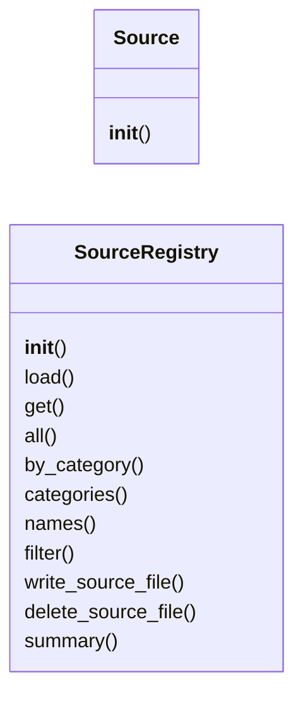
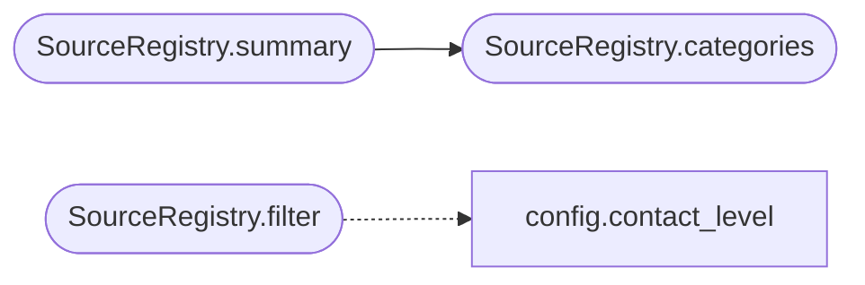

# `estorides_core.source_loader`

> Source: [estorides_core/source_loader.py:1](../../estorides_core/source_loader.py#L1) | language `py` | coverage 46.7% | [API index](../index.md)

estorides_core.source_loader ============================ Loads all YAML sources, normalises the schema, and provides a registry the rest of the engine can iterate over.

## Contents

- **Classes:** [`Source`](#source), [`SourceRegistry`](#sourceregistry)

## Type Diagram



## Call Graph

Solid arrows stay in this module, dashed arrows leave it.



## Classes

<a id="source"></a>

### `Source`

`class` | [estorides_core/source_loader.py:22](../../estorides_core/source_loader.py#L22)

```python
class Source(dict)
```

Bases: `dict`

A source is a YAML-defined OSINT data provider.

Stored as a dict for JSON-serialisation convenience, but exposes
attribute access for ergonomic call sites.

**Members**

| Member | Kind | Summary |
|---|---|---|
| [`__init__`](#source-__init__) | constructor |  |

<a id="source-__init__"></a>

#### `Source.__init__`

`constructor` | [estorides_core/source_loader.py:28](../../estorides_core/source_loader.py#L28)

```python
def __init__(self, data: dict[str, Any]) -> None
```

**Parameters**

| Name | Type | Default | Description |
|---|---|---|---|
| `data` | `dict[str, Any]` |  |  |

---

<a id="sourceregistry"></a>

### `SourceRegistry`

`class` | [estorides_core/source_loader.py:38](../../estorides_core/source_loader.py#L38)

```python
class SourceRegistry
```

Loads YAML sources from the sources/ directory and exposes them by name.

**Members**

| Member | Kind | Summary |
|---|---|---|
| [`__init__`](#sourceregistry-__init__) | constructor |  |
| [`load`](#sourceregistry-load) | method |  |
| [`get`](#sourceregistry-get) | method |  |
| [`all`](#sourceregistry-all) | method |  |
| [`by_category`](#sourceregistry-by_category) | method |  |
| [`categories`](#sourceregistry-categories) | method |  |
| [`names`](#sourceregistry-names) | method |  |
| [`filter`](#sourceregistry-filter) | method | Return sources matching the given predicates. |
| [`write_source_file`](#sourceregistry-write_source_file) | method | Write a source dict to the correct YAML file, overwriting if exists. |
| [`delete_source_file`](#sourceregistry-delete_source_file) | method | Delete a source file by name. |
| [`summary`](#sourceregistry-summary) | method | Compact summary used by /api/status. |

<a id="sourceregistry-__init__"></a>

#### `SourceRegistry.__init__`

`constructor` | [estorides_core/source_loader.py:41](../../estorides_core/source_loader.py#L41)

```python
def __init__(self, sources_dir: Path) -> None
```

**Parameters**

| Name | Type | Default | Description |
|---|---|---|---|
| `sources_dir` | `Path` |  |  |

*Called by:* [`Orchestrator.__init__`](estorides_core.orchestrator.py.md#orchestrator-__init__)

<a id="sourceregistry-load"></a>

#### `SourceRegistry.load`

`method` | [estorides_core/source_loader.py:47](../../estorides_core/source_loader.py#L47)

```python
def load(self) -> None
```

<a id="sourceregistry-get"></a>

#### `SourceRegistry.get`

`method` | [estorides_core/source_loader.py:200](../../estorides_core/source_loader.py#L200)

```python
def get(self, name: str) -> Source | None
```

**Parameters**

| Name | Type | Default | Description |
|---|---|---|---|
| `name` | `str` |  |  |

**Returns:** `Source | None`

<a id="sourceregistry-all"></a>

#### `SourceRegistry.all`

`method` | [estorides_core/source_loader.py:203](../../estorides_core/source_loader.py#L203)

```python
def all(self) -> list[Source]
```

**Returns:** `list[Source]`

<a id="sourceregistry-by_category"></a>

#### `SourceRegistry.by_category`

`method` | [estorides_core/source_loader.py:206](../../estorides_core/source_loader.py#L206)

```python
def by_category(self, category: str) -> list[Source]
```

**Parameters**

| Name | Type | Default | Description |
|---|---|---|---|
| `category` | `str` |  |  |

**Returns:** `list[Source]`

<a id="sourceregistry-categories"></a>

#### `SourceRegistry.categories`

`method` | [estorides_core/source_loader.py:209](../../estorides_core/source_loader.py#L209)

```python
def categories(self) -> list[str]
```

**Returns:** `list[str]`

*Called by:* [`SourceRegistry.summary`](#sourceregistry-summary)

<a id="sourceregistry-names"></a>

#### `SourceRegistry.names`

`method` | [estorides_core/source_loader.py:212](../../estorides_core/source_loader.py#L212)

```python
def names(self) -> list[str]
```

**Returns:** `list[str]`

<a id="sourceregistry-filter"></a>

#### `SourceRegistry.filter`

`method` | [estorides_core/source_loader.py:215](../../estorides_core/source_loader.py#L215)

```python
def filter(self, *, requires_key: bool | None = None, max_contact: str | None = None) -> list[Source]
```

Return sources matching the given predicates.

`max_contact` keeps only sources whose contact class is at or below
the given ceiling (e.g. "none" for a passive-only run, "broker" to
also allow third-party probes). Sources with an unknown contact
class are treated as the most exposing and thus excluded by any
ceiling below `active`.

**Parameters**

| Name | Type | Default | Description |
|---|---|---|---|
| `requires_key` | `bool \| None` | `None` |  |
| `max_contact` | `str \| None` | `None` |  |

**Returns:** `list[Source]`

*Calls:* [`contact_level`](estorides_core.config.py.md#contact_level)

<a id="sourceregistry-write_source_file"></a>

#### `SourceRegistry.write_source_file`

`method` | [estorides_core/source_loader.py:272](../../estorides_core/source_loader.py#L272)

```python
def write_source_file(self, data: dict[str, Any]) -> Path
```

Write a source dict to the correct YAML file, overwriting if exists.

This is a pure file-write operation — no normalisation, no registry
update. The caller is responsible for reloading the registry if needed.
Returns the path written.

**Parameters**

| Name | Type | Default | Description |
|---|---|---|---|
| `data` | `dict[str, Any]` |  |  |

**Returns:** `Path`

**Raises**

- `ValueError`: (raised in the body, not documented)

<a id="sourceregistry-delete_source_file"></a>

#### `SourceRegistry.delete_source_file`

`method` | [estorides_core/source_loader.py:342](../../estorides_core/source_loader.py#L342)

```python
def delete_source_file(self, name: str) -> None
```

Delete a source file by name.

Raises KeyError if not found on disk.

**Parameters**

| Name | Type | Default | Description |
|---|---|---|---|
| `name` | `str` |  |  |

**Raises**

- `KeyError`: (raised in the body, not documented)

<a id="sourceregistry-summary"></a>

#### `SourceRegistry.summary`

`method` | [estorides_core/source_loader.py:351](../../estorides_core/source_loader.py#L351)

```python
def summary(self) -> dict[str, Any]
```

Compact summary used by /api/status.

**Returns:** `dict[str, Any]`

*Calls:* [`SourceRegistry.categories`](#sourceregistry-categories)

---
