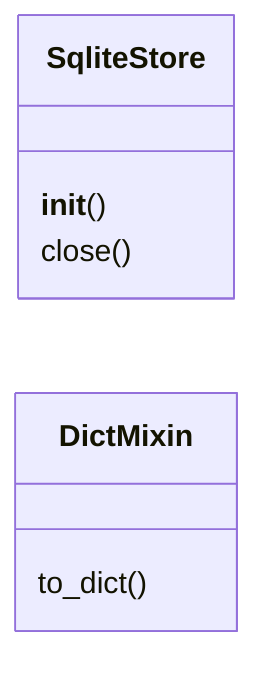

# `estorides_core.sqlite_store`

> Source: [estorides_core/sqlite_store.py:1](../../estorides_core/sqlite_store.py#L1) | language `py` | coverage 50.0% | [API index](../index.md)

estorides_core.sqlite_store =========================== Shared plumbing for the hand-rolled SQLite stores.

Four stores (`monitoring.WatchStore`, `cases.CaseStore`,
`entity_store.EntityStore`, `fusion_store.FusionStore`) used to carry
byte-identical copies of:

  * [`__init__`](#sqlitestore-__init__) — mkdir + lock + `sqlite3.connect(check_same_thread=False,
    isolation_level=None)` + WAL/foreign-keys pragmas + schema init;
  * `_init_schema` — execute every DDL statement under the lock;
  * `_tx` — `BEGIN` / `COMMIT` / `ROLLBACK` inside the lock;
  * [`close`](static.js.estorides.js.md#close) — swallow-and-close.

This module is the single source of truth for that boilerplate. A store
subclasses [`SqliteStore`](#sqlitestore), declares `_DDL` and `_DEFAULT_PATH`, and
overrides only its own queries.

Also exports [`DictMixin`](#dictmixin) for the 29 dataclasses whose [`to_dict`](#dictmixin-to_dict)
was literally `asdict(self)`.

## Contents

- **Classes:** [`SqliteStore`](#sqlitestore), [`DictMixin`](#dictmixin)

## Type Diagram



## Classes

<a id="sqlitestore"></a>

### `SqliteStore`

`class` | [estorides_core/sqlite_store.py:34](../../estorides_core/sqlite_store.py#L34)

```python
class SqliteStore
```

Subclasses: [`CaseStore`](estorides_core.cases.py.md#casestore), [`EntityStore`](estorides_core.entity_store.py.md#entitystore), [`FusionStore`](estorides_core.fusion_store.py.md#fusionstore), [`WatchStore`](estorides_core.monitoring.py.md#watchstore)

Thread-safe SQLite base: one serialised connection behind a lock.

Contract:
  * ``_DDL``          — list/tuple of schema statements, executed once.
  * ``_DEFAULT_PATH`` — path used when the constructor gets ``None``.
  * ``_PRAGMAS``      — connection pragmas applied before schema init.

**Members**

| Member | Kind | Summary |
|---|---|---|
| [`__init__`](#sqlitestore-__init__) | constructor |  |
| [`close`](#sqlitestore-close) | method |  |

<a id="sqlitestore-__init__"></a>

#### `SqliteStore.__init__`

`constructor` | [estorides_core/sqlite_store.py:50](../../estorides_core/sqlite_store.py#L50)

```python
def __init__(self, path: Path | None = None) -> None
```

**Parameters**

| Name | Type | Default | Description |
|---|---|---|---|
| `path` | `Path \| None` | `None` |  |

**Raises**

- `ValueError`: (raised in the body, not documented)

<a id="sqlitestore-close"></a>

#### `SqliteStore.close`

`method` | [estorides_core/sqlite_store.py:82](../../estorides_core/sqlite_store.py#L82)

```python
def close(self) -> None
```

---

<a id="dictmixin"></a>

### `DictMixin`

`class` | [estorides_core/sqlite_store.py:109](../../estorides_core/sqlite_store.py#L109)

```python
class DictMixin
```

[`to_dict`](#dictmixin-to_dict) for dataclasses that map 1:1 to a JSON object.

**Members**

| Member | Kind | Summary |
|---|---|---|
| [`to_dict`](#dictmixin-to_dict) | method |  |

<a id="dictmixin-to_dict"></a>

#### `DictMixin.to_dict`

`method` | [estorides_core/sqlite_store.py:112](../../estorides_core/sqlite_store.py#L112)

```python
def to_dict(self) -> dict[str, Any]
```

**Returns:** `dict[str, Any]`

---
