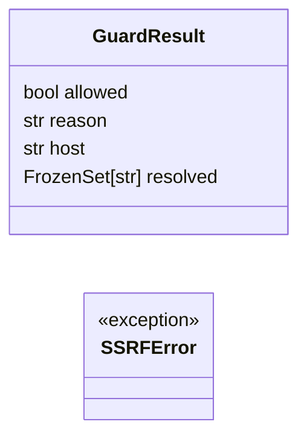
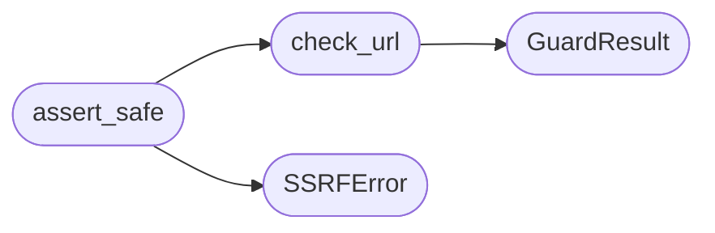

# `estorides_core.ssrf_guard`

> Source: [estorides_core/ssrf_guard.py:1](../../estorides_core/ssrf_guard.py#L1) | language `py` | coverage 80.0% | [API index](../index.md)

estorides_core.ssrf_guard ========================= SSRF / SSRF-rebound protection for outbound HTTP.

The OSINT engine speaks to user-specified hosts (a domain, a URL from a
paste, a link from a Telegram channel). Without filtering, a malicious
or careless query can redirect our client at:

  * RFC1918 private space              (10/8, 172.16/12, 192.168/16)
  * Loopback                           (127/8, ::1)
  * Link-local / cloud metadata        (169.254/16 — AWS, GCP, Azure IMDS)
  * CGNAT / Tailscale                  (100.64/10)
  * Multicast / reserved               (224/4, 240/4, 0/8, 255.255.255.255)
  * Documentation / benchmark          (192.0.2/24, 198.51.100/24, 203.0.113/24)
  * IPv6 link-local                    (fe80::/10)
  * IPv6 unique-local                  (fc00::/7)
  * IPv4-mapped IPv6                   (::ffff:0:0/96)

We block at TWO layers:

  1. Canonicalise the literal host the source YAML gave us. Reject dotted
     forms that land in a reserved range and any IPv6 in a reserved prefix.
  2. For hostnames, resolve A + AAAA at fetch time and reject if *any*
     answer lands in a reserved range. This is the TOCTOU-resistant layer
     that catches a DNS rebinding attack where the YAML says
     `attacker.com` but the resolver returns `169.254.169.254`.

Pinning the IP at the socket layer (the third leg of true TOCTOU defence)
is intentionally out of scope: aiohttp doesn't expose socket-level
binding on a request-by-request basis without monkey-patching, and the
rebind window is short enough that resolving + pinning inside a single
event-loop turn defeats the practical rebinder. The resolver here is
synchronous and runs immediately before the HTTP request goes out, so
a rebinder must win a TTL=0 race against the connector.

Allowlisting is opt-in: if `ESTORIDES_ALLOWED_HOSTS` is set, only those
hosts (suffix-matched) may be contacted. This is the right mode for
air-gapped or hardened deployments.

This module is intentionally dependency-light — only stdlib — so the
core can import it without pulling aiohttp.

## Contents

- **Classes:** [`GuardResult`](#guardresult)
- **Exceptions:** [`SSRFError`](#ssrferror)
- **Functions:** [`check_url`](#check_url), [`assert_safe`](#assert_safe)

## Type Diagram



## Call Graph

Solid arrows stay in this module, dashed arrows leave it.



## Classes

<a id="guardresult"></a>

### `GuardResult`

`class` `dataclass` | [estorides_core/ssrf_guard.py:99](../../estorides_core/ssrf_guard.py#L99)

Decorators: `@dataclass(frozen=True)`

```python
class GuardResult
```

**Attributes**

| Name | Type | Default | Description |
|---|---|---|---|
| [`allowed`](#guardresult-allowed) | `bool` |  |  |
| [`reason`](#guardresult-reason) | `str` | `''` |  |
| [`host`](#guardresult-host) | `str` | `''` |  |
| [`resolved`](#guardresult-resolved) | `FrozenSet[str]` | `frozenset()` |  |

---

## Exceptions

<a id="ssrferror"></a>

### `SSRFError`

`exception` | [estorides_core/ssrf_guard.py:269](../../estorides_core/ssrf_guard.py#L269)

```python
class SSRFError(ValueError)
```

Bases: `ValueError`

Raised when an outbound URL fails the SSRF guard.

---

## Functions

<a id="check_url"></a>

### `check_url`

`function` | [estorides_core/ssrf_guard.py:194](../../estorides_core/ssrf_guard.py#L194)

```python
def check_url(url: str, *, resolve: bool = True) -> GuardResult
```

Validate a URL for outbound fetch.

**Parameters**

| Name | Type | Default | Description |
|---|---|---|---|
| `url` | `str` |  | the URL string the source YAML wants us to hit. |
| `resolve` | `bool` | `True` | when True (default) also resolve hostnames and reject if any answer lands in a reserved range. Disable only in tests with mocked DNS. |

**Returns:** `GuardResult` - GuardResult with allowed/reason. Use as a bool.

*Calls:* [`GuardResult`](#guardresult)

*Called by:* [`sync_fetch`](estorides_core.async_client.py.md#sync_fetch), [`assert_safe`](#assert_safe)

---

<a id="assert_safe"></a>

### `assert_safe`

`function` | [estorides_core/ssrf_guard.py:262](../../estorides_core/ssrf_guard.py#L262)

```python
def assert_safe(url: str) -> None
```

Raise SSRFError if `url` is not safe to fetch.

**Parameters**

| Name | Type | Default | Description |
|---|---|---|---|
| `url` | `str` |  |  |

**Raises**

- [`SSRFError`](#ssrferror): (raised in the body, not documented)

*Calls:* [`SSRFError`](#ssrferror), [`check_url`](#check_url)

*Called by:* [`fetch_bgp`](estorides_core.osiris_sources.py.md#fetch_bgp), [`fetch_github_user`](estorides_core.osiris_sources.py.md#fetch_github_user), [`fetch_leaks`](estorides_core.osiris_sources.py.md#fetch_leaks), [`fetch_mac`](estorides_core.osiris_sources.py.md#fetch_mac), [`fetch_malware_c2`](estorides_core.osiris_sources.py.md#fetch_malware_c2)

---
