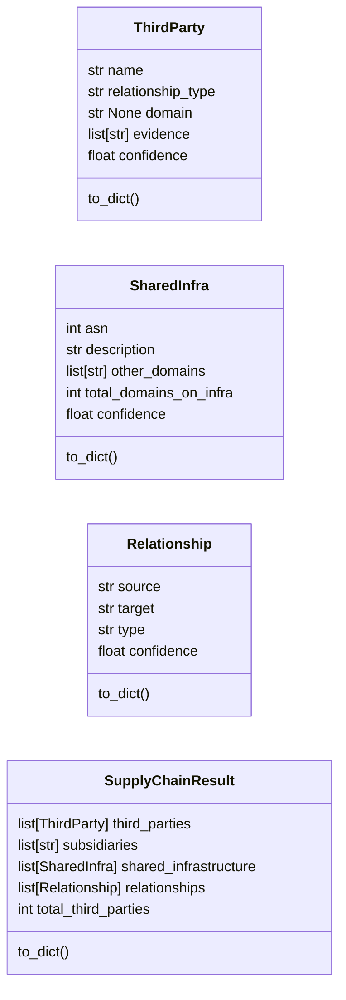
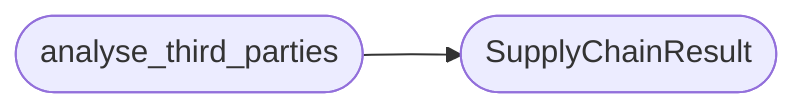

# `estorides_core.supply_chain`

> Source: [estorides_core/supply_chain.py:1](../../estorides_core/supply_chain.py#L1) | language `py` | coverage 0.0% | [API index](../index.md)

## Contents

- **Classes:** [`ThirdParty`](#thirdparty), [`SharedInfra`](#sharedinfra), [`Relationship`](#relationship), [`SupplyChainResult`](#supplychainresult)
- **Functions:** [`detect_mx_provider`](#detect_mx_provider), [`detect_ns_provider`](#detect_ns_provider), [`detect_cdn`](#detect_cdn), [`analyse_third_parties`](#analyse_third_parties), [`detect_shared_infrastructure`](#detect_shared_infrastructure)
- **Constants:** [`MX_PROVIDER_MAP`](#mx_provider_map), [`NS_PROVIDER_MAP`](#ns_provider_map), [`CDN_PATTERNS`](#cdn_patterns)

## Type Diagram



## Call Graph

Solid arrows stay in this module, dashed arrows leave it.



## Classes

<a id="thirdparty"></a>

### `ThirdParty`

`class` `dataclass` | [estorides_core/supply_chain.py:54](../../estorides_core/supply_chain.py#L54)

Decorators: `@dataclass`

```python
class ThirdParty
```

**Attributes**

| Name | Type | Default | Description |
|---|---|---|---|
| [`name`](#thirdparty-name) | `str` |  |  |
| [`relationship_type`](#thirdparty-relationship_type) | `str` |  |  |
| [`domain`](#thirdparty-domain) | `str \| None` |  |  |
| [`evidence`](#thirdparty-evidence) | `list[str]` |  |  |
| [`confidence`](#thirdparty-confidence) | `float` |  |  |

**Members**

| Member | Kind | Summary |
|---|---|---|
| [`to_dict`](#thirdparty-to_dict) | method |  |

<a id="thirdparty-to_dict"></a>

#### `ThirdParty.to_dict`

`method` | [estorides_core/supply_chain.py:61](../../estorides_core/supply_chain.py#L61)

```python
def to_dict(self) -> dict[str, Any]
```

**Returns:** `dict[str, Any]`

---

<a id="sharedinfra"></a>

### `SharedInfra`

`class` `dataclass` | [estorides_core/supply_chain.py:66](../../estorides_core/supply_chain.py#L66)

Decorators: `@dataclass`

```python
class SharedInfra
```

**Attributes**

| Name | Type | Default | Description |
|---|---|---|---|
| [`asn`](#sharedinfra-asn) | `int` |  |  |
| [`description`](#sharedinfra-description) | `str` |  |  |
| [`other_domains`](#sharedinfra-other_domains) | `list[str]` |  |  |
| [`total_domains_on_infra`](#sharedinfra-total_domains_on_infra) | `int` |  |  |
| [`confidence`](#sharedinfra-confidence) | `float` |  |  |

**Members**

| Member | Kind | Summary |
|---|---|---|
| [`to_dict`](#sharedinfra-to_dict) | method |  |

<a id="sharedinfra-to_dict"></a>

#### `SharedInfra.to_dict`

`method` | [estorides_core/supply_chain.py:73](../../estorides_core/supply_chain.py#L73)

```python
def to_dict(self) -> dict[str, Any]
```

**Returns:** `dict[str, Any]`

---

<a id="relationship"></a>

### `Relationship`

`class` `dataclass` | [estorides_core/supply_chain.py:78](../../estorides_core/supply_chain.py#L78)

Decorators: `@dataclass`

```python
class Relationship
```

**Attributes**

| Name | Type | Default | Description |
|---|---|---|---|
| [`source`](#relationship-source) | `str` |  |  |
| [`target`](#relationship-target) | `str` |  |  |
| [`type`](#relationship-type) | `str` |  |  |
| [`confidence`](#relationship-confidence) | `float` |  |  |

**Members**

| Member | Kind | Summary |
|---|---|---|
| [`to_dict`](#relationship-to_dict) | method |  |

<a id="relationship-to_dict"></a>

#### `Relationship.to_dict`

`method` | [estorides_core/supply_chain.py:84](../../estorides_core/supply_chain.py#L84)

```python
def to_dict(self) -> dict[str, Any]
```

**Returns:** `dict[str, Any]`

---

<a id="supplychainresult"></a>

### `SupplyChainResult`

`class` `dataclass` | [estorides_core/supply_chain.py:89](../../estorides_core/supply_chain.py#L89)

Decorators: `@dataclass`

```python
class SupplyChainResult
```

**Attributes**

| Name | Type | Default | Description |
|---|---|---|---|
| [`third_parties`](#supplychainresult-third_parties) | `list[ThirdParty]` | `field(default_factory=list)` |  |
| [`subsidiaries`](#supplychainresult-subsidiaries) | `list[str]` | `field(default_factory=list)` |  |
| [`shared_infrastructure`](#supplychainresult-shared_infrastructure) | `list[SharedInfra]` | `field(default_factory=list)` |  |
| [`relationships`](#supplychainresult-relationships) | `list[Relationship]` | `field(default_factory=list)` |  |
| [`total_third_parties`](#supplychainresult-total_third_parties) | `int` | `0` |  |

**Members**

| Member | Kind | Summary |
|---|---|---|
| [`to_dict`](#supplychainresult-to_dict) | method |  |

<a id="supplychainresult-to_dict"></a>

#### `SupplyChainResult.to_dict`

`method` | [estorides_core/supply_chain.py:96](../../estorides_core/supply_chain.py#L96)

```python
def to_dict(self) -> dict[str, Any]
```

**Returns:** `dict[str, Any]`

---

## Functions

<a id="detect_mx_provider"></a>

### `detect_mx_provider`

`function` | [estorides_core/supply_chain.py:106](../../estorides_core/supply_chain.py#L106)

```python
def detect_mx_provider(mx_records: list[str]) -> str | None
```

**Parameters**

| Name | Type | Default | Description |
|---|---|---|---|
| `mx_records` | `list[str]` |  |  |

**Returns:** `str | None`

---

<a id="detect_ns_provider"></a>

### `detect_ns_provider`

`function` | [estorides_core/supply_chain.py:114](../../estorides_core/supply_chain.py#L114)

```python
def detect_ns_provider(ns_records: list[str]) -> str | None
```

**Parameters**

| Name | Type | Default | Description |
|---|---|---|---|
| `ns_records` | `list[str]` |  |  |

**Returns:** `str | None`

---

<a id="detect_cdn"></a>

### `detect_cdn`

`function` | [estorides_core/supply_chain.py:122](../../estorides_core/supply_chain.py#L122)

```python
def detect_cdn(cname: str) -> str | None
```

**Parameters**

| Name | Type | Default | Description |
|---|---|---|---|
| `cname` | `str` |  |  |

**Returns:** `str | None`

---

<a id="analyse_third_parties"></a>

### `analyse_third_parties`

`function` | [estorides_core/supply_chain.py:129](../../estorides_core/supply_chain.py#L129)

```python
def analyse_third_parties(third_parties: list[ThirdParty], subsidiaries: list[str] | None = None) -> SupplyChainResult
```

**Parameters**

| Name | Type | Default | Description |
|---|---|---|---|
| `third_parties` | `list[ThirdParty]` |  |  |
| `subsidiaries` | `list[str] \| None` | `None` |  |

**Returns:** `SupplyChainResult`

*Calls:* [`SupplyChainResult`](#supplychainresult)

*Called by:* [`run_passive_recon`](estorides_core.recon_pipeline.py.md#run_passive_recon)

---

<a id="detect_shared_infrastructure"></a>

### `detect_shared_infrastructure`

`function` | [estorides_core/supply_chain.py:140](../../estorides_core/supply_chain.py#L140)

```python
def detect_shared_infrastructure(asn: int) -> SharedInfra | None
```

**Parameters**

| Name | Type | Default | Description |
|---|---|---|---|
| `asn` | `int` |  |  |

**Returns:** `SharedInfra | None`

---

## Constants

<a id="mx_provider_map"></a>

### `MX_PROVIDER_MAP`

`constant` | [estorides_core/supply_chain.py:10](../../estorides_core/supply_chain.py#L10)

```python
MX_PROVIDER_MAP: dict[re.Pattern[Any], str]
```

---

<a id="ns_provider_map"></a>

### `NS_PROVIDER_MAP`

`constant` | [estorides_core/supply_chain.py:24](../../estorides_core/supply_chain.py#L24)

```python
NS_PROVIDER_MAP: dict[re.Pattern[Any], str]
```

---

<a id="cdn_patterns"></a>

### `CDN_PATTERNS`

`constant` | [estorides_core/supply_chain.py:39](../../estorides_core/supply_chain.py#L39)

```python
CDN_PATTERNS: list[tuple[re.Pattern[Any], str]]
```

---
