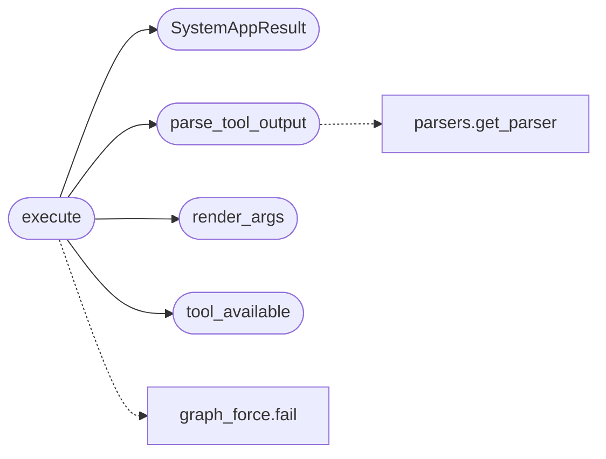

# `estorides_core.system_app_sources`

> Source: [estorides_core/system_app_sources.py:1](../../estorides_core/system_app_sources.py#L1) | language `py` | coverage 37.0% | [API index](../index.md)

estorides_core.system_app_sources ================================= Kali OSINT CLI tools as first-class sources (`kind: system_app`).

A system_app source is a YAML-declared local binary executed through the
existing [`estorides_core.tool_runner`](estorides_core.tool_runner.py.md) sandbox (allowlist, no shell,
injection blocking, timeouts, output caps) whose output is parsed and fed
into the **same** aggregation pipeline as HTTP sources: observations →
entity extraction → fusion → reliability scoring → recon tiers.

The YAML schema differs from HTTP sources (`tool.binary` + `tool.args`
instead of `tool.url` + `tool.params`) — one registry, two origin kinds,
zero special-casing downstream.

Public surface:

    KIND_SYSTEM_APP        "system_app" origin kind constant
    SystemAppResult        frozen dataclass, JSON-serialisable
    is_system_app          kind/binary predicate
    tool_available         shutil.which wrapper (monkeypatchable)
    render_args            {query}/{outdir} template substitution, pure
    parse_tool_output      parser dispatch with never-raise contract
    execute                full run: sandbox + parse + audit metadata
    TOOL_PARSER_NAMES      registered tool-output parsers (for fuzzing)

## Contents

- **Classes:** [`SystemAppResult`](#systemappresult)
- **Functions:** [`is_system_app`](#is_system_app), [`tool_available`](#tool_available), [`render_args`](#render_args), [`parse_amass_json`](#parse_amass_json), [`parse_maigret_json`](#parse_maigret_json), [`parse_phoneinfoga_json`](#parse_phoneinfoga_json), [`parse_sherlock_text`](#parse_sherlock_text), [`parse_holehe_text`](#parse_holehe_text), [`parse_wafw00f_text`](#parse_wafw00f_text), [`parse_sublist3r_lines`](#parse_sublist3r_lines), [`parse_dnsrecon_text`](#parse_dnsrecon_text), [`parse_dnsenum_text`](#parse_dnsenum_text), [`parse_fierce_text`](#parse_fierce_text), [`parse_dmitry_text`](#parse_dmitry_text), [`parse_urlcrazy_text`](#parse_urlcrazy_text), [`parse_metagoofil_text`](#parse_metagoofil_text), [`parse_whatweb_text`](#parse_whatweb_text), [`parse_theharvester_text`](#parse_theharvester_text), [`parse_usufy_text`](#parse_usufy_text), [`parse_mailfy_text`](#parse_mailfy_text), [`parse_phonefy_text`](#parse_phonefy_text), [`parse_searchfy_text`](#parse_searchfy_text), [`parse_tool_output`](#parse_tool_output), [`execute`](#execute)
- **Constants:** [`KIND_SYSTEM_APP`](#kind_system_app), [`KIND_HTTP_API`](#kind_http_api), [`VALID_KINDS`](#valid_kinds), [`VALID_OUTPUT_FORMATS`](#valid_output_formats), [`TOOL_PARSER_NAMES`](#tool_parser_names)

## Call Graph

Solid arrows stay in this module, dashed arrows leave it.



## Classes

<a id="systemappresult"></a>

### `SystemAppResult`

`class` `dataclass` | [estorides_core/system_app_sources.py:57](../../estorides_core/system_app_sources.py#L57)

Decorators: `@dataclass(frozen=True)`

```python
class SystemAppResult
```

Normalised outcome of one system_app tool invocation.

Mirrors the contract in ``spec/system_app_sources.md``: failures are
values, never exceptions.

**Attributes**

| Name | Type | Default | Description |
|---|---|---|---|
| [`source_name`](#systemappresult-source_name) | `str` |  |  |
| [`tool_name`](#systemappresult-tool_name) | `str` |  |  |
| [`success`](#systemappresult-success) | `bool` |  |  |
| [`exit_code`](#systemappresult-exit_code) | `int` |  |  |
| [`stdout`](#systemappresult-stdout) | `str` |  |  |
| [`stderr`](#systemappresult-stderr) | `str` |  |  |
| [`duration_s`](#systemappresult-duration_s) | `float` |  |  |
| [`parsed`](#systemappresult-parsed) | `Any` | `None` |  |
| [`raw_output_sha1`](#systemappresult-raw_output_sha1) | `str` | `''` |  |
| [`truncated`](#systemappresult-truncated) | `bool` | `False` |  |
| [`error_code`](#systemappresult-error_code) | `str \| None` | `None` |  |
| [`error_message`](#systemappresult-error_message) | `str \| None` | `None` |  |

**Members**

| Member | Kind | Summary |
|---|---|---|
| [`to_dict`](#systemappresult-to_dict) | method |  |

<a id="systemappresult-to_dict"></a>

#### `SystemAppResult.to_dict`

`method` | [estorides_core/system_app_sources.py:76](../../estorides_core/system_app_sources.py#L76)

```python
def to_dict(self) -> dict[str, Any]
```

**Returns:** `dict[str, Any]`

---

## Functions

<a id="is_system_app"></a>

### `is_system_app`

`function` | [estorides_core/system_app_sources.py:81](../../estorides_core/system_app_sources.py#L81)

```python
def is_system_app(source: Any) -> bool
```

True when a source dict is a system_app (or has a binary tool).

**Parameters**

| Name | Type | Default | Description |
|---|---|---|---|
| `source` | `Any` |  |  |

**Returns:** `bool`

*Called by:* [`Orchestrator.run`](estorides_core.orchestrator.py.md#orchestrator-run)

---

<a id="tool_available"></a>

### `tool_available`

`function` | [estorides_core/system_app_sources.py:91](../../estorides_core/system_app_sources.py#L91)

```python
def tool_available(binary: str) -> bool
```

Resolve a binary on the filesystem (shutil.which).

**Parameters**

| Name | Type | Default | Description |
|---|---|---|---|
| `binary` | `str` |  |  |

**Returns:** `bool`

*Called by:* [`execute`](#execute)

---

<a id="render_args"></a>

### `render_args`

`function` | [estorides_core/system_app_sources.py:96](../../estorides_core/system_app_sources.py#L96)

```python
def render_args(args: list[Any], query: str, outdir: str) -> list[str]
```

Substitute ``{query}``/``{outdir}`` placeholders in an args template.

Unknown placeholders are left verbatim (same contract as the HTTP
``_safe_format``). Non-string template elements are programmer error
and raise ``ValueError`` — a silently stringified int is a typo that
must be caught at source-authoring time, not at exec time.

**Parameters**

| Name | Type | Default | Description |
|---|---|---|---|
| `args` | `list[Any]` |  |  |
| `query` | `str` |  |  |
| `outdir` | `str` |  |  |

**Returns:** `list[str]`

**Raises**

- `ValueError`: (raised in the body, not documented)

*Called by:* [`execute`](#execute)

---

<a id="parse_amass_json"></a>

### `parse_amass_json`

`function` | [estorides_core/system_app_sources.py:193](../../estorides_core/system_app_sources.py#L193)

Decorators: `@register_parser('amass_json')`

```python
def parse_amass_json(payload: Any) -> list[dict[str, Any]]
```

amass ``-json`` output: one JSON object per line (DNS + infra).

**Parameters**

| Name | Type | Default | Description |
|---|---|---|---|
| `payload` | `Any` |  |  |

**Returns:** `list[dict[str, Any]]`

---

<a id="parse_maigret_json"></a>

### `parse_maigret_json`

`function` | [estorides_core/system_app_sources.py:225](../../estorides_core/system_app_sources.py#L225)

Decorators: `@register_parser('maigret_json')`

```python
def parse_maigret_json(payload: Any) -> list[dict[str, Any]]
```

maigret ``--json simple``: one object keyed by site name.

**Parameters**

| Name | Type | Default | Description |
|---|---|---|---|
| `payload` | `Any` |  |  |

**Returns:** `list[dict[str, Any]]`

---

<a id="parse_phoneinfoga_json"></a>

### `parse_phoneinfoga_json`

`function` | [estorides_core/system_app_sources.py:247](../../estorides_core/system_app_sources.py#L247)

Decorators: `@register_parser('phoneinfoga_json')`

```python
def parse_phoneinfoga_json(payload: Any) -> list[Any]
```

phoneinfoga v2 `[`scan`](estorides_core.lan_runner.py.md#scan)`: a single JSON object (possibly after logs).

**Parameters**

| Name | Type | Default | Description |
|---|---|---|---|
| `payload` | `Any` |  |  |

**Returns:** `list[Any]`

---

<a id="parse_sherlock_text"></a>

### `parse_sherlock_text`

`function` | [estorides_core/system_app_sources.py:260](../../estorides_core/system_app_sources.py#L260)

Decorators: `@register_parser('sherlock_text')`

```python
def parse_sherlock_text(payload: Any) -> list[str]
```

**Parameters**

| Name | Type | Default | Description |
|---|---|---|---|
| `payload` | `Any` |  |  |

**Returns:** `list[str]`

---

<a id="parse_holehe_text"></a>

### `parse_holehe_text`

`function` | [estorides_core/system_app_sources.py:265](../../estorides_core/system_app_sources.py#L265)

Decorators: `@register_parser('holehe_text')`

```python
def parse_holehe_text(payload: Any) -> list[str]
```

**Parameters**

| Name | Type | Default | Description |
|---|---|---|---|
| `payload` | `Any` |  |  |

**Returns:** `list[str]`

---

<a id="parse_wafw00f_text"></a>

### `parse_wafw00f_text`

`function` | [estorides_core/system_app_sources.py:270](../../estorides_core/system_app_sources.py#L270)

Decorators: `@register_parser('wafw00f_text')`

```python
def parse_wafw00f_text(payload: Any) -> list[str]
```

**Parameters**

| Name | Type | Default | Description |
|---|---|---|---|
| `payload` | `Any` |  |  |

**Returns:** `list[str]`

---

<a id="parse_sublist3r_lines"></a>

### `parse_sublist3r_lines`

`function` | [estorides_core/system_app_sources.py:275](../../estorides_core/system_app_sources.py#L275)

Decorators: `@register_parser('sublist3r_lines')`

```python
def parse_sublist3r_lines(payload: Any) -> list[str]
```

**Parameters**

| Name | Type | Default | Description |
|---|---|---|---|
| `payload` | `Any` |  |  |

**Returns:** `list[str]`

---

<a id="parse_dnsrecon_text"></a>

### `parse_dnsrecon_text`

`function` | [estorides_core/system_app_sources.py:280](../../estorides_core/system_app_sources.py#L280)

Decorators: `@register_parser('dnsrecon_text')`

```python
def parse_dnsrecon_text(payload: Any) -> list[str]
```

**Parameters**

| Name | Type | Default | Description |
|---|---|---|---|
| `payload` | `Any` |  |  |

**Returns:** `list[str]`

---

<a id="parse_dnsenum_text"></a>

### `parse_dnsenum_text`

`function` | [estorides_core/system_app_sources.py:285](../../estorides_core/system_app_sources.py#L285)

Decorators: `@register_parser('dnsenum_text')`

```python
def parse_dnsenum_text(payload: Any) -> list[str]
```

**Parameters**

| Name | Type | Default | Description |
|---|---|---|---|
| `payload` | `Any` |  |  |

**Returns:** `list[str]`

---

<a id="parse_fierce_text"></a>

### `parse_fierce_text`

`function` | [estorides_core/system_app_sources.py:292](../../estorides_core/system_app_sources.py#L292)

Decorators: `@register_parser('fierce_text')`

```python
def parse_fierce_text(payload: Any) -> list[str]
```

**Parameters**

| Name | Type | Default | Description |
|---|---|---|---|
| `payload` | `Any` |  |  |

**Returns:** `list[str]`

---

<a id="parse_dmitry_text"></a>

### `parse_dmitry_text`

`function` | [estorides_core/system_app_sources.py:297](../../estorides_core/system_app_sources.py#L297)

Decorators: `@register_parser('dmitry_text')`

```python
def parse_dmitry_text(payload: Any) -> list[str]
```

**Parameters**

| Name | Type | Default | Description |
|---|---|---|---|
| `payload` | `Any` |  |  |

**Returns:** `list[str]`

---

<a id="parse_urlcrazy_text"></a>

### `parse_urlcrazy_text`

`function` | [estorides_core/system_app_sources.py:302](../../estorides_core/system_app_sources.py#L302)

Decorators: `@register_parser('urlcrazy_text')`

```python
def parse_urlcrazy_text(payload: Any) -> list[str]
```

**Parameters**

| Name | Type | Default | Description |
|---|---|---|---|
| `payload` | `Any` |  |  |

**Returns:** `list[str]`

---

<a id="parse_metagoofil_text"></a>

### `parse_metagoofil_text`

`function` | [estorides_core/system_app_sources.py:307](../../estorides_core/system_app_sources.py#L307)

Decorators: `@register_parser('metagoofil_text')`

```python
def parse_metagoofil_text(payload: Any) -> list[str]
```

**Parameters**

| Name | Type | Default | Description |
|---|---|---|---|
| `payload` | `Any` |  |  |

**Returns:** `list[str]`

---

<a id="parse_whatweb_text"></a>

### `parse_whatweb_text`

`function` | [estorides_core/system_app_sources.py:312](../../estorides_core/system_app_sources.py#L312)

Decorators: `@register_parser('whatweb_text')`

```python
def parse_whatweb_text(payload: Any) -> list[str]
```

**Parameters**

| Name | Type | Default | Description |
|---|---|---|---|
| `payload` | `Any` |  |  |

**Returns:** `list[str]`

---

<a id="parse_theharvester_text"></a>

### `parse_theharvester_text`

`function` | [estorides_core/system_app_sources.py:317](../../estorides_core/system_app_sources.py#L317)

Decorators: `@register_parser('theharvester_text')`

```python
def parse_theharvester_text(payload: Any) -> list[str]
```

**Parameters**

| Name | Type | Default | Description |
|---|---|---|---|
| `payload` | `Any` |  |  |

**Returns:** `list[str]`

---

<a id="parse_usufy_text"></a>

### `parse_usufy_text`

`function` | [estorides_core/system_app_sources.py:322](../../estorides_core/system_app_sources.py#L322)

Decorators: `@register_parser('usufy_text')`

```python
def parse_usufy_text(payload: Any) -> list[str]
```

**Parameters**

| Name | Type | Default | Description |
|---|---|---|---|
| `payload` | `Any` |  |  |

**Returns:** `list[str]`

---

<a id="parse_mailfy_text"></a>

### `parse_mailfy_text`

`function` | [estorides_core/system_app_sources.py:327](../../estorides_core/system_app_sources.py#L327)

Decorators: `@register_parser('mailfy_text')`

```python
def parse_mailfy_text(payload: Any) -> list[str]
```

**Parameters**

| Name | Type | Default | Description |
|---|---|---|---|
| `payload` | `Any` |  |  |

**Returns:** `list[str]`

---

<a id="parse_phonefy_text"></a>

### `parse_phonefy_text`

`function` | [estorides_core/system_app_sources.py:332](../../estorides_core/system_app_sources.py#L332)

Decorators: `@register_parser('phonefy_text')`

```python
def parse_phonefy_text(payload: Any) -> list[str]
```

**Parameters**

| Name | Type | Default | Description |
|---|---|---|---|
| `payload` | `Any` |  |  |

**Returns:** `list[str]`

---

<a id="parse_searchfy_text"></a>

### `parse_searchfy_text`

`function` | [estorides_core/system_app_sources.py:337](../../estorides_core/system_app_sources.py#L337)

Decorators: `@register_parser('searchfy_text')`

```python
def parse_searchfy_text(payload: Any) -> list[str]
```

**Parameters**

| Name | Type | Default | Description |
|---|---|---|---|
| `payload` | `Any` |  |  |

**Returns:** `list[str]`

---

<a id="parse_tool_output"></a>

### `parse_tool_output`

`function` | [estorides_core/system_app_sources.py:365](../../estorides_core/system_app_sources.py#L365)

```python
def parse_tool_output(source_name: str, parser_name: str | None, data: Any, *, fallback_text: str = '') -> list[Any]
```

Parse tool output with the declared parser; never raises.

A parser that returns a non-list is wrapped; an empty/None parse falls
back to the generic entity scanner over the raw text so a tool with a
broken/unknown parser still yields entities.

**Parameters**

| Name | Type | Default | Description |
|---|---|---|---|
| `source_name` | `str` |  |  |
| `parser_name` | `str \| None` |  |  |
| `data` | `Any` |  |  |
| `fallback_text` | `str` | `''` |  |

**Returns:** `list[Any]`

*Calls:* [`get_parser`](estorides_core.parsers.py.md#get_parser)

*Called by:* [`execute`](#execute)

---

<a id="execute"></a>

### `execute`

`function` | [estorides_core/system_app_sources.py:396](../../estorides_core/system_app_sources.py#L396)

```python
def execute(source: dict[str, Any], query: str, *, timeout: int | None = None, max_output_bytes: int = TOOL_MAX_OUTPUT_BYTES, _runner: Callable[..., Any] = run_tool) -> SystemAppResult
```

Execute one system_app source through the tool_runner sandbox.

Failures (missing binary, not allowlisted, wrong platform, injection,
timeout, crash) are `[`SystemAppResult`](#systemappresult)` values — never exceptions.
``{outdir}`` renders into a fresh private TemporaryDirectory that is
removed after parsing.

**Parameters**

| Name | Type | Default | Description |
|---|---|---|---|
| `source` | `dict[str, Any]` |  |  |
| `query` | `str` |  |  |
| `timeout` | `int \| None` | `None` |  |
| `max_output_bytes` | `int` | `TOOL_MAX_OUTPUT_BYTES` |  |
| `_runner` | `Callable[..., Any]` | `run_tool` |  |

**Returns:** `SystemAppResult`

*Calls:* [`SystemAppResult`](#systemappresult), [`parse_tool_output`](#parse_tool_output), [`render_args`](#render_args), [`tool_available`](#tool_available), [`fail`](static.js.graph_force.js.md#fail)

---

## Constants

<a id="kind_system_app"></a>

### `KIND_SYSTEM_APP`

`constant` | [estorides_core/system_app_sources.py:47](../../estorides_core/system_app_sources.py#L47)

```python
KIND_SYSTEM_APP: str = 'system_app'
```

---

<a id="kind_http_api"></a>

### `KIND_HTTP_API`

`constant` | [estorides_core/system_app_sources.py:48](../../estorides_core/system_app_sources.py#L48)

```python
KIND_HTTP_API: str = 'http_api'
```

---

<a id="valid_kinds"></a>

### `VALID_KINDS`

`constant` | [estorides_core/system_app_sources.py:49](../../estorides_core/system_app_sources.py#L49)

```python
VALID_KINDS: frozenset[str] = frozenset({KIND_SYSTEM_APP, KIND_HTTP_API})
```

---

<a id="valid_output_formats"></a>

### `VALID_OUTPUT_FORMATS`

`constant` | [estorides_core/system_app_sources.py:50](../../estorides_core/system_app_sources.py#L50)

```python
VALID_OUTPUT_FORMATS: frozenset[str] = frozenset({'json', 'text', 'lines'})
```

---

<a id="tool_parser_names"></a>

### `TOOL_PARSER_NAMES`

`constant` | [estorides_core/system_app_sources.py:341](../../estorides_core/system_app_sources.py#L341)

```python
TOOL_PARSER_NAMES: tuple[str, ...]
```

---
