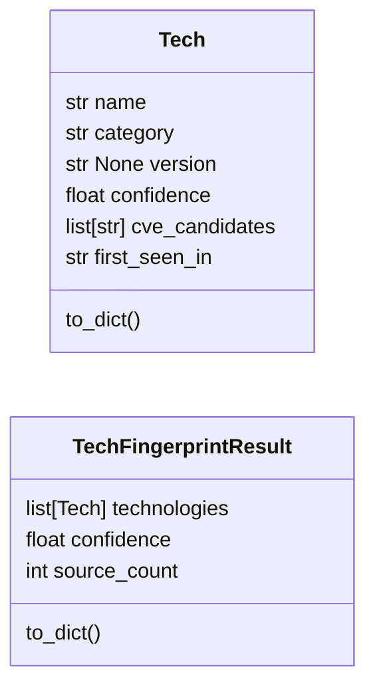
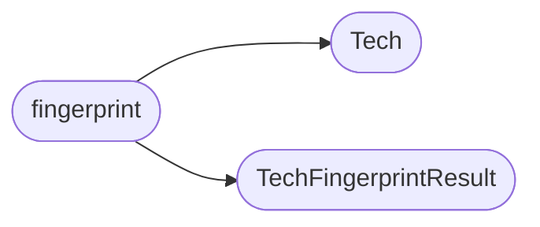

# `estorides_core.tech_fingerprint`

> Source: [estorides_core/tech_fingerprint.py:1](../../estorides_core/tech_fingerprint.py#L1) | language `py` | coverage 0.0% | [API index](../index.md)

## Contents

- **Classes:** [`Tech`](#tech), [`TechFingerprintResult`](#techfingerprintresult)
- **Functions:** [`fingerprint`](#fingerprint)
- **Constants:** [`MAX_HTML_BYTES`](#max_html_bytes), [`MAX_HEADER_BYTES`](#max_header_bytes), [`HEADER_PATTERNS`](#header_patterns), [`CDN_HEADERS`](#cdn_headers), [`HTML_META_PATTERNS`](#html_meta_patterns), [`HTML_JS_PATTERNS`](#html_js_patterns), [`CMS_META_REGEX`](#cms_meta_regex), [`META_TECH_MAP`](#meta_tech_map)

## Type Diagram



## Call Graph

Solid arrows stay in this module, dashed arrows leave it.



## Classes

<a id="tech"></a>

### `Tech`

`class` `dataclass` | [estorides_core/tech_fingerprint.py:89](../../estorides_core/tech_fingerprint.py#L89)

Decorators: `@dataclass`

```python
class Tech
```

**Attributes**

| Name | Type | Default | Description |
|---|---|---|---|
| [`name`](#tech-name) | `str` |  |  |
| [`category`](#tech-category) | `str` |  |  |
| [`version`](#tech-version) | `str \| None` | `None` |  |
| [`confidence`](#tech-confidence) | `float` | `0.7` |  |
| [`cve_candidates`](#tech-cve_candidates) | `list[str]` | `field(default_factory=list)` |  |
| [`first_seen_in`](#tech-first_seen_in) | `str` | `''` |  |

**Members**

| Member | Kind | Summary |
|---|---|---|
| [`to_dict`](#tech-to_dict) | method |  |

<a id="tech-to_dict"></a>

#### `Tech.to_dict`

`method` | [estorides_core/tech_fingerprint.py:97](../../estorides_core/tech_fingerprint.py#L97)

```python
def to_dict(self) -> dict[str, Any]
```

**Returns:** `dict[str, Any]`

---

<a id="techfingerprintresult"></a>

### `TechFingerprintResult`

`class` `dataclass` | [estorides_core/tech_fingerprint.py:102](../../estorides_core/tech_fingerprint.py#L102)

Decorators: `@dataclass`

```python
class TechFingerprintResult
```

**Attributes**

| Name | Type | Default | Description |
|---|---|---|---|
| [`technologies`](#techfingerprintresult-technologies) | `list[Tech]` | `field(default_factory=list)` |  |
| [`confidence`](#techfingerprintresult-confidence) | `float` | `0.0` |  |
| [`source_count`](#techfingerprintresult-source_count) | `int` | `0` |  |

**Members**

| Member | Kind | Summary |
|---|---|---|
| [`to_dict`](#techfingerprintresult-to_dict) | method |  |

<a id="techfingerprintresult-to_dict"></a>

#### `TechFingerprintResult.to_dict`

`method` | [estorides_core/tech_fingerprint.py:107](../../estorides_core/tech_fingerprint.py#L107)

```python
def to_dict(self) -> dict[str, Any]
```

**Returns:** `dict[str, Any]`

---

## Functions

<a id="fingerprint"></a>

### `fingerprint`

`function` | [estorides_core/tech_fingerprint.py:115](../../estorides_core/tech_fingerprint.py#L115)

```python
def fingerprint(headers: dict[str, str], html: str, cookies: list[str] | None = None, status: int = 200) -> TechFingerprintResult
```

**Parameters**

| Name | Type | Default | Description |
|---|---|---|---|
| `headers` | `dict[str, str]` |  |  |
| `html` | `str` |  |  |
| `cookies` | `list[str] \| None` | `None` |  |
| `status` | `int` | `200` |  |

**Returns:** `TechFingerprintResult`

*Calls:* [`Tech`](#tech), [`TechFingerprintResult`](#techfingerprintresult)

*Called by:* [`run_passive_recon`](estorides_core.recon_pipeline.py.md#run_passive_recon)

---

## Constants

<a id="max_html_bytes"></a>

### `MAX_HTML_BYTES`

`constant` | [estorides_core/tech_fingerprint.py:10](../../estorides_core/tech_fingerprint.py#L10)

```python
MAX_HTML_BYTES = 102400
```

---

<a id="max_header_bytes"></a>

### `MAX_HEADER_BYTES`

`constant` | [estorides_core/tech_fingerprint.py:11](../../estorides_core/tech_fingerprint.py#L11)

```python
MAX_HEADER_BYTES = 10240
```

---

<a id="header_patterns"></a>

### `HEADER_PATTERNS`

`constant` | [estorides_core/tech_fingerprint.py:13](../../estorides_core/tech_fingerprint.py#L13)

```python
HEADER_PATTERNS: dict[str, list[tuple[re.Pattern[Any], str, str | None, str]]]
```

---

<a id="cdn_headers"></a>

### `CDN_HEADERS`

`constant` | [estorides_core/tech_fingerprint.py:38](../../estorides_core/tech_fingerprint.py#L38)

```python
CDN_HEADERS: dict[str, list[tuple[re.Pattern[Any], str]]]
```

---

<a id="html_meta_patterns"></a>

### `HTML_META_PATTERNS`

`constant` | [estorides_core/tech_fingerprint.py:48](../../estorides_core/tech_fingerprint.py#L48)

```python
HTML_META_PATTERNS: list[tuple[re.Pattern[Any], str | None, str | None, str, str | None]]
```

---

<a id="html_js_patterns"></a>

### `HTML_JS_PATTERNS`

`constant` | [estorides_core/tech_fingerprint.py:54](../../estorides_core/tech_fingerprint.py#L54)

```python
HTML_JS_PATTERNS: list[tuple[re.Pattern[Any], str, str | None, str, re.Pattern[Any] | None]]
```

---

<a id="cms_meta_regex"></a>

### `CMS_META_REGEX`

`constant` | [estorides_core/tech_fingerprint.py:70](../../estorides_core/tech_fingerprint.py#L70)

```python
CMS_META_REGEX
```

---

<a id="meta_tech_map"></a>

### `META_TECH_MAP`

`constant` | [estorides_core/tech_fingerprint.py:73](../../estorides_core/tech_fingerprint.py#L73)

```python
META_TECH_MAP: dict[str, tuple[str, str]]
```

---
