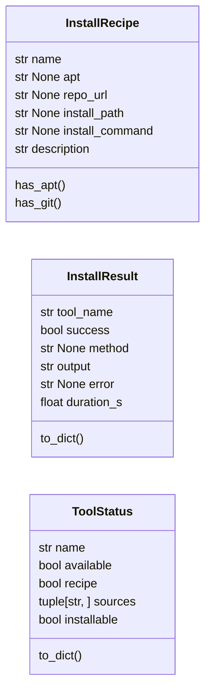

# `estorides_core.tool_install`

> Source: [estorides_core/tool_install.py:1](../../estorides_core/tool_install.py#L1) | language `py` | coverage 76.5% | [API index](../index.md)

estorides_core.tool_install =========================== One-click installation for missing Kali/OSINT CLI tools, modelled on the LazyOwn lazyaddon mechanism (`lazyaddons/*.yaml`) and wired into the GUI's results section: when a source fails with ``TOOL_NOT_FOUND`` the UI offers an "Install tool" button that calls this module.

Each installable tool has a YAML recipe in ``tool_recipes/<name>.yaml`` with
the same shape as a LazyOwn lazyaddon:

    name: sherlock
    description: ...
    os: any
    apt: sherlock            # optional: Debian/Kali package name
    git:                     # optional: git + install_command fallback
      repo_url: https://github.com/sherlock-project/sherlock.git
      install_path: sherlock
      install_command: pip install -r requirements.txt

Install methods (tried in order when the binary is still missing):

  * `[`apt`](#installrecipe-apt)` — ``run0 apt-get update`` + ``run0 apt-get install -y <pkg>``.
  * ``git`` — ``git clone <repo_url> <install_path>`` (as the operator, no
    elevation) then ``<install_command>`` inside the clone (elevated only
    when it performs a system-wide install, e.g. ``pip install``).

Privilege elevation
-------------------
Estorides is a GUI app; user management should be graphical. The default
elevator is ``run0`` (systemd's polkit-aware runner) which pops a desktop
authentication prompt instead of demanding a terminal ``sudo`` password.
``sudo`` is used only as a fallback when ``run0`` is unavailable; if the
process is already root no elevator is used at all.

Safety (mirrors tool_runner): every subprocess runs as an argument list — the
trusted, operator-invoked `[`install_command`](#installrecipe-install_command)` is shlex-split and executed
with no shell (shell=False), so a mangled recipe can never smuggle a
subcommand; the binary must still pass the allowlist; output is capped;
every run is time-boxed.

## Contents

- **Classes:** [`InstallRecipe`](#installrecipe), [`InstallResult`](#installresult), [`ToolStatus`](#toolstatus)
- **Functions:** [`is_valid_recipe_name`](#is_valid_recipe_name), [`is_valid_binary`](#is_valid_binary), [`load_recipe`](#load_recipe), [`recipe_available`](#recipe_available), [`tool_available`](#tool_available), [`list_recipes`](#list_recipes), [`doctor`](#doctor), [`install_tool`](#install_tool), [`main`](#main)

## Type Diagram



## Call Graph

Solid arrows stay in this module, dashed arrows leave it.


## Classes

<a id="installrecipe"></a>

### `InstallRecipe`

`class` `dataclass` | [estorides_core/tool_install.py:81](../../estorides_core/tool_install.py#L81)

Decorators: `@dataclass(frozen=True)`

```python
class InstallRecipe
```

One tool's install recipe, loaded from ``tool_recipes/<name>.yaml``.

Mirrors the LazyOwn lazyaddon ``tool`` block. `[`apt`](#installrecipe-apt)` is tried first;
``git`` is the fallback. At least one of the two must be present.

**Attributes**

| Name | Type | Default | Description |
|---|---|---|---|
| [`name`](#installrecipe-name) | `str` |  |  |
| [`apt`](#installrecipe-apt) | `str \| None` | `None` |  |
| [`repo_url`](#installrecipe-repo_url) | `str \| None` | `None` |  |
| [`install_path`](#installrecipe-install_path) | `str \| None` | `None` |  |
| [`install_command`](#installrecipe-install_command) | `str \| None` | `None` |  |
| [`description`](#installrecipe-description) | `str` | `''` |  |

**Members**

| Member | Kind | Summary |
|---|---|---|
| [`has_apt`](#installrecipe-has_apt) | method |  |
| [`has_git`](#installrecipe-has_git) | method |  |

<a id="installrecipe-has_apt"></a>

#### `InstallRecipe.has_apt`

`method` | [estorides_core/tool_install.py:95](../../estorides_core/tool_install.py#L95)

```python
def has_apt(self) -> bool
```

**Returns:** `bool`

*Called by:* [`load_recipe`](#load_recipe)

<a id="installrecipe-has_git"></a>

#### `InstallRecipe.has_git`

`method` | [estorides_core/tool_install.py:98](../../estorides_core/tool_install.py#L98)

```python
def has_git(self) -> bool
```

**Returns:** `bool`

*Called by:* [`load_recipe`](#load_recipe)

---

<a id="installresult"></a>

### `InstallResult`

`class` `dataclass` | [estorides_core/tool_install.py:103](../../estorides_core/tool_install.py#L103)

Decorators: `@dataclass(frozen=True)`

```python
class InstallResult
```

Outcome of one `[`install_tool`](#install_tool)` invocation.

Failures are values.

**Attributes**

| Name | Type | Default | Description |
|---|---|---|---|
| [`tool_name`](#installresult-tool_name) | `str` |  |  |
| [`success`](#installresult-success) | `bool` |  |  |
| [`method`](#installresult-method) | `str \| None` |  |  |
| [`output`](#installresult-output) | `str` |  |  |
| [`error`](#installresult-error) | `str \| None` | `None` |  |
| [`duration_s`](#installresult-duration_s) | `float` | `0.0` |  |

**Members**

| Member | Kind | Summary |
|---|---|---|
| [`to_dict`](#installresult-to_dict) | method |  |

<a id="installresult-to_dict"></a>

#### `InstallResult.to_dict`

`method` | [estorides_core/tool_install.py:113](../../estorides_core/tool_install.py#L113)

```python
def to_dict(self) -> dict[str, Any]
```

**Returns:** `dict[str, Any]`

---

<a id="toolstatus"></a>

### `ToolStatus`

`class` `dataclass` | [estorides_core/tool_install.py:278](../../estorides_core/tool_install.py#L278)

Decorators: `@dataclass(frozen=True)`

```python
class ToolStatus
```

One binary's install/readiness state for the doctor report.

**Attributes**

| Name | Type | Default | Description |
|---|---|---|---|
| [`name`](#toolstatus-name) | `str` |  |  |
| [`available`](#toolstatus-available) | `bool` |  |  |
| [`recipe`](#toolstatus-recipe) | `bool` |  |  |
| [`sources`](#toolstatus-sources) | `tuple[str, ...]` | `()` |  |
| [`installable`](#toolstatus-installable) | `bool` | `False` |  |

**Members**

| Member | Kind | Summary |
|---|---|---|
| [`to_dict`](#toolstatus-to_dict) | method |  |

<a id="toolstatus-to_dict"></a>

#### `ToolStatus.to_dict`

`method` | [estorides_core/tool_install.py:287](../../estorides_core/tool_install.py#L287)

```python
def to_dict(self) -> dict[str, Any]
```

**Returns:** `dict[str, Any]`

*Called by:* [`doctor`](#doctor)

---

## Functions

<a id="is_valid_recipe_name"></a>

### `is_valid_recipe_name`

`function` | [estorides_core/tool_install.py:169](../../estorides_core/tool_install.py#L169)

```python
def is_valid_recipe_name(name: object) -> bool
```

True when `[`name`](#installrecipe-name)` is a safe recipe/tool identifier (no separators).

**Parameters**

| Name | Type | Default | Description |
|---|---|---|---|
| `name` | `object` |  |  |

**Returns:** `bool`

*Called by:* [`install_tool`](#install_tool), [`api_tool_install`](estorides_web_tools.py.md#api_tool_install)

---

<a id="is_valid_binary"></a>

### `is_valid_binary`

`function` | [estorides_core/tool_install.py:174](../../estorides_core/tool_install.py#L174)

```python
def is_valid_binary(name: object) -> bool
```

True when `[`name`](#installrecipe-name)` is a plausible bare binary name (no path).

**Parameters**

| Name | Type | Default | Description |
|---|---|---|---|
| `name` | `object` |  |  |

**Returns:** `bool`

*Called by:* [`install_tool`](#install_tool), [`tool_available`](#tool_available), [`api_tool_install`](estorides_web_tools.py.md#api_tool_install)

---

<a id="load_recipe"></a>

### `load_recipe`

`function` | [estorides_core/tool_install.py:210](../../estorides_core/tool_install.py#L210)

```python
def load_recipe(name: str) -> InstallRecipe | None
```

Load a tool recipe from ``tool_recipes/<name>.yaml`` (or ``None``).

A malformed recipe is logged and treated as absent so one bad file can
never break the whole registry. An invalid (traversal) name is likewise
treated as absent so a hostile ``<name>`` URL segment can never cause a
filesystem read outside `[`TOOL_RECIPES_DIR`](estorides_core.config.py.md#tool_recipes_dir)`. Names outside the shipped
recipe allowlist are treated as absent before any path is built
(CodeQL #48/#49/#52): only directory-listed stems ever reach the
filesystem.

**Parameters**

| Name | Type | Default | Description |
|---|---|---|---|
| `name` | `str` |  |  |

**Returns:** `InstallRecipe | None`

*Calls:* [`InstallRecipe`](#installrecipe), [`InstallRecipe.has_apt`](#installrecipe-has_apt), [`InstallRecipe.has_git`](#installrecipe-has_git), [`list_recipes`](#list_recipes)

*Called by:* [`install_tool`](#install_tool), [`recipe_available`](#recipe_available)

---

<a id="recipe_available"></a>

### `recipe_available`

`function` | [estorides_core/tool_install.py:254](../../estorides_core/tool_install.py#L254)

```python
def recipe_available(name: str) -> bool
```

True when a recipe exists for `[`name`](#installrecipe-name)` (the UI gates the button on this).

**Parameters**

| Name | Type | Default | Description |
|---|---|---|---|
| `name` | `str` |  |  |

**Returns:** `bool`

*Calls:* [`load_recipe`](#load_recipe)

*Called by:* [`api_tool_install`](estorides_web_tools.py.md#api_tool_install)

---

<a id="tool_available"></a>

### `tool_available`

`function` | [estorides_core/tool_install.py:259](../../estorides_core/tool_install.py#L259)

```python
def tool_available(binary: str) -> bool
```

True when the binary resolves on PATH (mirrors system_app_sources).

**Parameters**

| Name | Type | Default | Description |
|---|---|---|---|
| `binary` | `str` |  |  |

**Returns:** `bool`

*Calls:* [`is_valid_binary`](#is_valid_binary)

*Called by:* [`doctor`](#doctor), [`api_tools_list`](estorides_web_tools.py.md#api_tools_list)

---

<a id="list_recipes"></a>

### `list_recipes`

`function` | [estorides_core/tool_install.py:270](../../estorides_core/tool_install.py#L270)

```python
def list_recipes() -> list[str]
```

Names of all tool recipe files in ``tool_recipes/`` (sorted).

**Returns:** `list[str]`

*Called by:* [`doctor`](#doctor), [`install_tool`](#install_tool), [`load_recipe`](#load_recipe), [`main`](#main), [`api_tools_list`](estorides_web_tools.py.md#api_tools_list)

---

<a id="doctor"></a>

### `doctor`

`function` | [estorides_core/tool_install.py:321](../../estorides_core/tool_install.py#L321)

```python
def doctor(sources_dir: Path | None = None) -> dict[str, Any]
```

Read-only readiness report over system_app binaries + recipes.

Never installs, never elevates, never raises on malformed YAML:
every failure mode degrades to an entry, not an exception.

**Parameters**

| Name | Type | Default | Description |
|---|---|---|---|
| `sources_dir` | `Path \| None` | `None` |  |

**Returns:** `dict[str, Any]`

*Calls:* [`ToolStatus`](#toolstatus), [`ToolStatus.to_dict`](#toolstatus-to_dict), [`list_recipes`](#list_recipes), [`tool_available`](#tool_available)

*Called by:* [`api_tools_doctor`](estorides_web_tools.py.md#api_tools_doctor)

---

<a id="install_tool"></a>

### `install_tool`

`function` | [estorides_core/tool_install.py:414](../../estorides_core/tool_install.py#L414)

```python
def install_tool(tool_name: str, *, binary: str | None = None, force: bool = False) -> InstallResult
```

Install a missing tool from its recipe (if any).

If ``binary`` is given (the executable name from ``meta.tool_binary``),
the install is skipped when it already resolves on PATH unless ``force``.

**Parameters**

| Name | Type | Default | Description |
|---|---|---|---|
| `tool_name` | `str` |  |  |
| `binary` | `str \| None` | `None` |  |
| `force` | `bool` | `False` |  |

**Returns:** `InstallResult`

*Calls:* [`InstallResult`](#installresult), [`is_valid_binary`](#is_valid_binary), [`is_valid_recipe_name`](#is_valid_recipe_name), [`list_recipes`](#list_recipes), [`load_recipe`](#load_recipe), [`fn`](static.js.graph_force.js.md#fn)

*Called by:* [`main`](#main), [`api_tool_install`](estorides_web_tools.py.md#api_tool_install)

---

<a id="main"></a>

### `main`

`function` | [estorides_core/tool_install.py:516](../../estorides_core/tool_install.py#L516)

```python
def main(argv: list[str] | None = None) -> int
```

Minimal CLI: ``python -m estorides_core.tool_install <tool> [--force]``.

**Parameters**

| Name | Type | Default | Description |
|---|---|---|---|
| `argv` | `list[str] \| None` | `None` |  |

**Returns:** `int`

*Calls:* [`install_tool`](#install_tool), [`list_recipes`](#list_recipes)

---
