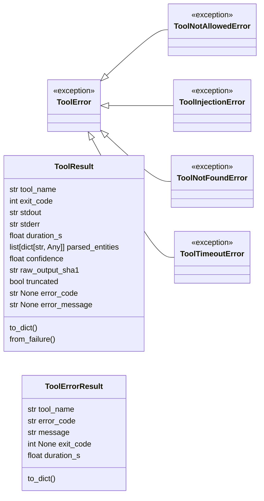
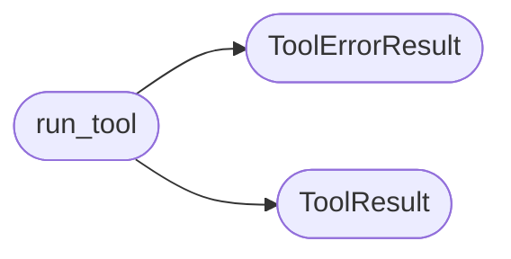

# `estorides_core.tool_runner`

> Source: [estorides_core/tool_runner.py:1](../../estorides_core/tool_runner.py#L1) | language `py` | coverage 0.0% | [API index](../index.md)

## Contents

- **Classes:** [`ToolResult`](#toolresult), [`ToolErrorResult`](#toolerrorresult)
- **Exceptions:** [`ToolError`](#toolerror), [`ToolNotAllowedError`](#toolnotallowederror), [`ToolInjectionError`](#toolinjectionerror), [`ToolNotFoundError`](#toolnotfounderror), [`ToolTimeoutError`](#tooltimeouterror)
- **Functions:** [`run_tool`](#run_tool)
- **Constants:** [`SHELL_METACHAR_RE`](#shell_metachar_re)

## Type Diagram



## Call Graph

Solid arrows stay in this module, dashed arrows leave it.



## Classes

<a id="toolresult"></a>

### `ToolResult`

`class` `dataclass` | [estorides_core/tool_runner.py:38](../../estorides_core/tool_runner.py#L38)

Decorators: `@dataclass(frozen=True)`

```python
class ToolResult
```

**Attributes**

| Name | Type | Default | Description |
|---|---|---|---|
| [`tool_name`](#toolresult-tool_name) | `str` |  |  |
| [`exit_code`](#toolresult-exit_code) | `int` |  |  |
| [`stdout`](#toolresult-stdout) | `str` |  |  |
| [`stderr`](#toolresult-stderr) | `str` |  |  |
| [`duration_s`](#toolresult-duration_s) | `float` |  |  |
| [`parsed_entities`](#toolresult-parsed_entities) | `list[dict[str, Any]]` |  |  |
| [`confidence`](#toolresult-confidence) | `float` |  |  |
| [`raw_output_sha1`](#toolresult-raw_output_sha1) | `str` |  |  |
| [`truncated`](#toolresult-truncated) | `bool` | `False` |  |
| [`error_code`](#toolresult-error_code) | `str \| None` | `None` |  |
| [`error_message`](#toolresult-error_message) | `str \| None` | `None` |  |

**Members**

| Member | Kind | Summary |
|---|---|---|
| [`to_dict`](#toolresult-to_dict) | method |  |
| [`from_failure`](#toolresult-from_failure) | classmethod |  |

<a id="toolresult-to_dict"></a>

#### `ToolResult.to_dict`

`method` | [estorides_core/tool_runner.py:51](../../estorides_core/tool_runner.py#L51)

```python
def to_dict(self) -> dict[str, Any]
```

**Returns:** `dict[str, Any]`

<a id="toolresult-from_failure"></a>

#### `ToolResult.from_failure`

`classmethod` | [estorides_core/tool_runner.py:59](../../estorides_core/tool_runner.py#L59)

Decorators: `@classmethod`

```python
def from_failure(cls, tool_name: str, error_code: str, error_message: str, duration_s: float, exit_code: int | None = None, stdout: str = '', stderr: str = '', parsed_entities: list[dict[str, Any]] | None = None) -> ToolResult
```

**Parameters**

| Name | Type | Default | Description |
|---|---|---|---|
| `tool_name` | `str` |  |  |
| `error_code` | `str` |  |  |
| `error_message` | `str` |  |  |
| `duration_s` | `float` |  |  |
| `exit_code` | `int \| None` | `None` |  |
| `stdout` | `str` | `''` |  |
| `stderr` | `str` | `''` |  |
| `parsed_entities` | `list[dict[str, Any]] \| None` | `None` |  |

**Returns:** `ToolResult`

---

<a id="toolerrorresult"></a>

### `ToolErrorResult`

`class` `dataclass` | [estorides_core/tool_runner.py:86](../../estorides_core/tool_runner.py#L86)

Decorators: `@dataclass(frozen=True)`

```python
class ToolErrorResult
```

**Attributes**

| Name | Type | Default | Description |
|---|---|---|---|
| [`tool_name`](#toolerrorresult-tool_name) | `str` |  |  |
| [`error_code`](#toolerrorresult-error_code) | `str` |  |  |
| [`message`](#toolerrorresult-message) | `str` |  |  |
| [`exit_code`](#toolerrorresult-exit_code) | `int \| None` |  |  |
| [`duration_s`](#toolerrorresult-duration_s) | `float` |  |  |

**Members**

| Member | Kind | Summary |
|---|---|---|
| [`to_dict`](#toolerrorresult-to_dict) | method |  |

<a id="toolerrorresult-to_dict"></a>

#### `ToolErrorResult.to_dict`

`method` | [estorides_core/tool_runner.py:93](../../estorides_core/tool_runner.py#L93)

```python
def to_dict(self) -> dict[str, Any]
```

**Returns:** `dict[str, Any]`

---

## Exceptions

<a id="toolerror"></a>

### `ToolError`

`exception` | [estorides_core/tool_runner.py:17](../../estorides_core/tool_runner.py#L17)

```python
class ToolError(Exception)
```

Bases: `Exception`

Subclasses: [`ToolInjectionError`](#toolinjectionerror), [`ToolNotAllowedError`](#toolnotallowederror), [`ToolNotFoundError`](#toolnotfounderror), [`ToolTimeoutError`](#tooltimeouterror)

---

<a id="toolnotallowederror"></a>

### `ToolNotAllowedError`

`exception` | [estorides_core/tool_runner.py:21](../../estorides_core/tool_runner.py#L21)

```python
class ToolNotAllowedError(ToolError)
```

Bases: [`ToolError`](#toolerror)

---

<a id="toolinjectionerror"></a>

### `ToolInjectionError`

`exception` | [estorides_core/tool_runner.py:25](../../estorides_core/tool_runner.py#L25)

```python
class ToolInjectionError(ToolError)
```

Bases: [`ToolError`](#toolerror)

---

<a id="toolnotfounderror"></a>

### `ToolNotFoundError`

`exception` | [estorides_core/tool_runner.py:29](../../estorides_core/tool_runner.py#L29)

```python
class ToolNotFoundError(ToolError)
```

Bases: [`ToolError`](#toolerror)

---

<a id="tooltimeouterror"></a>

### `ToolTimeoutError`

`exception` | [estorides_core/tool_runner.py:33](../../estorides_core/tool_runner.py#L33)

```python
class ToolTimeoutError(ToolError)
```

Bases: [`ToolError`](#toolerror)

---

## Functions

<a id="run_tool"></a>

### `run_tool`

`function` | [estorides_core/tool_runner.py:156](../../estorides_core/tool_runner.py#L156)

```python
def run_tool(tool_name: str, args: list[str], target: str = '', timeout: int | None = None, max_output_bytes: int = TOOL_MAX_OUTPUT_BYTES, cwd: str | None = None) -> ToolResult | ToolErrorResult
```

**Parameters**

| Name | Type | Default | Description |
|---|---|---|---|
| `tool_name` | `str` |  |  |
| `args` | `list[str]` |  |  |
| `target` | `str` | `''` |  |
| `timeout` | `int \| None` | `None` |  |
| `max_output_bytes` | `int` | `TOOL_MAX_OUTPUT_BYTES` |  |
| `cwd` | `str \| None` | `None` |  |

**Returns:** `ToolResult | ToolErrorResult`

*Calls:* [`ToolErrorResult`](#toolerrorresult), [`ToolResult`](#toolresult)

*Called by:* [`run_dnsrecon`](estorides_core.active_recon.py.md#run_dnsrecon), [`run_nikto`](estorides_core.active_recon.py.md#run_nikto), [`run_nmap`](estorides_core.active_recon.py.md#run_nmap), [`run_sqlmap`](estorides_core.active_recon.py.md#run_sqlmap), [`run_theHarvester`](estorides_core.active_recon.py.md#run_theharvester)

---

## Constants

<a id="shell_metachar_re"></a>

### `SHELL_METACHAR_RE`

`constant` | [estorides_core/tool_runner.py:14](../../estorides_core/tool_runner.py#L14)

```python
SHELL_METACHAR_RE = __import__('re').compile('[;|`$()\\n\\r]')
```

---
