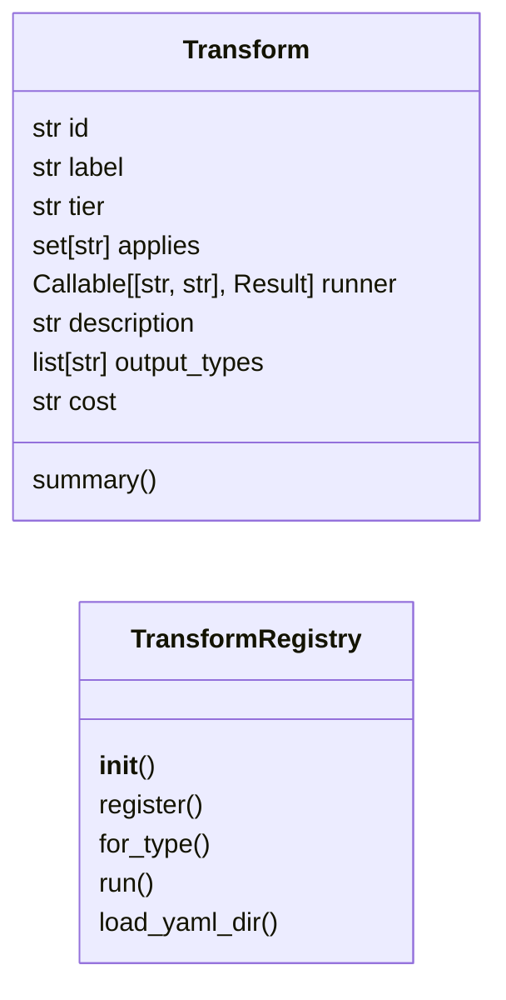

# `estorides_core.transforms`

> Source: [estorides_core/transforms.py:1](../../estorides_core/transforms.py#L1) | language `py` | coverage 50.0% | [API index](../index.md)

estorides_core.transforms ========================= Maltego-style transform registry.

A *transform* takes one entity `(type, value)` and returns related [`nodes`](static.js.graph_force.js.md#nodes)/[`links`](static.js.graph_force.js.md#links) in the same shape as [`estorides_core.intel_resolver`](estorides_core.intel_resolver.py.md), so the web layer and the D3 graph can merge the result with the existing expansion pipeline.

Transforms are grouped into the four-stage intelligence pipeline the
operator walks a selector through:

    data -> information -> intelligence -> counter_intelligence

Most transforms are thin filters over a single cross-feed resolution
(`resolver.resolve`), which already fans a selector out across Wikidata,
IP-API, OFAC and VirusTotal relationships. A few wrap the keyless Osiris
probes (BGP, breach leaks, GitHub) and adapt their raw payloads into the
node/link shape.

Public surface::

    from estorides_core.transforms import registry
    registry.for_type("ip")                 # -> [{"id","label","tier",...}, ...]
    registry.run("ip_to_sanctions", "ip", "1.2.3.4")

Transforms can also be added without code: drop a ``*.yaml`` file in
``transforms/`` (same ease as ``sources/``)::

    id: my_pivot
    label: My pivot
    tier: intelligence
    input_types: [domain]
    output_types: [ip]
    cost: free
    engine: resolver
    relations: [resolves_to]

Engines: ``resolver`` (filter over ``intel_resolver``), ``osiris_bgp`` /
``osiris_leaks`` / ``osiris_github``, ``static`` (fixed nodes/links with
``{query}`` substitution). Loaded via [`TransformRegistry.load_yaml_dir`](#transformregistry-load_yaml_dir)
(YAML multi-doc / lists, like ``source_loader``); broken files are skipped
fail-soft so built-ins always survive.

## Contents

- **Classes:** [`Transform`](#transform), [`TransformRegistry`](#transformregistry)
- **Functions:** [`iter_sse_events`](#iter_sse_events)
- **Constants:** [`TIERS`](#tiers), [`MAX_ID_LEN`](#max_id_len), [`MAX_TYPE_LEN`](#max_type_len), [`MAX_VALUE_LEN`](#max_value_len), [`MAX_STATIC_NODES`](#max_static_nodes), [`MAX_STATIC_LINKS`](#max_static_links)

## Type Diagram



## Call Graph

Solid arrows stay in this module, dashed arrows leave it.


## Classes

<a id="transform"></a>

### `Transform`

`class` `dataclass` | [estorides_core/transforms.py:73](../../estorides_core/transforms.py#L73)

Decorators: `@dataclass`

```python
class Transform
```

One named transform applicable to a set of entity types.

**Attributes**

| Name | Type | Default | Description |
|---|---|---|---|
| [`id`](#transform-id) | `str` |  |  |
| [`label`](#transform-label) | `str` |  |  |
| [`tier`](#transform-tier) | `str` |  |  |
| [`applies`](#transform-applies) | `set[str]` |  |  |
| [`runner`](#transform-runner) | `Callable[[str, str], Result]` |  |  |
| [`description`](#transform-description) | `str` | `''` |  |
| [`output_types`](#transform-output_types) | `list[str]` | `field(default_factory=list)` |  |
| [`cost`](#transform-cost) | `str` | `'free'` |  |

**Members**

| Member | Kind | Summary |
|---|---|---|
| [`summary`](#transform-summary) | method |  |

<a id="transform-summary"></a>

#### `Transform.summary`

`method` | [estorides_core/transforms.py:85](../../estorides_core/transforms.py#L85)

```python
def summary(self) -> dict[str, Any]
```

**Returns:** `dict[str, Any]`

---

<a id="transformregistry"></a>

### `TransformRegistry`

`class` | [estorides_core/transforms.py:227](../../estorides_core/transforms.py#L227)

```python
class TransformRegistry
```

Holds every transform and dispatches by id.

**Members**

| Member | Kind | Summary |
|---|---|---|
| [`__init__`](#transformregistry-__init__) | constructor |  |
| [`register`](#transformregistry-register) | method |  |
| [`for_type`](#transformregistry-for_type) | method |  |
| [`run`](#transformregistry-run) | method |  |
| [`load_yaml_dir`](#transformregistry-load_yaml_dir) | method | Register every transform declared in ``*.yaml`` under `directory`. |

<a id="transformregistry-__init__"></a>

#### `TransformRegistry.__init__`

`constructor` | [estorides_core/transforms.py:230](../../estorides_core/transforms.py#L230)

```python
def __init__(self) -> None
```

<a id="transformregistry-register"></a>

#### `TransformRegistry.register`

`method` | [estorides_core/transforms.py:233](../../estorides_core/transforms.py#L233)

```python
def register(self, t: Transform) -> None
```

**Parameters**

| Name | Type | Default | Description |
|---|---|---|---|
| `t` | `Transform` |  |  |

*Called by:* [`TransformRegistry.load_yaml_dir`](#transformregistry-load_yaml_dir)

<a id="transformregistry-for_type"></a>

#### `TransformRegistry.for_type`

`method` | [estorides_core/transforms.py:236](../../estorides_core/transforms.py#L236)

```python
def for_type(self, ent_type: str) -> list[dict[str, Any]]
```

**Parameters**

| Name | Type | Default | Description |
|---|---|---|---|
| `ent_type` | `str` |  |  |

**Returns:** `list[dict[str, Any]]`

<a id="transformregistry-run"></a>

#### `TransformRegistry.run`

`method` | [estorides_core/transforms.py:248](../../estorides_core/transforms.py#L248)

```python
def run(self, transform_id: str, ent_type: str, value: str) -> Result
```

**Parameters**

| Name | Type | Default | Description |
|---|---|---|---|
| `transform_id` | `str` |  |  |
| `ent_type` | `str` |  |  |
| `value` | `str` |  |  |

**Returns:** `Result`

<a id="transformregistry-load_yaml_dir"></a>

#### `TransformRegistry.load_yaml_dir`

`method` | [estorides_core/transforms.py:282](../../estorides_core/transforms.py#L282)

```python
def load_yaml_dir(self, directory: str | Path) -> int
```

Register every transform declared in ``*.yaml`` under `directory`.

Same ease as ``sources/``: one file per pivot, multi-doc / list
docs supported. Broken files are skipped fail-soft; duplicates
overwrite with a warning. Returns the number of transforms loaded.

**Parameters**

| Name | Type | Default | Description |
|---|---|---|---|
| `directory` | `str \| Path` |  |  |

**Returns:** `int`

*Calls:* [`TransformRegistry.register`](#transformregistry-register)

---

## Functions

<a id="iter_sse_events"></a>

### `iter_sse_events`

`function` `generator` | [estorides_core/transforms.py:408](../../estorides_core/transforms.py#L408)

```python
def iter_sse_events(transform_id: str, ent_type: str, value: str, runner: Callable[[str, str], Result] | None = None) -> Iterator[tuple[str, dict[str, Any]]]
```

Yield ``(kind, payload)`` tuples for the SSE stream endpoint.

Kinds: ``node`` / ``link`` per item, then ``done`` with counts, or
``error`` when the run fails. [`runner`](#transform-runner) override exists for tests.

**Parameters**

| Name | Type | Default | Description |
|---|---|---|---|
| `transform_id` | `str` |  |  |
| `ent_type` | `str` |  |  |
| `value` | `str` |  |  |
| `runner` | `Callable[[str, str], Result] \| None` | `None` |  |

**Returns:** `Iterator[tuple[str, dict[str, Any]]]`

*Called by:* [`create_app`](estorides_web.py.md#create_app)

---

## Constants

<a id="tiers"></a>

### `TIERS`

`constant` | [estorides_core/transforms.py:58](../../estorides_core/transforms.py#L58)

```python
TIERS = ('data', 'information', 'intelligence', 'counter_intelligence')
```

---

<a id="max_id_len"></a>

### `MAX_ID_LEN`

`constant` | [estorides_core/transforms.py:62](../../estorides_core/transforms.py#L62)

```python
MAX_ID_LEN = 64
```

---

<a id="max_type_len"></a>

### `MAX_TYPE_LEN`

`constant` | [estorides_core/transforms.py:63](../../estorides_core/transforms.py#L63)

```python
MAX_TYPE_LEN = 64
```

---

<a id="max_value_len"></a>

### `MAX_VALUE_LEN`

`constant` | [estorides_core/transforms.py:64](../../estorides_core/transforms.py#L64)

```python
MAX_VALUE_LEN = 512
```

---

<a id="max_static_nodes"></a>

### `MAX_STATIC_NODES`

`constant` | [estorides_core/transforms.py:66](../../estorides_core/transforms.py#L66)

```python
MAX_STATIC_NODES = 50
```

---

<a id="max_static_links"></a>

### `MAX_STATIC_LINKS`

`constant` | [estorides_core/transforms.py:67](../../estorides_core/transforms.py#L67)

```python
MAX_STATIC_LINKS = 100
```

---
