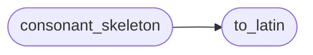

# `estorides_core.transliteration`

> Source: [estorides_core/transliteration.py:1](../../estorides_core/transliteration.py#L1) | language `py` | coverage 100.0% | [API index](../index.md)

estorides_core.transliteration ============================== Cross-script name normalisation for entity resolution.

State-level person/organisation matching lives or dies on names that
arrive in different writing systems: a sanctions list spells a target in
Cyrillic, a leak spells him in Latin, a news article in Arabic. This
module folds all of them onto a single comparable Latin (ASCII) skeleton
so the resolver can score them against each other.

It is deliberately stdlib-only (no `unidecode`, no `transliterate`) so it
adds zero hard dependencies, consistent with the rest of the engine. The
maps are pragmatic romanisations (BGN/PCGN-leaning for Cyrillic/Greek,
ALA-LC-leaning for Arabic), not bit-exact standards; for fuzzy name
matching, recall matters more than scholarly fidelity.

Two representations are produced:

* ``to_latin(text)`` — best-effort Latin transliteration, lowercased and
  stripped of diacritics. ``"Владимир" -> "vladimir"``.
* ``consonant_skeleton(text)`` — the Latin form with vowels removed, so a
  vowelless Arabic spelling can still meet a fully-vowelled Latin one.
  Arabic script omits short vowels, so ``"محمد"`` romanises to ``"mhmd"``
  while the Latin source has ``"muhammad"``; comparing consonant
  skeletons (``"mhmd"`` vs ``"mhmd"``) recovers the match.

## Contents

- **Functions:** [`to_latin`](#to_latin), [`consonant_skeleton`](#consonant_skeleton), [`is_non_latin`](#is_non_latin)

## Call Graph

Solid arrows stay in this module, dashed arrows leave it.



## Functions

<a id="to_latin"></a>

### `to_latin`

`function` | [estorides_core/transliteration.py:87](../../estorides_core/transliteration.py#L87)

```python
def to_latin(text: str) -> str
```

Return a lowercased, diacritic-free Latin transliteration.

The pipeline is: casefold -> NFKD diacritic strip (so accented Greek
and Latin fold to their base letters) -> per-character script map
(Cyrillic/Greek/Arabic) -> keep only ``[a-z0-9 ]``. Casefolding and
stripping run *before* the map so that uppercase and accented source
letters reach the lowercase, accent-free keys the map is written for.
Whitespace is collapsed to single spaces and the result is trimmed.
Non-mappable characters (e.g. unmapped CJK) are dropped, which is the
safe failure mode for fuzzy matching.

**Parameters**

| Name | Type | Default | Description |
|---|---|---|---|
| `text` | `str` |  |  |

**Returns:** `str`

*Called by:* [`normalize_value`](estorides_core.entity_resolution.py.md#normalize_value), [`consonant_skeleton`](#consonant_skeleton)

---

<a id="consonant_skeleton"></a>

### `consonant_skeleton`

`function` | [estorides_core/transliteration.py:112](../../estorides_core/transliteration.py#L112)

```python
def consonant_skeleton(text: str) -> str
```

Return the Latin transliteration with vowels and spaces removed.

This is the vowel-insensitive comparison key. Abjad scripts (Arabic,
Hebrew) routinely omit short vowels, so two spellings of the same name
can only be reconciled on their consonant skeletons. The first
character is preserved even if it is a vowel, because name-initial
vowels are usually written and carry signal.

Adjacent duplicate letters are collapsed so that gemination written as
a doubled Latin consonant (``Muhammad`` -> ``mhmmd``) reconciles with a
script that marks it with a diacritic instead of doubling the letter
(Arabic ``محمد`` -> ``mhmd``).

**Parameters**

| Name | Type | Default | Description |
|---|---|---|---|
| `text` | `str` |  |  |

**Returns:** `str`

*Calls:* [`to_latin`](#to_latin)

*Called by:* [`blocking_keys`](estorides_core.entity_resolution.py.md#blocking_keys), [`score_pair`](estorides_core.entity_resolution.py.md#score_pair)

---

<a id="is_non_latin"></a>

### `is_non_latin`

`function` | [estorides_core/transliteration.py:139](../../estorides_core/transliteration.py#L139)

```python
def is_non_latin(text: str) -> bool
```

True if any character is outside the Basic Latin / Latin-1 range.

Used by the resolver to decide whether the cross-script path is worth
taking for a given value before paying for transliteration of both
sides of a comparison.

**Parameters**

| Name | Type | Default | Description |
|---|---|---|---|
| `text` | `str` |  |  |

**Returns:** `bool`

---
