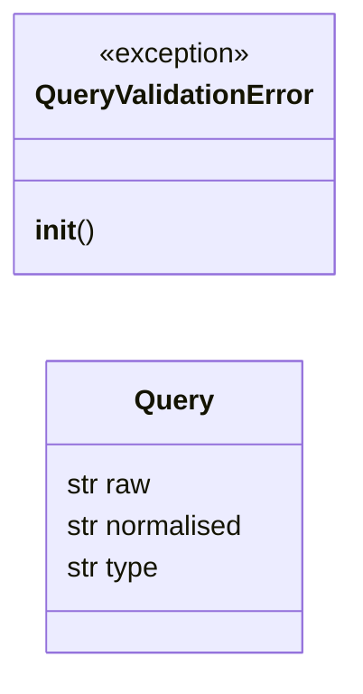
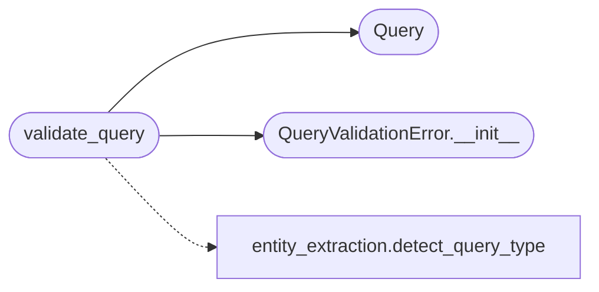

# `estorides_core.validation`

> Source: [estorides_core/validation.py:1](../../estorides_core/validation.py#L1) | language `py` | coverage 80.0% | [API index](../index.md)

estorides_core.validation ========================= Input validation for free-form queries.

OSINT platforms ingest user-controlled text and turn it into network
requests. A bare string is a free pass for: control characters, billion-
laughing-doesn't-laugh payloads, ReDoS-inducing regex inputs, billion-
byte blobs, and "clever" Unicode lookalikes that break downstream
parsers. This module is the first line of defence: every public entry
point (`api_run`, the CLI `run` subcommand) should pass the user query
through [`validate_query`](#validate_query) before it touches a source.

Rules:

  * Trim, collapse internal whitespace, strip control chars.
  * Cap length: 1-512 chars. Long enough for an indictment, short
    enough that no single run can become a DoS.
  * Reject ASCII control chars (except space, tab).
  * Reject Unicode bidi overrides (U+202A-202E, U+2066-2069) — these
    are the classic "swap the file extension" phishing trick and they
    have no business in an OSINT query.
  * Detect query type via the existing detector and require it to be
    one of the recognised shapes; reject anything that smells like a
    free-form text dump.
  * Return a typed [`Query`](#query) object so callers don't have to redo the
    detection step.

## Contents

- **Classes:** [`Query`](#query)
- **Exceptions:** [`QueryValidationError`](#queryvalidationerror)
- **Functions:** [`validate_query`](#validate_query)

## Type Diagram



## Call Graph

Solid arrows stay in this module, dashed arrows leave it.



## Classes

<a id="query"></a>

### `Query`

`class` `dataclass` | [estorides_core/validation.py:63](../../estorides_core/validation.py#L63)

Decorators: `@dataclass(frozen=True)`

```python
class Query
```

A validated, normalised query string.

**Attributes**

| Name | Type | Default | Description |
|---|---|---|---|
| [`raw`](#query-raw) | `str` |  |  |
| [`normalised`](#query-normalised) | `str` |  |  |
| [`type`](#query-type) | `str` |  |  |

---

## Exceptions

<a id="queryvalidationerror"></a>

### `QueryValidationError`

`exception` | [estorides_core/validation.py:55](../../estorides_core/validation.py#L55)

```python
class QueryValidationError(ValueError)
```

Bases: `ValueError`

Raised when a query fails validation.

The reason is in `.reason`.

**Members**

| Member | Kind | Summary |
|---|---|---|
| [`__init__`](#queryvalidationerror-__init__) | constructor |  |

<a id="queryvalidationerror-__init__"></a>

#### `QueryValidationError.__init__`

`constructor` | [estorides_core/validation.py:57](../../estorides_core/validation.py#L57)

```python
def __init__(self, reason: str, message: str = '') -> None
```

**Parameters**

| Name | Type | Default | Description |
|---|---|---|---|
| `reason` | `str` |  |  |
| `message` | `str` | `''` |  |

*Called by:* [`validate_query`](#validate_query)

---

## Functions

<a id="validate_query"></a>

### `validate_query`

`function` | [estorides_core/validation.py:85](../../estorides_core/validation.py#L85)

```python
def validate_query(raw: str, *, max_length: int = 512) -> Query
```

Validate and normalise a user query string.

**Parameters**

| Name | Type | Default | Description |
|---|---|---|---|
| `raw` | `str` |  | the user-supplied query, exactly as received. |
| `max_length` | `int` | `512` | hard cap on the normalised length. Default 512. |

**Returns:** `Query` - A [`Query`](#query) with the normalised text and detected type.

**Raises**

- `QueryValidationError if the query is empty, oversized, contains`
- `forbidden characters, or resolves to a type the engine cannot`
- `dispatch on.`
- [`QueryValidationError`](#queryvalidationerror): (raised in the body, not documented)

*Calls:* [`detect_query_type`](estorides_core.entity_extraction.py.md#detect_query_type), [`Query`](#query), [`QueryValidationError.__init__`](#queryvalidationerror-__init__)

*Called by:* [`cmd_run`](estorides_cli.py.md#cmd_run), [`create_app`](estorides_web.py.md#create_app)

---
