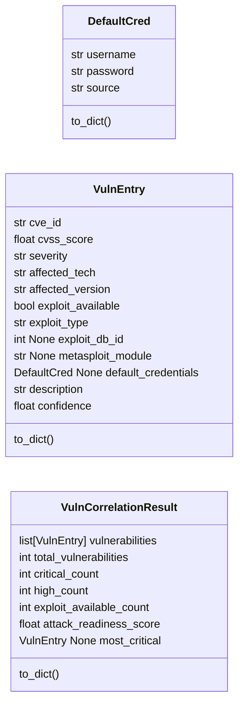
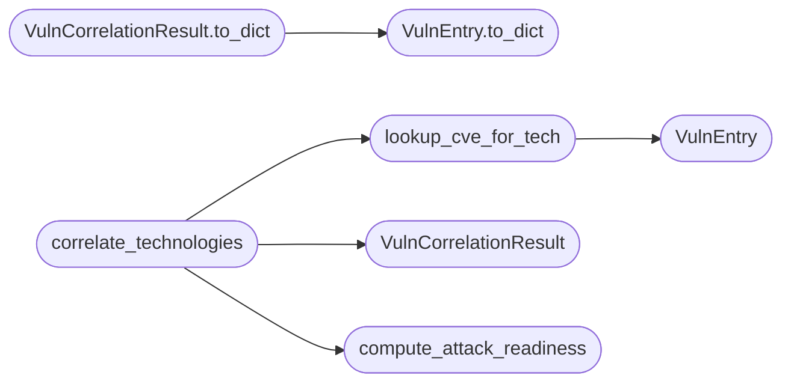

# `estorides_core.vuln_correlation`

> Source: [estorides_core/vuln_correlation.py:1](../../estorides_core/vuln_correlation.py#L1) | language `py` | coverage 0.0% | [API index](../index.md)

## Contents

- **Classes:** [`DefaultCred`](#defaultcred), [`VulnEntry`](#vulnentry), [`VulnCorrelationResult`](#vulncorrelationresult)
- **Functions:** [`lookup_cve_for_tech`](#lookup_cve_for_tech), [`correlate_technologies`](#correlate_technologies), [`compute_attack_readiness`](#compute_attack_readiness)
- **Constants:** [`VERSION_RE`](#version_re), [`VULN_DB`](#vuln_db), [`DEFAULT_CREDS`](#default_creds)

## Type Diagram



## Call Graph

Solid arrows stay in this module, dashed arrows leave it.



## Classes

<a id="defaultcred"></a>

### `DefaultCred`

`class` `dataclass` | [estorides_core/vuln_correlation.py:14](../../estorides_core/vuln_correlation.py#L14)

Decorators: `@dataclass`

```python
class DefaultCred
```

**Attributes**

| Name | Type | Default | Description |
|---|---|---|---|
| [`username`](#defaultcred-username) | `str` |  |  |
| [`password`](#defaultcred-password) | `str` |  |  |
| [`source`](#defaultcred-source) | `str` |  |  |

**Members**

| Member | Kind | Summary |
|---|---|---|
| [`to_dict`](#defaultcred-to_dict) | method |  |

<a id="defaultcred-to_dict"></a>

#### `DefaultCred.to_dict`

`method` | [estorides_core/vuln_correlation.py:19](../../estorides_core/vuln_correlation.py#L19)

```python
def to_dict(self) -> dict[str, Any]
```

**Returns:** `dict[str, Any]`

---

<a id="vulnentry"></a>

### `VulnEntry`

`class` `dataclass` | [estorides_core/vuln_correlation.py:24](../../estorides_core/vuln_correlation.py#L24)

Decorators: `@dataclass`

```python
class VulnEntry
```

**Attributes**

| Name | Type | Default | Description |
|---|---|---|---|
| [`cve_id`](#vulnentry-cve_id) | `str` |  |  |
| [`cvss_score`](#vulnentry-cvss_score) | `float` |  |  |
| [`severity`](#vulnentry-severity) | `str` |  |  |
| [`affected_tech`](#vulnentry-affected_tech) | `str` |  |  |
| [`affected_version`](#vulnentry-affected_version) | `str` |  |  |
| [`exploit_available`](#vulnentry-exploit_available) | `bool` |  |  |
| [`exploit_type`](#vulnentry-exploit_type) | `str` |  |  |
| [`exploit_db_id`](#vulnentry-exploit_db_id) | `int \| None` |  |  |
| [`metasploit_module`](#vulnentry-metasploit_module) | `str \| None` |  |  |
| [`default_credentials`](#vulnentry-default_credentials) | `DefaultCred \| None` |  |  |
| [`description`](#vulnentry-description) | `str` |  |  |
| [`confidence`](#vulnentry-confidence) | `float` |  |  |

**Members**

| Member | Kind | Summary |
|---|---|---|
| [`to_dict`](#vulnentry-to_dict) | method |  |

<a id="vulnentry-to_dict"></a>

#### `VulnEntry.to_dict`

`method` | [estorides_core/vuln_correlation.py:38](../../estorides_core/vuln_correlation.py#L38)

```python
def to_dict(self) -> dict[str, Any]
```

**Returns:** `dict[str, Any]`

*Called by:* [`VulnCorrelationResult.to_dict`](#vulncorrelationresult-to_dict)

---

<a id="vulncorrelationresult"></a>

### `VulnCorrelationResult`

`class` `dataclass` | [estorides_core/vuln_correlation.py:43](../../estorides_core/vuln_correlation.py#L43)

Decorators: `@dataclass`

```python
class VulnCorrelationResult
```

**Attributes**

| Name | Type | Default | Description |
|---|---|---|---|
| [`vulnerabilities`](#vulncorrelationresult-vulnerabilities) | `list[VulnEntry]` | `field(default_factory=list)` |  |
| [`total_vulnerabilities`](#vulncorrelationresult-total_vulnerabilities) | `int` | `0` |  |
| [`critical_count`](#vulncorrelationresult-critical_count) | `int` | `0` |  |
| [`high_count`](#vulncorrelationresult-high_count) | `int` | `0` |  |
| [`exploit_available_count`](#vulncorrelationresult-exploit_available_count) | `int` | `0` |  |
| [`attack_readiness_score`](#vulncorrelationresult-attack_readiness_score) | `float` | `0.0` |  |
| [`most_critical`](#vulncorrelationresult-most_critical) | `VulnEntry \| None` | `None` |  |

**Members**

| Member | Kind | Summary |
|---|---|---|
| [`to_dict`](#vulncorrelationresult-to_dict) | method |  |

<a id="vulncorrelationresult-to_dict"></a>

#### `VulnCorrelationResult.to_dict`

`method` | [estorides_core/vuln_correlation.py:52](../../estorides_core/vuln_correlation.py#L52)

```python
def to_dict(self) -> dict[str, Any]
```

**Returns:** `dict[str, Any]`

*Calls:* [`VulnEntry.to_dict`](#vulnentry-to_dict)

---

## Functions

<a id="lookup_cve_for_tech"></a>

### `lookup_cve_for_tech`

`function` | [estorides_core/vuln_correlation.py:169](../../estorides_core/vuln_correlation.py#L169)

```python
def lookup_cve_for_tech(tech_name: str, version: str | None) -> list[VulnEntry]
```

**Parameters**

| Name | Type | Default | Description |
|---|---|---|---|
| `tech_name` | `str` |  |  |
| `version` | `str \| None` |  |  |

**Returns:** `list[VulnEntry]`

*Calls:* [`VulnEntry`](#vulnentry)

*Called by:* [`correlate_technologies`](#correlate_technologies)

---

<a id="correlate_technologies"></a>

### `correlate_technologies`

`function` | [estorides_core/vuln_correlation.py:202](../../estorides_core/vuln_correlation.py#L202)

```python
def correlate_technologies(technologies: list[dict[str, Any]]) -> VulnCorrelationResult
```

**Parameters**

| Name | Type | Default | Description |
|---|---|---|---|
| `technologies` | `list[dict[str, Any]]` |  |  |

**Returns:** `VulnCorrelationResult`

*Calls:* [`VulnCorrelationResult`](#vulncorrelationresult), [`compute_attack_readiness`](#compute_attack_readiness), [`lookup_cve_for_tech`](#lookup_cve_for_tech)

*Called by:* [`run_passive_recon`](estorides_core.recon_pipeline.py.md#run_passive_recon)

---

<a id="compute_attack_readiness"></a>

### `compute_attack_readiness`

`function` | [estorides_core/vuln_correlation.py:228](../../estorides_core/vuln_correlation.py#L228)

```python
def compute_attack_readiness(vulnerabilities: list[VulnEntry]) -> float
```

**Parameters**

| Name | Type | Default | Description |
|---|---|---|---|
| `vulnerabilities` | `list[VulnEntry]` |  |  |

**Returns:** `float`

*Called by:* [`correlate_technologies`](#correlate_technologies)

---

## Constants

<a id="version_re"></a>

### `VERSION_RE`

`constant` | [estorides_core/vuln_correlation.py:10](../../estorides_core/vuln_correlation.py#L10)

```python
VERSION_RE = re.compile('(\\d+(?:\\.\\d+)*)')
```

---

<a id="vuln_db"></a>

### `VULN_DB`

`constant` | [estorides_core/vuln_correlation.py:64](../../estorides_core/vuln_correlation.py#L64)

```python
VULN_DB: dict[str, list[dict[str, Any]]]
```

---

<a id="default_creds"></a>

### `DEFAULT_CREDS`

`constant` | [estorides_core/vuln_correlation.py:103](../../estorides_core/vuln_correlation.py#L103)

```python
DEFAULT_CREDS: dict[str, list[DefaultCred]]
```

---
