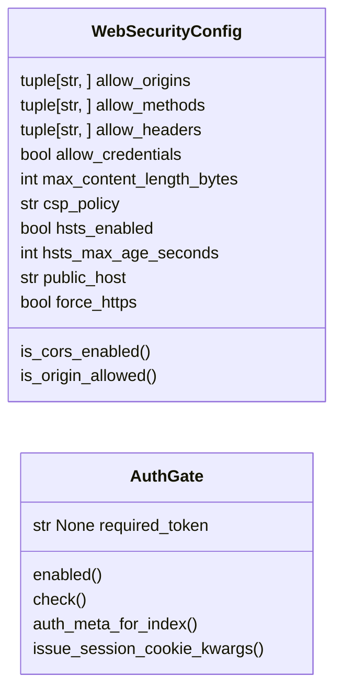
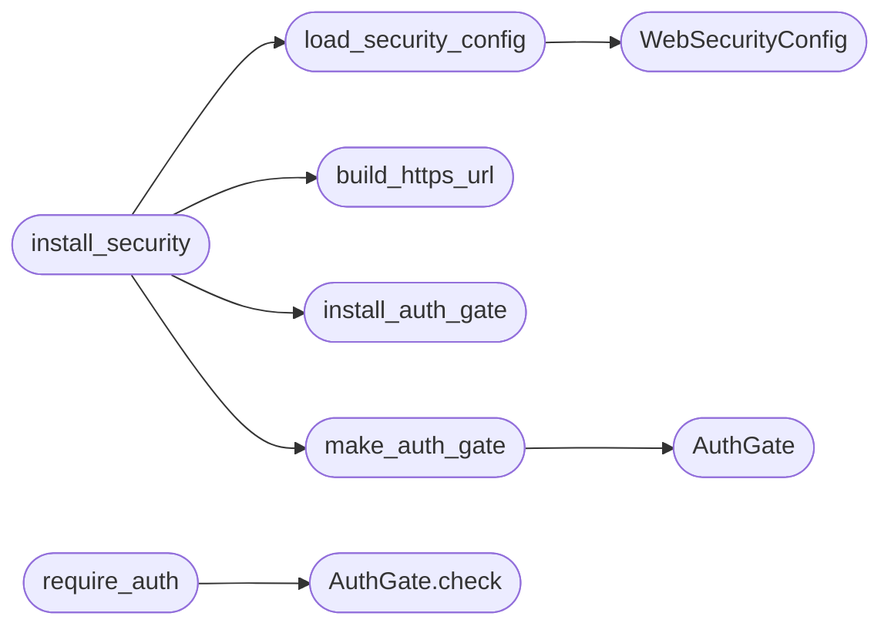

# `estorides_core.web_security`

> Source: [estorides_core/web_security.py:1](../../estorides_core/web_security.py#L1) | language `py` | coverage 81.2% | [API index](../index.md)

estorides_core.web_security ===========================

Production-grade web hardening helpers used by the Flask app factory.

Responsibilities
----------------
* Security headers on every response (CSP, X-Frame-Options, X-Content-Type-Options,
  Referrer-Policy, Permissions-Policy, HSTS when behind TLS).
* Optional CORS allowlist (the platform is a local single-user tool by default —
  CORS is opt-in, not opt-out, so the default is a tight same-origin policy).
* A defensive request-size guard that rejects oversized JSON / form bodies
  before they reach a route handler (the rest of the app trusts `request.get_json()`
  blindly).
* A Werkzeug-debugger kill-switch. Production deployments must never expose the
  interactive debugger console — this helper refuses to register routes when
  the dev debugger is on, and logs the attempt at WARNING level.
* A bearer-token auth gate ([`require_auth`](#require_auth)) for sensitive endpoints. When the
  operator sets `ESTORIDES_AUTH_TOKEN`, the sensitive `/api/*` surface stops
  trusting anonymous callers; the legitimate UI gets the token from a
  `<meta name="estorides-auth-token">` tag rendered into `index.html` and
  includes it as a header on every fetch.

  When `ESTORIDES_AUTH_TOKEN` is unset, the system **auto-generates** a random
  64-hex-char token on startup and prints it to the terminal. This ensures API
  abuse protection is always on — no login page needed, no explicit registration.

Why a dedicated module?
-----------------------
The Flask app is built by [`estorides_web.create_app`](estorides_web.py.md#create_app). Keeping the hardening
out of the factory means:
  * unit tests can spin up an app with a stripped-down middleware set,
  * the surface is one file to audit (CVE-2023-style header regressions),
  * everything is policy-driven by env vars, not magic literals scattered
      across route definitions.

## Contents

- **Classes:** [`WebSecurityConfig`](#websecurityconfig), [`AuthGate`](#authgate)
- **Functions:** [`build_https_url`](#build_https_url), [`load_security_config`](#load_security_config), [`install_security`](#install_security), [`make_auth_gate`](#make_auth_gate), [`require_auth`](#require_auth), [`install_auth_gate`](#install_auth_gate), [`auto_generated_token`](#auto_generated_token)
- **Constants:** [`AUTH_HEADER`](#auth_header), [`AUTH_COOKIE`](#auth_cookie), [`AUTH_META`](#auth_meta), [`AUTH_HEADER_ALT`](#auth_header_alt), [`AUTO_GENERATED_TOKEN`](#auto_generated_token)

## Type Diagram



## Call Graph

Solid arrows stay in this module, dashed arrows leave it.



## Classes

<a id="websecurityconfig"></a>

### `WebSecurityConfig`

`class` `dataclass` | [estorides_core/web_security.py:87](../../estorides_core/web_security.py#L87)

Decorators: `@dataclass(frozen=True)`

```python
class WebSecurityConfig
```

Resolved security policy for the Flask app.

All fields are read from the environment at import time and frozen so
the policy cannot drift at runtime. Changing a knob requires a restart
— the right call for a tool that mostly runs as a long-lived daemon.

**Attributes**

| Name | Type | Default | Description |
|---|---|---|---|
| [`allow_origins`](#websecurityconfig-allow_origins) | `tuple[str, ...]` | `()` |  |
| [`allow_methods`](#websecurityconfig-allow_methods) | `tuple[str, ...]` | `('GET', 'POST', 'DELETE', 'OPTIONS')` |  |
| [`allow_headers`](#websecurityconfig-allow_headers) | `tuple[str, ...]` | `('Content-Type', 'Authorization')` |  |
| [`allow_credentials`](#websecurityconfig-allow_credentials) | `bool` | `False` |  |
| [`max_content_length_bytes`](#websecurityconfig-max_content_length_bytes) | `int` | `16 * 1024 * 1024` |  |
| [`csp_policy`](#websecurityconfig-csp_policy) | `str` | `"default-src 'self'; script-src 'self' https://unpkg.com https://cdn.jsdelivr.net; style-src 'self' 'unsafe-hashes' https://unpkg.com; img-src 'self' data: https:; connect-src 'self' https://unpkg.com; frame-ancestors 'none'; base-uri 'self'; form-action 'self'"` |  |
| [`hsts_enabled`](#websecurityconfig-hsts_enabled) | `bool` | `False` |  |
| [`hsts_max_age_seconds`](#websecurityconfig-hsts_max_age_seconds) | `int` | `31536000` |  |
| [`public_host`](#websecurityconfig-public_host) | `str` | `'localhost:5050'` |  |
| [`force_https`](#websecurityconfig-force_https) | `bool` | `False` |  |

**Members**

| Member | Kind | Summary |
|---|---|---|
| [`is_cors_enabled`](#websecurityconfig-is_cors_enabled) | property |  |
| [`is_origin_allowed`](#websecurityconfig-is_origin_allowed) | property | CORS is opt-in; this is the runtime check used by the after_request hook. |

<a id="websecurityconfig-is_cors_enabled"></a>

#### `WebSecurityConfig.is_cors_enabled`

`property` | [estorides_core/web_security.py:128](../../estorides_core/web_security.py#L128)

Decorators: `@property`

```python
def is_cors_enabled(self) -> bool
```

**Returns:** `bool`

<a id="websecurityconfig-is_origin_allowed"></a>

#### `WebSecurityConfig.is_origin_allowed`

`property` | [estorides_core/web_security.py:132](../../estorides_core/web_security.py#L132)

Decorators: `@property`

```python
def is_origin_allowed(self) -> bool
```

CORS is opt-in; this is the runtime check used by the after_request hook.

**Returns:** `bool`

---

<a id="authgate"></a>

### `AuthGate`

`class` `dataclass` | [estorides_core/web_security.py:341](../../estorides_core/web_security.py#L341)

Decorators: `@dataclass`

```python
class AuthGate
```

Bearer-token gate applied to sensitive routes.

[`required_token`](#authgate-required_token) is the single shared secret. `None` disables the gate
(local-trust mode). Comparison is constant-time.

**Attributes**

| Name | Type | Default | Description |
|---|---|---|---|
| [`required_token`](#authgate-required_token) | `str \| None` | `None` |  |

**Members**

| Member | Kind | Summary |
|---|---|---|
| [`enabled`](#authgate-enabled) | property |  |
| [`check`](#authgate-check) | method |  |
| [`auth_meta_for_index`](#authgate-auth_meta_for_index) | method | Token to embed in `index.html` so the UI can auto-authenticate. |
| [`issue_session_cookie_kwargs`](#authgate-issue_session_cookie_kwargs) | method | Arguments for `set_cookie` to install the session cookie. |

<a id="authgate-enabled"></a>

#### `AuthGate.enabled`

`property` | [estorides_core/web_security.py:351](../../estorides_core/web_security.py#L351)

Decorators: `@property`

```python
def enabled(self) -> bool
```

**Returns:** `bool`

<a id="authgate-check"></a>

#### `AuthGate.check`

`method` | [estorides_core/web_security.py:354](../../estorides_core/web_security.py#L354)

```python
def check(self) -> bool
```

**Returns:** `bool`

*Called by:* [`require_auth`](#require_auth)

<a id="authgate-auth_meta_for_index"></a>

#### `AuthGate.auth_meta_for_index`

`method` | [estorides_core/web_security.py:362](../../estorides_core/web_security.py#L362)

```python
def auth_meta_for_index(self) -> str | None
```

Token to embed in `index.html` so the UI can auto-authenticate.

Returns `None` when the gate is off (the UI then omits the meta
tag and every call goes through anonymously, which is the
local-trust default).

**Returns:** `str | None`

<a id="authgate-issue_session_cookie_kwargs"></a>

#### `AuthGate.issue_session_cookie_kwargs`

`method` | [estorides_core/web_security.py:371](../../estorides_core/web_security.py#L371)

```python
def issue_session_cookie_kwargs(self) -> dict[str, Any]
```

Arguments for `set_cookie` to install the session cookie.

`Secure` is set when the request itself is over HTTPS or the operator
requested ESTORIDES_FORCE_HTTPS=1 (in that case we know they're behind
TLS). `SameSite=Lax` keeps the cookie from cross-site POSTs.

**Returns:** `dict[str, Any]`

---

## Functions

<a id="build_https_url"></a>

### `build_https_url`

`function` | [estorides_core/web_security.py:58](../../estorides_core/web_security.py#L58)

```python
def build_https_url(public_host: str, path: str, query_string: bytes) -> str
```

Build a safe HTTPS redirect target from a trusted host and client path.

The client controls `[`path`](estorides_core.audit.py.md#auditevent-path)`/``query_string``, so they are treated as
hostile (the standing doctrine: never trust user input). We parse the
reconstructed URL and refuse to emit a Location header whose scheme is
not ``https`` or whose host differs from the configured `[`public_host`](#websecurityconfig-public_host)`.
On any mismatch we fall back to a bare host root, so a crafted ``//evil``
or ``\evil`` path can never become an open redirect.

**Parameters**

| Name | Type | Default | Description |
|---|---|---|---|
| `public_host` | `str` |  |  |
| `path` | `str` |  |  |
| `query_string` | `bytes` |  |  |

**Returns:** `str`

*Called by:* [`install_security`](#install_security)

---

<a id="load_security_config"></a>

### `load_security_config`

`function` | [estorides_core/web_security.py:144](../../estorides_core/web_security.py#L144)

```python
def load_security_config() -> WebSecurityConfig
```

Resolve the security policy from env vars.

ESTORIDES_CORS_ORIGINS    comma-separated list, e.g. "https://app.example.com"
ESTORIDES_MAX_BODY_BYTES  int, default 1 MiB
ESTORIDES_HSTS            1 to emit Strict-Transport-Security
ESTORIDES_FORCE_HTTPS     1 to redirect plain http to https (only meaningful behind TLS)
ESTORIDES_CSP             override the default Content-Security-Policy
ESTORIDES_PUBLIC_HOST     public hostname for HTTPS redirect (default localhost:5050)

**Returns:** `WebSecurityConfig`

*Calls:* [`WebSecurityConfig`](#websecurityconfig)

*Called by:* [`install_security`](#install_security)

---

<a id="install_security"></a>

### `install_security`

`function` | [estorides_core/web_security.py:169](../../estorides_core/web_security.py#L169)

```python
def install_security(app: Flask, cfg: WebSecurityConfig | None = None) -> WebSecurityConfig
```

Wire security middleware into a Flask app.

Idempotent: calling twice is a no-op (we re-attach, but Flask keeps the
last hook, and our hooks are stateless). Returns the resolved config so
the caller can echo it in a startup banner.

**Parameters**

| Name | Type | Default | Description |
|---|---|---|---|
| `app` | `Flask` |  |  |
| `cfg` | `WebSecurityConfig \| None` | `None` |  |

**Returns:** `WebSecurityConfig`

**Raises**

- `RuntimeError`: (raised in the body, not documented)

*Calls:* [`build_https_url`](#build_https_url), [`install_auth_gate`](#install_auth_gate), [`load_security_config`](#load_security_config), [`make_auth_gate`](#make_auth_gate)

*Called by:* [`create_app`](estorides_web.py.md#create_app)

---

<a id="make_auth_gate"></a>

### `make_auth_gate`

`function` | [estorides_core/web_security.py:321](../../estorides_core/web_security.py#L321)

```python
def make_auth_gate() -> AuthGate
```

Build the auth gate from the current environment.

When `ESTORIDES_AUTH_TOKEN` is set, the gate uses that value.
When unset, the system auto-generates a random 64-hex-char token,
stores it in [`AUTO_GENERATED_TOKEN`](#auto_generated_token) (so the startup banner can
display it), and returns an enabled gate. This guarantees API
abuse protection is always active — no login screen, no explicit
enrolment.

**Returns:** `AuthGate`

*Calls:* [`AuthGate`](#authgate)

*Called by:* [`install_security`](#install_security)

---

<a id="require_auth"></a>

### `require_auth`

`function` | [estorides_core/web_security.py:388](../../estorides_core/web_security.py#L388)

```python
def require_auth(view: Callable[..., Any]) -> Callable[..., Any]
```

Decorator: enforce the bearer-token gate on a view.

Behaviour:
  * gate disabled (no env var) → pass-through, no overhead.
  * gate enabled, token missing → 401 with `WWW-Authenticate: Bearer`.
  * gate enabled, token present but wrong → 401 (same shape, constant-
    time compare on the server side).

Use on every endpoint that reads or mutates operator-private data:
cases, run, run/stream/*, discover/*, export, intel/*, transform/*,
osiris/*, graph, status.

**Parameters**

| Name | Type | Default | Description |
|---|---|---|---|
| `view` | `Callable[..., Any]` |  |  |

**Returns:** `Callable[..., Any]`

*Calls:* [`AuthGate.check`](#authgate-check)

---

<a id="install_auth_gate"></a>

### `install_auth_gate`

`function` | [estorides_core/web_security.py:421](../../estorides_core/web_security.py#L421)

```python
def install_auth_gate(app: Flask, gate: AuthGate) -> AuthGate
```

Attach the gate to a Flask app and a module-level slot.

Two consumers read the gate: the [`require_auth`](#require_auth) decorator (module
slot, so it works even when called outside a request context) and
[`auth_meta_for_index`](#authgate-auth_meta_for_index) (so `index.html` can be rendered with the
token embedded for the UI to pick up).

**Parameters**

| Name | Type | Default | Description |
|---|---|---|---|
| `app` | `Flask` |  |  |
| `gate` | `AuthGate` |  |  |

**Returns:** `AuthGate`

*Called by:* [`install_security`](#install_security)

---

<a id="auto_generated_token"></a>

### `auto_generated_token`

`function` | [estorides_core/web_security.py:444](../../estorides_core/web_security.py#L444)

```python
def auto_generated_token() -> str | None
```

Return the auto-generated token (None if user set ESTORIDES_AUTH_TOKEN manually).

**Returns:** `str | None`

*Called by:* [`create_app`](estorides_web.py.md#create_app)

---

## Constants

<a id="auth_header"></a>

### `AUTH_HEADER`

`constant` | [estorides_core/web_security.py:280](../../estorides_core/web_security.py#L280)

```python
AUTH_HEADER = 'Authorization'
```

---

<a id="auth_cookie"></a>

### `AUTH_COOKIE`

`constant` | [estorides_core/web_security.py:281](../../estorides_core/web_security.py#L281)

```python
AUTH_COOKIE = 'estorides_session'
```

---

<a id="auth_meta"></a>

### `AUTH_META`

`constant` | [estorides_core/web_security.py:282](../../estorides_core/web_security.py#L282)

```python
AUTH_META = 'estorides-auth-token'
```

---

<a id="auth_header_alt"></a>

### `AUTH_HEADER_ALT`

`constant` | [estorides_core/web_security.py:283](../../estorides_core/web_security.py#L283)

```python
AUTH_HEADER_ALT = 'X-Estorides-Token'
```

---

<a id="auto_generated_token"></a>

### `AUTO_GENERATED_TOKEN`

`constant` | [estorides_core/web_security.py:318](../../estorides_core/web_security.py#L318)

```python
AUTO_GENERATED_TOKEN: str | None = None
```

---
