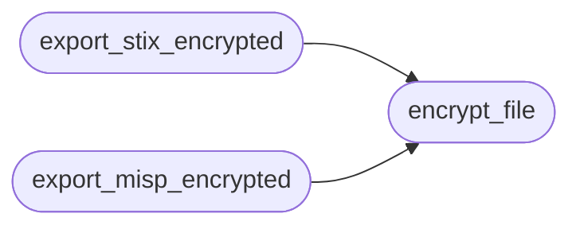

# `estorides_export.encryption`

> Source: [estorides_export/encryption.py:1](../../estorides_export/encryption.py#L1) | language `py` | coverage 75.0% | [API index](../index.md)

estorides_export.encryption =========================== Optional age-encrypted report export.

The default export path produces STIX / MISP / GraphML as plaintext
JSON on disk, which is fine for a local single-user install. For
deployments where the report itself is the deliverable (analyst
hands a file to a customer, regulator, court), the file should be
encrypted at rest with a recipient's public key.

This module wraps the optional `age` encryption tool (`age` is a
modern, audited replacement for gpg; the binary is `age` from
https://age-encryption.org). If `age` is not on PATH the export
falls back to a plaintext file and logs a warning — never to a
broken file. This is the "graceful degradation" posture: the
operator decides whether encryption is required by whether the
recipient public key is set.

Three entry points:

  encrypt_file(plaintext_path, recipient_pubkey) -> ciphertext_path
    Encrypts a single file to a recipient's age public key. The
    resulting file is `<name>.age` next to the original. Returns
    the ciphertext path.

  export_stix_encrypted(kg, recipient_pubkey, path) -> ciphertext_path
  export_misp_encrypted(kg, recipient_pubkey, path) -> ciphertext_path
    Composed: build the bundle, write to a tempfile, encrypt in
    place, return the .age path.

A recipient public key looks like `age1ql3z7hjy54pw3hyww5ayyfg7zqgvc7w3j2elw8zmrj2kg5sfn9aqmcac8p`.

## Contents

- **Functions:** [`encrypt_file`](#encrypt_file), [`export_stix_encrypted`](#export_stix_encrypted), [`export_misp_encrypted`](#export_misp_encrypted)

## Call Graph

Solid arrows stay in this module, dashed arrows leave it.



## Functions

<a id="encrypt_file"></a>

### `encrypt_file`

`function` | [estorides_export/encryption.py:51](../../estorides_export/encryption.py#L51)

```python
def encrypt_file(plaintext_path: Path, recipient_pubkey: str) -> Path
```

Encrypt `plaintext_path` to `<plaintext_path>.age` for the recipient.

Returns the ciphertext path. Raises RuntimeError if `age` is
missing or the encryption subprocess fails — the orchestrator
catches and falls back to plaintext. Raises ValueError if
`recipient_pubkey` doesn't look like an age public key.

Validation order is: key shape (cheap, no exec) → binary
presence (filesystem stat) → subprocess. A malformed key is
always a programmer error and surfaces as ValueError; a missing
binary is an environment problem and surfaces as RuntimeError.

**Parameters**

| Name | Type | Default | Description |
|---|---|---|---|
| `plaintext_path` | `Path` |  |  |
| `recipient_pubkey` | `str` |  |  |

**Returns:** `Path`

**Raises**

- `RuntimeError`: (raised in the body, not documented)
- `ValueError`: (raised in the body, not documented)

*Called by:* [`export_misp_encrypted`](#export_misp_encrypted), [`export_stix_encrypted`](#export_stix_encrypted)

---

<a id="export_stix_encrypted"></a>

### `export_stix_encrypted`

`function` | [estorides_export/encryption.py:100](../../estorides_export/encryption.py#L100)

```python
def export_stix_encrypted(kg: KnowledgeGraph, recipient_pubkey: str, path: Path) -> Path
```

Build the STIX bundle, write to disk, encrypt to <path>.age.

[`path`](estorides_core.audit.py.md#auditevent-path) is the plaintext filename; the returned path is the
encrypted artefact next to it. The plaintext is removed once
encryption succeeds so reports/ never accumulates raw intel
bundles — that was the disk-residue problem fixed for issue #8.

**Parameters**

| Name | Type | Default | Description |
|---|---|---|---|
| `kg` | `KnowledgeGraph` |  |  |
| `recipient_pubkey` | `str` |  |  |
| `path` | `Path` |  |  |

**Returns:** `Path`

*Calls:* [`encrypt_file`](#encrypt_file)

*Called by:* [`create_app`](estorides_web.py.md#create_app)

---

<a id="export_misp_encrypted"></a>

### `export_misp_encrypted`

`function` | [estorides_export/encryption.py:128](../../estorides_export/encryption.py#L128)

```python
def export_misp_encrypted(kg: KnowledgeGraph, recipient_pubkey: str, path: Path) -> Path
```

**Parameters**

| Name | Type | Default | Description |
|---|---|---|---|
| `kg` | `KnowledgeGraph` |  |  |
| `recipient_pubkey` | `str` |  |  |
| `path` | `Path` |  |  |

**Returns:** `Path`

*Calls:* [`encrypt_file`](#encrypt_file)

*Called by:* [`create_app`](estorides_web.py.md#create_app)

---
