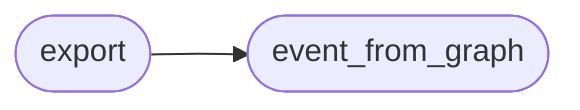

# `estorides_export.misp`

> Source: [estorides_export/misp.py:1](../../estorides_export/misp.py#L1) | language `py` | coverage 33.3% | [API index](../index.md)

estorides_export.misp ===================== Minimal MISP event JSON.

Mirrors STIX in spirit but matches the MISP galaxy/cluster schema used by the MISP project.

This is *not* a complete MISP integration — it's enough to import
into MISP as an event.

## Contents

- **Functions:** [`event_from_graph`](#event_from_graph), [`export`](#export)
- **Constants:** [`TYPE_MAP`](#type_map)

## Call Graph

Solid arrows stay in this module, dashed arrows leave it.



## Functions

<a id="event_from_graph"></a>

### `event_from_graph`

`function` | [estorides_export/misp.py:36](../../estorides_export/misp.py#L36)

```python
def event_from_graph(kg: KnowledgeGraph, *, name: str = 'Estorides Run') -> Dict[str, Any]
```

**Parameters**

| Name | Type | Default | Description |
|---|---|---|---|
| `kg` | `KnowledgeGraph` |  |  |
| `name` | `str` | `'Estorides Run'` |  |

**Returns:** `Dict[str, Any]`

*Called by:* [`export`](#export)

---

<a id="export"></a>

### `export`

`function` | [estorides_export/misp.py:79](../../estorides_export/misp.py#L79)

```python
def export(kg: KnowledgeGraph, path: Path = MISP_EVENT_PATH) -> Path
```

**Parameters**

| Name | Type | Default | Description |
|---|---|---|---|
| `kg` | `KnowledgeGraph` |  |  |
| `path` | `Path` | `MISP_EVENT_PATH` |  |

**Returns:** `Path`

*Calls:* [`event_from_graph`](#event_from_graph)

---

## Constants

<a id="type_map"></a>

### `TYPE_MAP`

`constant` | [estorides_export/misp.py:25](../../estorides_export/misp.py#L25)

```python
TYPE_MAP
```

---
