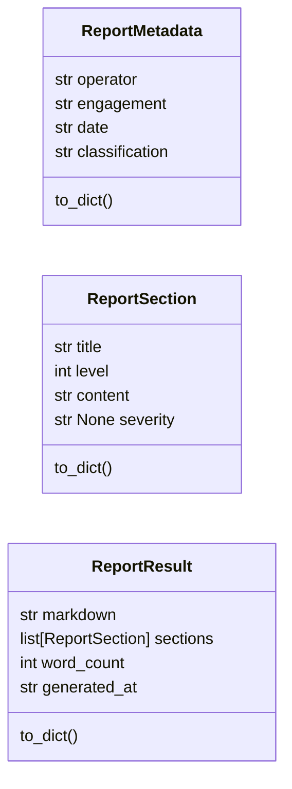
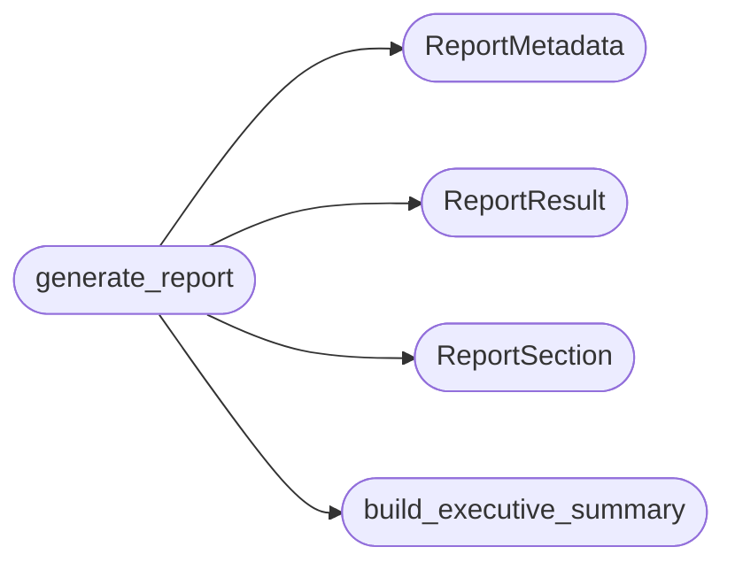

# `estorides_export.recon_report`

> Source: [estorides_export/recon_report.py:1](../../estorides_export/recon_report.py#L1) | language `py` | coverage 0.0% | [API index](../index.md)

## Contents

- **Classes:** [`ReportMetadata`](#reportmetadata), [`ReportSection`](#reportsection), [`ReportResult`](#reportresult)
- **Functions:** [`redact_sensitive`](#redact_sensitive), [`build_subdomain_tree`](#build_subdomain_tree), [`build_executive_summary`](#build_executive_summary), [`generate_report`](#generate_report)
- **Constants:** [`REDACT_PATTERNS`](#redact_patterns)

## Type Diagram



## Call Graph

Solid arrows stay in this module, dashed arrows leave it.



## Classes

<a id="reportmetadata"></a>

### `ReportMetadata`

`class` `dataclass` | [estorides_export/recon_report.py:23](../../estorides_export/recon_report.py#L23)

Decorators: `@dataclass`

```python
class ReportMetadata
```

**Attributes**

| Name | Type | Default | Description |
|---|---|---|---|
| [`operator`](#reportmetadata-operator) | `str` | `''` |  |
| [`engagement`](#reportmetadata-engagement) | `str` | `''` |  |
| [`date`](#reportmetadata-date) | `str` | `''` |  |
| [`classification`](#reportmetadata-classification) | `str` | `'TLP:AMBER'` |  |

**Members**

| Member | Kind | Summary |
|---|---|---|
| [`to_dict`](#reportmetadata-to_dict) | method |  |

<a id="reportmetadata-to_dict"></a>

#### `ReportMetadata.to_dict`

`method` | [estorides_export/recon_report.py:35](../../estorides_export/recon_report.py#L35)

```python
def to_dict(self) -> dict[str, Any]
```

**Returns:** `dict[str, Any]`

---

<a id="reportsection"></a>

### `ReportSection`

`class` `dataclass` | [estorides_export/recon_report.py:40](../../estorides_export/recon_report.py#L40)

Decorators: `@dataclass`

```python
class ReportSection
```

**Attributes**

| Name | Type | Default | Description |
|---|---|---|---|
| [`title`](#reportsection-title) | `str` |  |  |
| [`level`](#reportsection-level) | `int` |  |  |
| [`content`](#reportsection-content) | `str` |  |  |
| [`severity`](#reportsection-severity) | `str \| None` | `None` |  |

**Members**

| Member | Kind | Summary |
|---|---|---|
| [`to_dict`](#reportsection-to_dict) | method |  |

<a id="reportsection-to_dict"></a>

#### `ReportSection.to_dict`

`method` | [estorides_export/recon_report.py:46](../../estorides_export/recon_report.py#L46)

```python
def to_dict(self) -> dict[str, Any]
```

**Returns:** `dict[str, Any]`

---

<a id="reportresult"></a>

### `ReportResult`

`class` `dataclass` | [estorides_export/recon_report.py:51](../../estorides_export/recon_report.py#L51)

Decorators: `@dataclass`

```python
class ReportResult
```

**Attributes**

| Name | Type | Default | Description |
|---|---|---|---|
| [`markdown`](#reportresult-markdown) | `str` | `''` |  |
| [`sections`](#reportresult-sections) | `list[ReportSection]` | `field(default_factory=list)` |  |
| [`word_count`](#reportresult-word_count) | `int` | `0` |  |
| [`generated_at`](#reportresult-generated_at) | `str` | `''` |  |

**Members**

| Member | Kind | Summary |
|---|---|---|
| [`to_dict`](#reportresult-to_dict) | method |  |

<a id="reportresult-to_dict"></a>

#### `ReportResult.to_dict`

`method` | [estorides_export/recon_report.py:57](../../estorides_export/recon_report.py#L57)

```python
def to_dict(self) -> dict[str, Any]
```

**Returns:** `dict[str, Any]`

---

## Functions

<a id="redact_sensitive"></a>

### `redact_sensitive`

`function` | [estorides_export/recon_report.py:61](../../estorides_export/recon_report.py#L61)

```python
def redact_sensitive(text: str) -> str
```

**Parameters**

| Name | Type | Default | Description |
|---|---|---|---|
| `text` | `str` |  |  |

**Returns:** `str`

---

<a id="build_subdomain_tree"></a>

### `build_subdomain_tree`

`function` | [estorides_export/recon_report.py:67](../../estorides_export/recon_report.py#L67)

```python
def build_subdomain_tree(subdomains: list[str]) -> str
```

**Parameters**

| Name | Type | Default | Description |
|---|---|---|---|
| `subdomains` | `list[str]` |  |  |

**Returns:** `str`

---

<a id="build_executive_summary"></a>

### `build_executive_summary`

`function` | [estorides_export/recon_report.py:92](../../estorides_export/recon_report.py#L92)

```python
def build_executive_summary(critical_findings: list[str], total_targets: int, domain: str, classification: str = 'TLP:AMBER') -> str
```

**Parameters**

| Name | Type | Default | Description |
|---|---|---|---|
| `critical_findings` | `list[str]` |  |  |
| `total_targets` | `int` |  |  |
| `domain` | `str` |  |  |
| `classification` | `str` | `'TLP:AMBER'` |  |

**Returns:** `str`

*Called by:* [`generate_report`](#generate_report)

---

<a id="generate_report"></a>

### `generate_report`

`function` | [estorides_export/recon_report.py:115](../../estorides_export/recon_report.py#L115)

```python
def generate_report(query: str, target_scoring: dict[str, Any], metadata: ReportMetadata) -> ReportResult
```

**Parameters**

| Name | Type | Default | Description |
|---|---|---|---|
| `query` | `str` |  |  |
| `target_scoring` | `dict[str, Any]` |  |  |
| `metadata` | `ReportMetadata` |  |  |

**Returns:** `ReportResult`

*Calls:* [`ReportMetadata`](#reportmetadata), [`ReportResult`](#reportresult), [`ReportSection`](#reportsection), [`build_executive_summary`](#build_executive_summary)

---

## Constants

<a id="redact_patterns"></a>

### `REDACT_PATTERNS`

`constant` | [estorides_export/recon_report.py:11](../../estorides_export/recon_report.py#L11)

```python
REDACT_PATTERNS: list[re.Pattern[Any]]
```

---
