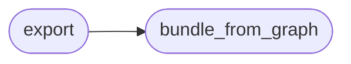

# `estorides_export.stix`

> Source: [estorides_export/stix.py:1](../../estorides_export/stix.py#L1) | language `py` | coverage 33.3% | [API index](../index.md)

estorides_export.stix ===================== STIX 2.1 bundle export.

Each unique entity becomes a STIX object (identity, ipv4-addr, domain-name, email-addr, software, vulnerability, url). Co-occurrences become sighting relationships. Sourced by the identity "Estorides".

Spec: https://docs.oasis-open.org/cti/stix/v2.1/cs01/stix-v2.1-cs01.html

## Contents

- **Functions:** [`bundle_from_graph`](#bundle_from_graph), [`export`](#export)
- **Constants:** [`IDENTITY_REF`](#identity_ref), [`ENTITY_TO_STIX`](#entity_to_stix)

## Call Graph

Solid arrows stay in this module, dashed arrows leave it.



## Functions

<a id="bundle_from_graph"></a>

### `bundle_from_graph`

`function` | [estorides_export/stix.py:55](../../estorides_export/stix.py#L55)

```python
def bundle_from_graph(kg: KnowledgeGraph, *, name: str = 'Estorides Run') -> Dict[str, Any]
```

**Parameters**

| Name | Type | Default | Description |
|---|---|---|---|
| `kg` | `KnowledgeGraph` |  |  |
| `name` | `str` | `'Estorides Run'` |  |

**Returns:** `Dict[str, Any]`

*Called by:* [`export`](#export)

---

<a id="export"></a>

### `export`

`function` | [estorides_export/stix.py:145](../../estorides_export/stix.py#L145)

```python
def export(kg: KnowledgeGraph, path: Path = STIX_BUNDLE_PATH) -> Path
```

**Parameters**

| Name | Type | Default | Description |
|---|---|---|---|
| `kg` | `KnowledgeGraph` |  |  |
| `path` | `Path` | `STIX_BUNDLE_PATH` |  |

**Returns:** `Path`

*Calls:* [`bundle_from_graph`](#bundle_from_graph)

---

## Constants

<a id="identity_ref"></a>

### `IDENTITY_REF`

`constant` | [estorides_export/stix.py:25](../../estorides_export/stix.py#L25)

```python
IDENTITY_REF = 'identity--estorides-1'
```

---

<a id="entity_to_stix"></a>

### `ENTITY_TO_STIX`

`constant` | [estorides_export/stix.py:37](../../estorides_export/stix.py#L37)

```python
ENTITY_TO_STIX
```

---
