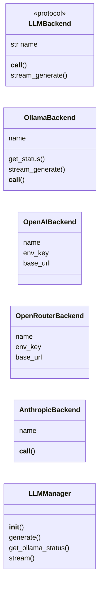
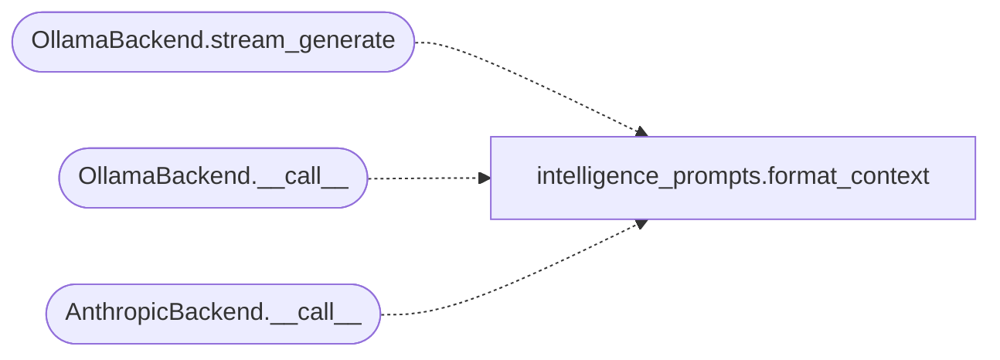

# `estorides_llm.manager`

> Source: [estorides_llm/manager.py:1](../../estorides_llm/manager.py#L1) | language `py` | coverage 55.6% | [API index](../index.md)

estorides_llm.manager ===================== Multi-backend LLM router with pluggable backends.

A [`LLMBackend`](#llmbackend) is a small Protocol that knows how to talk to one
provider (ollama, openai, anthropic, openrouter, …). Backends register
themselves in [`BACKENDS`](#backends) and the manager walks the list in priority
order, returning the first successful response.

This is the registry pattern in place of the old if/elif chain that
hard-coded a method per backend. Adding a new provider is now: write
a class, `@register("name")` it, done. No edits to the manager.

System prompt lives in `intelligence_prompts.py` so multiple prompts
(BLUF, tactical, standard) can be selected per call without
forking the manager.

## Contents

- **Classes:** [`OllamaBackend`](#ollamabackend), [`OpenAIBackend`](#openaibackend), [`OpenRouterBackend`](#openrouterbackend), [`AnthropicBackend`](#anthropicbackend), [`LLMManager`](#llmmanager)
- **Protocols:** [`LLMBackend`](#llmbackend)
- **Functions:** [`register`](#register)
- **Constants:** [`PREFERRED_OLLAMA_MODELS`](#preferred_ollama_models), [`BACKENDS`](#backends), [`DEFAULT_PRIORITY`](#default_priority)

## Type Diagram



## Call Graph

Solid arrows stay in this module, dashed arrows leave it.



## Classes

<a id="ollamabackend"></a>

### `OllamaBackend`

`class` | [estorides_llm/manager.py:120](../../estorides_llm/manager.py#L120)

Decorators: `@register('ollama')`

```python
class OllamaBackend
```

**Attributes**

| Name | Type | Default | Description |
|---|---|---|---|
| [`name`](#ollamabackend-name) |  | `'ollama'` |  |

**Members**

| Member | Kind | Summary |
|---|---|---|
| [`get_status`](#ollamabackend-get_status) | staticmethod | Return available ollama models and reachability status. |
| [`stream_generate`](#ollamabackend-stream_generate) | method | Stream an ollama response as (kind, text) chunks. |
| [`__call__`](#ollamabackend-__call__) | method |  |

<a id="ollamabackend-get_status"></a>

#### `OllamaBackend.get_status`

`staticmethod` | [estorides_llm/manager.py:124](../../estorides_llm/manager.py#L124)

Decorators: `@staticmethod`

```python
def get_status() -> dict[str, Any]
```

Return available ollama models and reachability status.

**Returns:** `dict[str, Any]`

<a id="ollamabackend-stream_generate"></a>

#### `OllamaBackend.stream_generate`

`method` `generator` | [estorides_llm/manager.py:188](../../estorides_llm/manager.py#L188)

```python
def stream_generate(self, prompt, context, model, temperature, request_timeout)
```

Stream an ollama response as (kind, text) chunks.

kind ∈ {"thinking", "content"} so the UI can render the model's
reasoning preamble into a collapsible "thinking" panel and stream
the final answer below it. Yields dicts, never raises; a hard
``request_timeout`` guards the whole stream.

**Parameters**

| Name | Type | Default | Description |
|---|---|---|---|
| `prompt` |  |  |  |
| `context` |  |  |  |
| `model` |  |  |  |
| `temperature` |  |  |  |
| `request_timeout` |  |  |  |

*Calls:* [`format_context`](estorides_llm.intelligence_prompts.py.md#format_context)

<a id="ollamabackend-__call__"></a>

#### `OllamaBackend.__call__`

`method` | [estorides_llm/manager.py:227](../../estorides_llm/manager.py#L227)

```python
def __call__(self, prompt, context, max_tokens, temperature, request_timeout) -> tuple[str, str]
```

**Parameters**

| Name | Type | Default | Description |
|---|---|---|---|
| `prompt` |  |  |  |
| `context` |  |  |  |
| `max_tokens` |  |  |  |
| `temperature` |  |  |  |
| `request_timeout` |  |  |  |

**Returns:** `tuple[str, str]`

**Raises**

- `RuntimeError`: (raised in the body, not documented)

*Calls:* [`format_context`](estorides_llm.intelligence_prompts.py.md#format_context)

---

<a id="openaibackend"></a>

### `OpenAIBackend`

`class` | [estorides_llm/manager.py:302](../../estorides_llm/manager.py#L302)

Decorators: `@register('openai')`

```python
class OpenAIBackend(_OpenAICompatibleBackend)
```

Bases: `_OpenAICompatibleBackend`

**Attributes**

| Name | Type | Default | Description |
|---|---|---|---|
| [`name`](#openaibackend-name) |  | `'openai'` |  |
| [`env_key`](#openaibackend-env_key) |  | `'OPENAI_API_KEY'` |  |
| [`base_url`](#openaibackend-base_url) |  | `OPENAI_URL` |  |

---

<a id="openrouterbackend"></a>

### `OpenRouterBackend`

`class` | [estorides_llm/manager.py:309](../../estorides_llm/manager.py#L309)

Decorators: `@register('openrouter')`

```python
class OpenRouterBackend(_OpenAICompatibleBackend)
```

Bases: `_OpenAICompatibleBackend`

**Attributes**

| Name | Type | Default | Description |
|---|---|---|---|
| [`name`](#openrouterbackend-name) |  | `'openrouter'` |  |
| [`env_key`](#openrouterbackend-env_key) |  | `'OPENROUTER_API_KEY'` |  |
| [`base_url`](#openrouterbackend-base_url) |  | `OPENROUTER_URL` |  |

---

<a id="anthropicbackend"></a>

### `AnthropicBackend`

`class` | [estorides_llm/manager.py:316](../../estorides_llm/manager.py#L316)

Decorators: `@register('anthropic')`

```python
class AnthropicBackend
```

**Attributes**

| Name | Type | Default | Description |
|---|---|---|---|
| [`name`](#anthropicbackend-name) |  | `'anthropic'` |  |

**Members**

| Member | Kind | Summary |
|---|---|---|
| [`__call__`](#anthropicbackend-__call__) | method |  |

<a id="anthropicbackend-__call__"></a>

#### `AnthropicBackend.__call__`

`method` | [estorides_llm/manager.py:319](../../estorides_llm/manager.py#L319)

```python
def __call__(self, prompt, context, max_tokens, temperature, request_timeout) -> tuple[str, str]
```

**Parameters**

| Name | Type | Default | Description |
|---|---|---|---|
| `prompt` |  |  |  |
| `context` |  |  |  |
| `max_tokens` |  |  |  |
| `temperature` |  |  |  |
| `request_timeout` |  |  |  |

**Returns:** `tuple[str, str]`

**Raises**

- `RuntimeError`: (raised in the body, not documented)

*Calls:* [`format_context`](estorides_llm.intelligence_prompts.py.md#format_context)

---

<a id="llmmanager"></a>

### `LLMManager`

`class` | [estorides_llm/manager.py:356](../../estorides_llm/manager.py#L356)

```python
class LLMManager
```

**Members**

| Member | Kind | Summary |
|---|---|---|
| [`__init__`](#llmmanager-__init__) | constructor |  |
| [`generate`](#llmmanager-generate) | method | Try each backend in priority order; return the first that succeeds. |
| [`get_ollama_status`](#llmmanager-get_ollama_status) | method | Return ollama reachability and available models. |
| [`stream`](#llmmanager-stream) | method | Stream an analysis from a specific ollama model. |

<a id="llmmanager-__init__"></a>

#### `LLMManager.__init__`

`constructor` | [estorides_llm/manager.py:357](../../estorides_llm/manager.py#L357)

```python
def __init__(self) -> None
```

*Called by:* [`Orchestrator.__init__`](estorides_core.orchestrator.py.md#orchestrator-__init__)

<a id="llmmanager-generate"></a>

#### `LLMManager.generate`

`method` | [estorides_llm/manager.py:373](../../estorides_llm/manager.py#L373)

```python
def generate(self, prompt: str, *, context: list[dict[str, Any]] | None = None, max_tokens: int = LLM_MAX_TOKENS, temperature: float = LLM_TEMPERATURE, request_timeout: float = LLM_REQUEST_TIMEOUT) -> dict[str, Any]
```

Try each backend in priority order; return the first that succeeds.

`request_timeout` caps every backend's HTTP call so a slow
local model cannot keep a worker thread alive past the
orchestrator's deadline. Returns a dict with keys:
backend, model, content, error.

**Parameters**

| Name | Type | Default | Description |
|---|---|---|---|
| `prompt` | `str` |  |  |
| `context` | `list[dict[str, Any]] \| None` | `None` |  |
| `max_tokens` | `int` | `LLM_MAX_TOKENS` |  |
| `temperature` | `float` | `LLM_TEMPERATURE` |  |
| `request_timeout` | `float` | `LLM_REQUEST_TIMEOUT` |  |

**Returns:** `dict[str, Any]`

<a id="llmmanager-get_ollama_status"></a>

#### `LLMManager.get_ollama_status`

`method` | [estorides_llm/manager.py:414](../../estorides_llm/manager.py#L414)

```python
def get_ollama_status(self) -> dict[str, Any]
```

Return ollama reachability and available models.

**Returns:** `dict[str, Any]`

<a id="llmmanager-stream"></a>

#### `LLMManager.stream`

`method` `generator` | [estorides_llm/manager.py:422](../../estorides_llm/manager.py#L422)

```python
def stream(self, prompt: str, *, context: list[dict[str, Any]] | None = None, model: str | None = None, temperature: float = LLM_TEMPERATURE, request_timeout: float = LLM_REQUEST_TIMEOUT) -> Any
```

Stream an analysis from a specific ollama model.

Yields ``{"kind": "thinking"|"content", "text": …}`` chunks. The
model name is treated as hostile: it must match an actual ollama
model, else we raise before touching the network. If no model is
given, we fall back to the auto-detected fast default.

**Parameters**

| Name | Type | Default | Description |
|---|---|---|---|
| `prompt` | `str` |  |  |
| `context` | `list[dict[str, Any]] \| None` | `None` |  |
| `model` | `str \| None` | `None` |  |
| `temperature` | `float` | `LLM_TEMPERATURE` |  |
| `request_timeout` | `float` | `LLM_REQUEST_TIMEOUT` |  |

**Returns:** `Any`

**Raises**

- `RuntimeError`: (raised in the body, not documented)

---

## Protocols

<a id="llmbackend"></a>

### `LLMBackend`

`protocol` | [estorides_llm/manager.py:60](../../estorides_llm/manager.py#L60)

```python
class LLMBackend(Protocol)
```

Bases: `Protocol`

Minimal contract for an LLM backend.

Implementations MUST be total: raise on failure (the manager
catches and moves on) or return ("", "") to signal "I can't
answer, try the next backend".

**Attributes**

| Name | Type | Default | Description |
|---|---|---|---|
| [`name`](#llmbackend-name) | `str` |  |  |

**Members**

| Member | Kind | Summary |
|---|---|---|
| [`__call__`](#llmbackend-__call__) | method | Return (content, model_id). |
| [`stream_generate`](#llmbackend-stream_generate) | method | Optional: stream (kind, text) chunks. |

<a id="llmbackend-__call__"></a>

#### `LLMBackend.__call__`

`method` | [estorides_llm/manager.py:69](../../estorides_llm/manager.py#L69)

```python
def __call__(self, prompt: str, context: list[dict[str, Any]] | None, max_tokens: int, temperature: float, request_timeout: float) -> tuple[str, str]
```

Return (content, model_id).

Empty content means "skip me".

**Parameters**

| Name | Type | Default | Description |
|---|---|---|---|
| `prompt` | `str` |  |  |
| `context` | `list[dict[str, Any]] \| None` |  |  |
| `max_tokens` | `int` |  |  |
| `temperature` | `float` |  |  |
| `request_timeout` | `float` |  |  |

**Returns:** `tuple[str, str]`

<a id="llmbackend-stream_generate"></a>

#### `LLMBackend.stream_generate`

`method` | [estorides_llm/manager.py:80](../../estorides_llm/manager.py#L80)

```python
def stream_generate(self, prompt: str, context: list[dict[str, Any]] | None, model: str, temperature: float, request_timeout: float) -> Any
```

Optional: stream (kind, text) chunks.

Base backends may skip.

**Parameters**

| Name | Type | Default | Description |
|---|---|---|---|
| `prompt` | `str` |  |  |
| `context` | `list[dict[str, Any]] \| None` |  |  |
| `model` | `str` |  |  |
| `temperature` | `float` |  |  |
| `request_timeout` | `float` |  |  |

**Returns:** `Any`

---

## Functions

<a id="register"></a>

### `register`

`function` | [estorides_llm/manager.py:97](../../estorides_llm/manager.py#L97)

```python
def register(name: str) -> Callable[[Any], LLMBackend]
```

Decorator: register a backend under [`name`](#llmbackend-name).

Accepts both an instance and a class. If a class is given, the
decorator instantiates it with no arguments — which is the
common case for stateless backends that hold no per-instance
state. The class must therefore have a no-arg constructor.

**Parameters**

| Name | Type | Default | Description |
|---|---|---|---|
| `name` | `str` |  |  |

**Returns:** `Callable[[Any], LLMBackend]`

---

## Constants

<a id="preferred_ollama_models"></a>

### `PREFERRED_OLLAMA_MODELS`

`constant` | [estorides_llm/manager.py:49](../../estorides_llm/manager.py#L49)

```python
PREFERRED_OLLAMA_MODELS: tuple[str, ...]
```

---

<a id="backends"></a>

### `BACKENDS`

`constant` | [estorides_llm/manager.py:93](../../estorides_llm/manager.py#L93)

```python
BACKENDS: dict[str, LLMBackend] = {}
```

name -> backend instance.

Populated by `@register` and module import.

---

<a id="default_priority"></a>

### `DEFAULT_PRIORITY`

`constant` | [estorides_llm/manager.py:353](../../estorides_llm/manager.py#L353)

```python
DEFAULT_PRIORITY: tuple[str, ...] = ('ollama', 'openrouter', 'anthropic', 'openai')
```

---
