# `estorides_web`

> Source: [estorides_web.py:1](../../estorides_web.py#L1) | language `py` | coverage 50.0% | [API index](../index.md)

estorides.web ============= Flask app providing: * 2D map     (Leaflet) * knowledge graph (D3.js force-directed) * timeline * source results panel * multi-LLM analysis

## Contents

- **Functions:** [`create_app`](#create_app)
- **Constants:** [`RUN_STREAM_JOBS`](#run_stream_jobs)

## Call Graph

Solid arrows stay in this module, dashed arrows leave it.

```mermaid
flowchart LR
    n_estorides_web_py__create_app(["create_app"])
    n_estorides_core_discoverer_py__start_discover_threadsafe["discoverer.start_discover_threadsafe"]
    n_estorides_core_entity_extraction_py__detect_query_type["entity_extraction.detect_query_type"]
    n_estorides_core_feeds_py__fetch_all["feeds.fetch_all"]
    n_estorides_core_feeds_py__list_feeds["feeds.list_feeds"]
    n_estorides_core_fusion_analytics_py__FusionAnalytics___init__["fusion_analytics.FusionAnalytics.__init__"]
    n_estorides_core_graph_force_py__build_force_payload["graph_force.build_force_payload"]
    n_estorides_core_graph_force_py__force_settings["graph_force.force_settings"]
    n_estorides_core_knowledge_graph_py__KnowledgeGraph___init__["knowledge_graph.KnowledgeGraph.__init__"]
    n_estorides_core_knowledge_graph_py__KnowledgeGraph_communities["knowledge_graph.KnowledgeGraph.communities"]
    n_estorides_core_knowledge_graph_py__KnowledgeGraph_export_graphml["knowledge_graph.KnowledgeGraph.export_graphml"]
    n_estorides_core_knowledge_graph_py__KnowledgeGraph_export_json["knowledge_graph.KnowledgeGraph.export_json"]
    n_estorides_core_knowledge_graph_py__KnowledgeGraph_intel_level["knowledge_graph.KnowledgeGraph.intel_level"]
    n_estorides_core_knowledge_graph_py__KnowledgeGraph_summary["knowledge_graph.KnowledgeGraph.summary"]
    n_estorides_core_knowledge_graph_py__KnowledgeGraph_top_entities["knowledge_graph.KnowledgeGraph.top_entities"]
    n_estorides_core_lan_runner_py__scan["lan_runner.scan"]
    n_estorides_core_lan_scope_py__read_local_interfaces["lan_scope.read_local_interfaces"]
    n_estorides_core_openapi_py__build_openapi["openapi.build_openapi"]
    n_estorides_core_ops_observability_py__health_payload["ops_observability.health_payload"]
    n_estorides_core_ops_observability_py__ready_payload["ops_observability.ready_payload"]
    n_estorides_core_ops_observability_py__render_metrics["ops_observability.render_metrics"]
    n_estorides_core_orchestrator_py__Orchestrator___init__["orchestrator.Orchestrator.__init__"]
    n_estorides_core_orchestrator_py__Orchestrator_run["orchestrator.Orchestrator.run"]
    n_estorides_core_orchestrator_py__pending_system_app_tasks["orchestrator.pending_system_app_tasks"]
    n_estorides_core_osiris_sources_py__fetch_bgp["osiris_sources.fetch_bgp"]
    n_estorides_web_py__create_app -.-> n_estorides_core_discoverer_py__start_discover_threadsafe
    n_estorides_web_py__create_app -.-> n_estorides_core_entity_extraction_py__detect_query_type
    n_estorides_web_py__create_app -.-> n_estorides_core_feeds_py__fetch_all
    n_estorides_web_py__create_app -.-> n_estorides_core_feeds_py__list_feeds
    n_estorides_web_py__create_app -.-> n_estorides_core_fusion_analytics_py__FusionAnalytics___init__
    n_estorides_web_py__create_app -.-> n_estorides_core_graph_force_py__build_force_payload
    n_estorides_web_py__create_app -.-> n_estorides_core_graph_force_py__force_settings
    n_estorides_web_py__create_app -.-> n_estorides_core_knowledge_graph_py__KnowledgeGraph___init__
    n_estorides_web_py__create_app -.-> n_estorides_core_knowledge_graph_py__KnowledgeGraph_communities
    n_estorides_web_py__create_app -.-> n_estorides_core_knowledge_graph_py__KnowledgeGraph_export_graphml
    n_estorides_web_py__create_app -.-> n_estorides_core_knowledge_graph_py__KnowledgeGraph_export_json
    n_estorides_web_py__create_app -.-> n_estorides_core_knowledge_graph_py__KnowledgeGraph_intel_level
    n_estorides_web_py__create_app -.-> n_estorides_core_knowledge_graph_py__KnowledgeGraph_summary
    n_estorides_web_py__create_app -.-> n_estorides_core_knowledge_graph_py__KnowledgeGraph_top_entities
    n_estorides_web_py__create_app -.-> n_estorides_core_lan_runner_py__scan
    n_estorides_web_py__create_app -.-> n_estorides_core_lan_scope_py__read_local_interfaces
    n_estorides_web_py__create_app -.-> n_estorides_core_openapi_py__build_openapi
    n_estorides_web_py__create_app -.-> n_estorides_core_ops_observability_py__health_payload
    n_estorides_web_py__create_app -.-> n_estorides_core_ops_observability_py__ready_payload
    n_estorides_web_py__create_app -.-> n_estorides_core_ops_observability_py__render_metrics
    n_estorides_web_py__create_app -.-> n_estorides_core_orchestrator_py__Orchestrator___init__
    n_estorides_web_py__create_app -.-> n_estorides_core_orchestrator_py__Orchestrator_run
    n_estorides_web_py__create_app -.-> n_estorides_core_orchestrator_py__pending_system_app_tasks
    n_estorides_web_py__create_app -.-> n_estorides_core_osiris_sources_py__fetch_bgp
```



## Functions

<a id="create_app"></a>

### `create_app`

`function` | [estorides_web.py:258](../../estorides_web.py#L258)

```python
def create_app() -> Flask
```

**Returns:** `Flask`

*Calls:* [`start_discover_threadsafe`](estorides_core.discoverer.py.md#start_discover_threadsafe), [`detect_query_type`](estorides_core.entity_extraction.py.md#detect_query_type), [`fetch_all`](estorides_core.feeds.py.md#fetch_all), [`list_feeds`](estorides_core.feeds.py.md#list_feeds), [`FusionAnalytics.__init__`](estorides_core.fusion_analytics.py.md#fusionanalytics-__init__), [`build_force_payload`](estorides_core.graph_force.py.md#build_force_payload), [`force_settings`](estorides_core.graph_force.py.md#force_settings), [`KnowledgeGraph.__init__`](estorides_core.knowledge_graph.py.md#knowledgegraph-__init__), [`KnowledgeGraph.communities`](estorides_core.knowledge_graph.py.md#knowledgegraph-communities), [`KnowledgeGraph.export_graphml`](estorides_core.knowledge_graph.py.md#knowledgegraph-export_graphml), [`KnowledgeGraph.export_json`](estorides_core.knowledge_graph.py.md#knowledgegraph-export_json), [`KnowledgeGraph.intel_level`](estorides_core.knowledge_graph.py.md#knowledgegraph-intel_level) and 27 more

*Called by:* [`cmd_serve`](estorides_cli.py.md#cmd_serve), [`collect`](tools.sync_docs.py.md#collect)

---

## Constants

<a id="run_stream_jobs"></a>

### `RUN_STREAM_JOBS`

`constant` | [estorides_web.py:181](../../estorides_web.py#L181)

```python
RUN_STREAM_JOBS: BoundedJobRegistry
```

---
