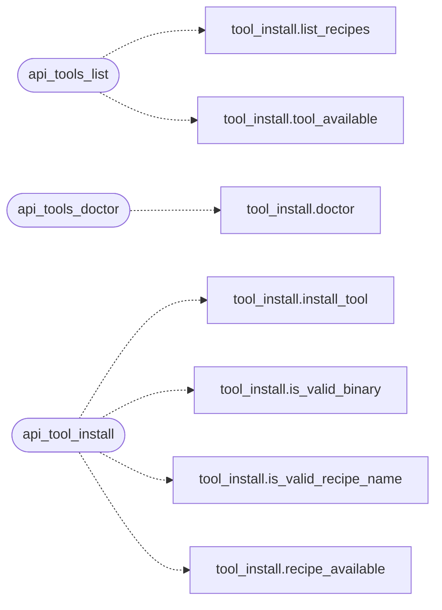

# `estorides_web_tools`

> Source: [estorides_web_tools.py:1](../../estorides_web_tools.py#L1) | language `py` | coverage 20.0% | [API index](../index.md)

estorides_web_tools =================== Tools vertical slice extracted from the `[`create_app`](estorides_web.py.md#create_app)` God factory.

Owns the install-state registry and the four ``/api/tools*`` routes
with identical URLs, auth, rate-limit events and behaviours. The
factory registers `tools_bp`; no tools view logic stays inline.

Import cycle note: this module is imported lazily inside
`[`create_app`](estorides_web.py.md#create_app)` (call time, after `[`estorides_web`](estorides_web.py.md)` is fully loaded),
so top-level imports of the factory helpers are safe.

## Contents

- **Functions:** [`api_tools_list`](#api_tools_list), [`api_tools_doctor`](#api_tools_doctor), [`api_tool_install`](#api_tool_install), [`api_tool_install_status`](#api_tool_install_status)

## Call Graph

Solid arrows stay in this module, dashed arrows leave it.



## Functions

<a id="api_tools_list"></a>

### `api_tools_list`

`function` | [estorides_web_tools.py:49](../../estorides_web_tools.py#L49)

Decorators: `@tools_bp.route('/api/tools')`, `@_rate_limit_decorator(event='api_tools_list')`, `@require_auth`

```python
def api_tools_list() -> Any
```

**Returns:** `Any`

*Calls:* [`list_recipes`](estorides_core.tool_install.py.md#list_recipes), [`tool_available`](estorides_core.tool_install.py.md#tool_available)

---

<a id="api_tools_doctor"></a>

### `api_tools_doctor`

`function` | [estorides_web_tools.py:68](../../estorides_web_tools.py#L68)

Decorators: `@tools_bp.route('/api/tools/doctor')`, `@_rate_limit_decorator(event='api_tools_doctor')`, `@require_auth`

```python
def api_tools_doctor() -> Any
```

**Returns:** `Any`

*Calls:* [`doctor`](estorides_core.tool_install.py.md#doctor)

---

<a id="api_tool_install"></a>

### `api_tool_install`

`function` | [estorides_web_tools.py:75](../../estorides_web_tools.py#L75)

Decorators: `@tools_bp.route('/api/tools/<name>/install', methods=['POST'])`, `@_rate_limit_decorator(event='api_tool_install')`, `@require_auth`

```python
def api_tool_install(name: str) -> Any
```

**Parameters**

| Name | Type | Default | Description |
|---|---|---|---|
| `name` | `str` |  |  |

**Returns:** `Any`

*Calls:* [`install_tool`](estorides_core.tool_install.py.md#install_tool), [`is_valid_binary`](estorides_core.tool_install.py.md#is_valid_binary), [`is_valid_recipe_name`](estorides_core.tool_install.py.md#is_valid_recipe_name), [`recipe_available`](estorides_core.tool_install.py.md#recipe_available)

---

<a id="api_tool_install_status"></a>

### `api_tool_install_status`

`function` | [estorides_web_tools.py:120](../../estorides_web_tools.py#L120)

Decorators: `@tools_bp.route('/api/tools/<name>/install/status')`, `@_rate_limit_decorator(event='api_tool_install_status')`, `@require_auth`

```python
def api_tool_install_status(name: str) -> Any
```

**Parameters**

| Name | Type | Default | Description |
|---|---|---|---|
| `name` | `str` |  |  |

**Returns:** `Any`

---
