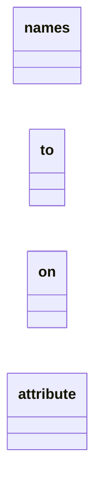
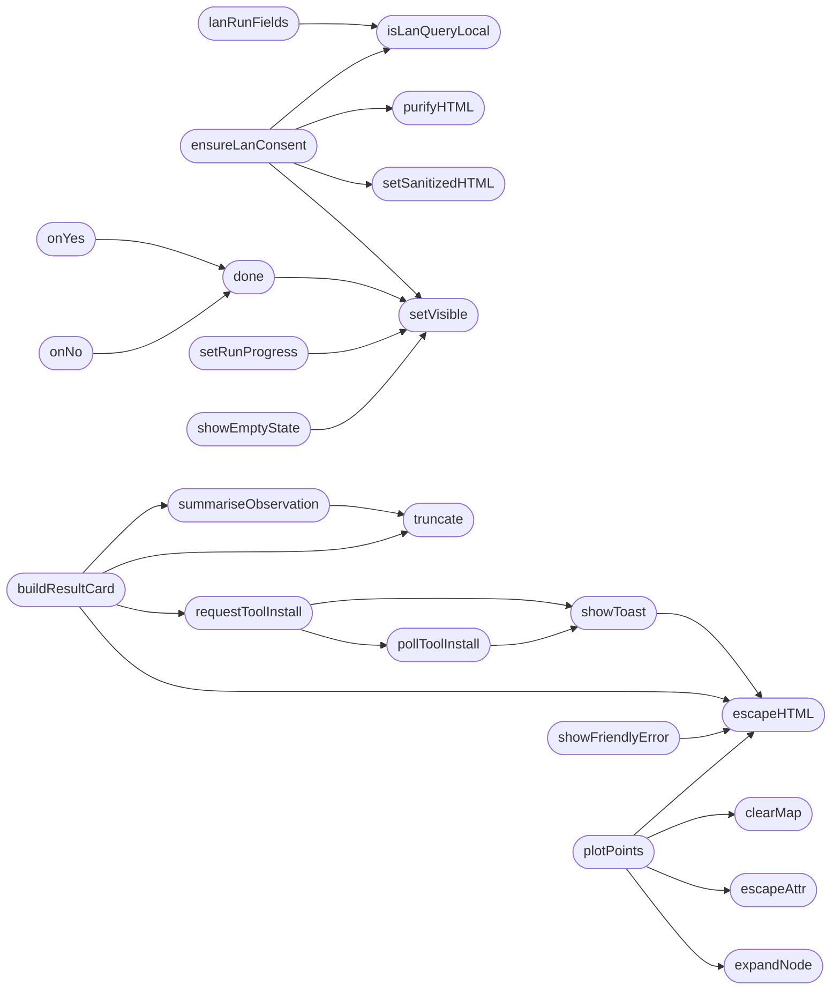

# `static/js/estorides.js`

> Source: [static/js/estorides.js:1](../../static/js/estorides.js#L1) | language `js` | coverage 25.0% | [API index](../index.md)

Estorides front-end controller

## Contents

- **Classes:** [`names`](#names), [`to`](#to), [`on`](#on), [`attribute`](#attribute)
- **Functions:** [`setVisible`](#setvisible), [`isLanQueryLocal`](#islanquerylocal), [`t`](#t), [`lanRunFields`](#lanrunfields), [`ensureLanConsent`](#ensurelanconsent), [`safe`](#safe), [`done`](#done), [`onYes`](#onyes), [`onNo`](#onno), [`set`](#set), [`TELEMETRY`](#telemetry), [`detectQueryTypeLocal`](#detectquerytypelocal), [`showToast`](#showtoast), [`updateQueryChip`](#updatequerychip), [`setRunProgress`](#setrunprogress), [`showEmptyState`](#showemptystate), [`summariseObservation`](#summariseobservation), [`buildResultCard`](#buildresultcard), [`toolBinary`](#toolbinary), [`status`](#status), [`requestToolInstall`](#requesttoolinstall), [`pollToolInstall`](#polltoolinstall), [`out`](#out), [`populateCategoryFilter`](#populatecategoryfilter), [`applyResultFilters`](#applyresultfilters), [`text`](#text), [`cat`](#cat), [`status`](#status), [`bindResultFilters`](#bindresultfilters), [`showFriendlyError`](#showfriendlyerror), [`focusGraphNodeByValue`](#focusgraphnodebyvalue), [`switchSidebarTab`](#switchsidebartab), [`switchCanvasTab`](#switchcanvastab), [`clearMap`](#clearmap), [`plotPoints`](#plotpoints), [`aeroEnabledSet`](#aeroenabledset), [`aeroPersist`](#aeropersist), [`aeroStatus`](#aerostatus), [`aeroBboxParam`](#aerobboxparam), [`aeroPopup`](#aeropopup), [`aeroRenderLayer`](#aerorenderlayer), [`loadAeroFeeds`](#loadaerofeeds), [`points`](#points), [`initAerospaceLayers`](#initaerospacelayers), [`replotStreamData`](#replotstreamdata), [`stopRunStream`](#stoprunstream), [`renderLanResults`](#renderlanresults), [`startLanScan`](#startlanscan), [`scope`](#scope), [`msg`](#msg), [`runQuery`](#runquery), [`runQueryBlocking`](#runqueryblocking), [`searchEntity`](#searchentity), [`handleRunStreamEvent`](#handlerunstreamevent), [`appendStreamObservation`](#appendstreamobservation), [`appendStreamEntity`](#appendstreamentity), [`sig`](#sig), [`clearAll`](#clearall), [`setStatus`](#setstatus), [`renderResult`](#renderresult), [`loadAnalysisModels`](#loadanalysismodels), [`renderAnalysisModels`](#renderanalysismodels), [`makeModelPill`](#makemodelpill), [`renderAnalysis`](#renderanalysis), [`renderMarkdownInto`](#rendermarkdowninto), [`setThinkingVisible`](#setthinkingvisible), [`toggleThinking`](#togglethinking), [`reanalyze`](#reanalyze), [`boxQ`](#boxq), [`scheduleRender`](#schedulerender), [`flush`](#flush), [`pump`](#pump), [`analyseEntity`](#analyseentity), [`expandNode`](#expandnode), [`mergeExpansionIntoGraph`](#mergeexpansionintograph), [`k`](#k), [`drawGraphWithExtras`](#drawgraphwithextras), [`pushLink`](#pushlink), [`is3DActive`](#is3dactive), [`CLUSTER_PALETTE`](#cluster_palette), [`resolverTypeFor`](#resolvertypefor), [`saveLevelOverrides`](#saveleveloverrides), [`levelOf`](#levelof), [`clusterColor`](#clustercolor), [`c`](#c), [`safeColor`](#safecolor), [`deriveClusters`](#deriveclusters), [`cid`](#cid), [`hideTooltip`](#hidetooltip), [`purifyHTML`](#purifyhtml), [`setSanitizedHTML`](#setsanitizedhtml), [`showTooltipAt`](#showtooltipat), [`hideContextMenu`](#hidecontextmenu), [`showBridgeTooltip`](#showbridgetooltip), [`labelFor`](#labelfor), [`c`](#c), [`showNodeTooltip`](#shownodetooltip), [`showContextMenu`](#showcontextmenu), [`tr`](#tr), [`setNodeLevel`](#setnodelevel), [`applyLevelStyles`](#applylevelstyles), [`focusNode`](#focusnode), [`barH`](#barh), [`runTransform`](#runtransform), [`runTransformStream`](#runtransformstream), [`flush`](#flush), [`undoGraph`](#undograph), [`k`](#k), [`selectNode`](#selectnode), [`add`](#add), [`addText`](#addtext), [`tr`](#tr), [`renderGraphCore`](#rendergraphcore), [`barH`](#barh), [`drawHulls`](#drawhulls), [`setStatusDot`](#setstatusdot), [`showWorkingIndicator`](#showworkingindicator), [`hideWorkingIndicator`](#hideworkingindicator), [`toggleTierSection`](#toggletiersection), [`renderTieredResults`](#rendertieredresults), [`escapeAttr`](#escapeattr), [`buildMapCoords`](#buildmapcoords), [`validCoord`](#validcoord), [`colorFor`](#colorfor), [`renderEntities`](#renderentities), [`renderGraphSummary`](#rendergraphsummary), [`colorForKind`](#colorforkind), [`renderTimeline`](#rendertimeline), [`obs`](#obs), [`frac`](#frac), [`fmtTime`](#fmttime), [`filterTimeline`](#filtertimeline), [`drawGraph`](#drawgraph), [`loadCases`](#loadcases), [`q`](#q), [`openCaseDetail`](#opencasedetail), [`entities`](#entities), [`obs`](#obs), [`restoreCaseToWorkspace`](#restorecasetoworkspace), [`buildCaseMapCoords`](#buildcasemapcoords), [`renderCaseItem`](#rendercaseitem), [`saved`](#saved), [`debounce`](#debounce), [`escapeHTML`](#escapehtml), [`truncate`](#truncate), [`caseActionSave`](#caseactionsave), [`caseActionDiff`](#caseactiondiff), [`renderCaseDiffPanel`](#rendercasediffpanel), [`rows`](#rows), [`removed`](#removed), [`caseActionReport`](#caseactionreport), [`showReportModal`](#showreportmodal), [`openModal`](#openmodal), [`actions`](#actions), [`close`](#close), [`promptModal`](#promptmodal), [`confirmModal`](#confirmmodal), [`tag`](#tag), [`loadSidebarWidth`](#loadsidebarwidth), [`saveSidebarWidth`](#savesidebarwidth), [`loadSidebarCollapsed`](#loadsidebarcollapsed), [`saveSidebarCollapsed`](#savesidebarcollapsed), [`switchSidebarTab`](#switchsidebartab), [`loadFusionTab`](#loadfusiontab), [`loadFusionStats`](#loadfusionstats), [`loadFusionTopChanged`](#loadfusiontopchanged), [`loadFusionSearch`](#loadfusionsearch), [`doSearch`](#dosearch), [`loadFusionEntityDetail`](#loadfusionentitydetail), [`setStatus`](#setstatus), [`setDiscoverProgress`](#setdiscoverprogress), [`hideDiscoverProgress`](#hidediscoverprogress), [`startDiscover`](#startdiscover), [`stopDiscover`](#stopdiscover), [`handleDiscoverEvent`](#handlediscoverevent), [`addDiscoverEntityToTab`](#adddiscoverentitytotab), [`sig`](#sig), [`escapeHtml`](#escapehtml), [`maybePlotDiscoverEntity`](#maybeplotdiscoverentity), [`flushDiscoverEntities`](#flushdiscoverentities), [`check`](#check)
- **Other Members:** [`setTimeout`](#settimeout), [`fetch`](#fetch)

## Type Diagram



## Call Graph

Solid arrows stay in this module, dashed arrows leave it.



## Classes

<a id="names"></a>

### `names`

`class` | [static/js/estorides.js:460](../../static/js/estorides.js#L460)

```javascript
// One Leaflet layer per keyless aerospace feed. The panel, class names
```

---- Estorides Aerospace map layers ----

---

<a id="to"></a>

### `to`

`class` | [static/js/estorides.js:690](../../static/js/estorides.js#L690)

```javascript
// id is "map", not "map-canvas"), so select by class to stay consistent.
```

Panels are keyed by the `<name>-canvas` class, not by id (the map panel's

---

<a id="on"></a>

### `on`

`class` | [static/js/estorides.js:2394](../../static/js/estorides.js#L2394)

```javascript
// make entities first-class on the map, not just observations.
```

Geolocated entities (parsed.lat / parsed.lon) AND country codes.

Many parsers stash coords on the entity itself (e.g. abuseipdb has a "countryCode" field). The whole point of v1.1 is to

---

<a id="attribute"></a>

### `attribute`

`class` | [static/js/estorides.js:3410](../../static/js/estorides.js#L3410)

```javascript
// Whitelist the intel level before it reaches a class attribute,
```

---

## Functions

<a id="setvisible"></a>

### `setVisible`

`function` | [static/js/estorides.js:12](../../static/js/estorides.js#L12)

```javascript
function setVisible(el, show, display)
```

Show/hide that respects the HTML5 `hidden` attribute.

`[hidden]` is enforced with `!important` (see estorides_ui.css), so toggling inline `style.display` alone can never reveal an element that carries the attribute — the attribute must be cleared too.

**Parameters**

| Name | Type | Default | Description |
|---|---|---|---|
| `el` |  |  |  |
| `show` |  |  |  |
| `display` |  |  |  |

*Called by:* [`done`](#done), [`ensureLanConsent`](#ensurelanconsent), [`hideContextMenu`](#hidecontextmenu), [`hideTooltip`](#hidetooltip), [`renderTimeline`](#rendertimeline), [`selectNode`](#selectnode), [`setRunProgress`](#setrunprogress), [`showContextMenu`](#showcontextmenu), [`showEmptyState`](#showemptystate), [`showTooltipAt`](#showtooltipat)

---

<a id="islanquerylocal"></a>

### `isLanQueryLocal`

`function` | [static/js/estorides.js:24](../../static/js/estorides.js#L24)

```javascript
function isLanQueryLocal(q)
```

**Parameters**

| Name | Type | Default | Description |
|---|---|---|---|
| `q` |  |  |  |

*Called by:* [`ensureLanConsent`](#ensurelanconsent), [`lanRunFields`](#lanrunfields), [`startLanScan`](#startlanscan)

---

<a id="t"></a>

### `t`

`function` `const` | [static/js/estorides.js:25](../../static/js/estorides.js#L25)

```javascript
const t = (q || '').trim();
```

**Parameters**

| Name | Type | Default | Description |
|---|---|---|---|
| `q` |  |  |  |

**Returns:** `cons`

---

<a id="lanrunfields"></a>

### `lanRunFields`

`function` | [static/js/estorides.js:33](../../static/js/estorides.js#L33)

```javascript
function lanRunFields(q)
```

**Parameters**

| Name | Type | Default | Description |
|---|---|---|---|
| `q` |  |  |  |

*Calls:* [`isLanQueryLocal`](#islanquerylocal)

*Called by:* [`runQuery`](#runquery), [`runQueryBlocking`](#runqueryblocking), [`searchEntity`](#searchentity)

---

<a id="ensurelanconsent"></a>

### `ensureLanConsent`

`function` | [static/js/estorides.js:46](../../static/js/estorides.js#L46)

```javascript
function ensureLanConsent(q)
```

**Parameters**

| Name | Type | Default | Description |
|---|---|---|---|
| `q` |  |  |  |

*Calls:* [`isLanQueryLocal`](#islanquerylocal), [`purifyHTML`](#purifyhtml), [`setSanitizedHTML`](#setsanitizedhtml), [`setVisible`](#setvisible)

*Called by:* [`runQuery`](#runquery), [`searchEntity`](#searchentity), [`startLanScan`](#startlanscan)

---

<a id="safe"></a>

### `safe`

`function` `const` | [static/js/estorides.js:60](../../static/js/estorides.js#L60)

```javascript
const safe = (typeof purifyHTML === 'function')
```

**Parameters**

| Name | Type | Default | Description |
|---|---|---|---|
| `purifyHTML` | `typeof` | `== 'function'` |  |

---

<a id="done"></a>

### `done`

`function` `const` | [static/js/estorides.js:70](../../static/js/estorides.js#L70)

```javascript
const done = (val) =>
```

**Parameters**

| Name | Type | Default | Description |
|---|---|---|---|
| `val` |  |  |  |

*Calls:* [`setVisible`](#setvisible)

*Called by:* [`onNo`](#onno), [`onYes`](#onyes)

---

<a id="onyes"></a>

### `onYes`

`function` `const` | [static/js/estorides.js:77](../../static/js/estorides.js#L77)

```javascript
const onYes = () => done(true);
```

*Calls:* [`done`](#done)

---

<a id="onno"></a>

### `onNo`

`function` `const` | [static/js/estorides.js:78](../../static/js/estorides.js#L78)

```javascript
const onNo = () => done(false);
```

*Calls:* [`done`](#done)

---

<a id="set"></a>

### `set`

`function` `const` | [static/js/estorides.js:105](../../static/js/estorides.js#L105)

```javascript
const set = (k, v) =>
```

Headers may be a Headers instance, an object, or absent.

**Parameters**

| Name | Type | Default | Description |
|---|---|---|---|
| `k` |  |  |  |
| `v` |  |  |  |

---

<a id="telemetry"></a>

### `TELEMETRY`

`function` `const` | [static/js/estorides.js:114](../../static/js/estorides.js#L114)

```javascript
const TELEMETRY = (function readTelemetry()
```

**Parameters**

| Name | Type | Default | Description |
|---|---|---|---|
| `readTelemetry` | `function ()` |  |  |

---

<a id="detectquerytypelocal"></a>

### `detectQueryTypeLocal`

`function` | [static/js/estorides.js:128](../../static/js/estorides.js#L128)

```javascript
function detectQueryTypeLocal(q)
```

---- UX helpers (v1.4) ----

**Parameters**

| Name | Type | Default | Description |
|---|---|---|---|
| `q` |  |  |  |

*Called by:* [`runQuery`](#runquery)

---

<a id="showtoast"></a>

### `showToast`

`function` | [static/js/estorides.js:139](../../static/js/estorides.js#L139)

```javascript
function showToast(type, title, body, duration)
```

**Parameters**

| Name | Type | Default | Description |
|---|---|---|---|
| `type` |  |  |  |
| `title` |  |  |  |
| `body` |  |  |  |
| `duration` |  |  |  |

*Calls:* [`escapeHTML`](#escapehtml)

*Called by:* [`appendStreamObservation`](#appendstreamobservation), [`caseActionDiff`](#caseactiondiff), [`caseActionReport`](#caseactionreport), [`caseActionSave`](#caseactionsave), [`pollToolInstall`](#polltoolinstall), [`requestToolInstall`](#requesttoolinstall), [`restoreCaseToWorkspace`](#restorecasetoworkspace), [`runQuery`](#runquery), [`runQueryBlocking`](#runqueryblocking), [`searchEntity`](#searchentity), [`startLanScan`](#startlanscan)

---

<a id="updatequerychip"></a>

### `updateQueryChip`

`function` | [static/js/estorides.js:149](../../static/js/estorides.js#L149)

```javascript
function updateQueryChip(type)
```

**Parameters**

| Name | Type | Default | Description |
|---|---|---|---|
| `type` |  |  |  |

*Called by:* [`clearAll`](#clearall), [`runQuery`](#runquery)

---

<a id="setrunprogress"></a>

### `setRunProgress`

`function` | [static/js/estorides.js:159](../../static/js/estorides.js#L159)

```javascript
function setRunProgress(current, total)
```

**Parameters**

| Name | Type | Default | Description |
|---|---|---|---|
| `current` |  |  |  |
| `total` |  |  |  |

*Calls:* [`setVisible`](#setvisible)

*Called by:* [`appendStreamObservation`](#appendstreamobservation), [`clearAll`](#clearall), [`runQuery`](#runquery), [`runQueryBlocking`](#runqueryblocking)

---

<a id="showemptystate"></a>

### `showEmptyState`

`function` | [static/js/estorides.js:180](../../static/js/estorides.js#L180)

```javascript
function showEmptyState(show)
```

**Parameters**

| Name | Type | Default | Description |
|---|---|---|---|
| `show` |  |  |  |

*Calls:* [`setVisible`](#setvisible)

*Called by:* [`clearAll`](#clearall), [`renderLanResults`](#renderlanresults), [`renderResult`](#renderresult), [`restoreCaseToWorkspace`](#restorecasetoworkspace), [`runQuery`](#runquery)

---

<a id="summariseobservation"></a>

### `summariseObservation`

`function` | [static/js/estorides.js:186](../../static/js/estorides.js#L186)

```javascript
function summariseObservation(obs)
```

**Parameters**

| Name | Type | Default | Description |
|---|---|---|---|
| `obs` |  |  |  |

*Calls:* [`truncate`](#truncate)

*Called by:* [`buildResultCard`](#buildresultcard)

---

<a id="buildresultcard"></a>

### `buildResultCard`

`function` | [static/js/estorides.js:211](../../static/js/estorides.js#L211)

```javascript
function buildResultCard(obs)
```

**Parameters**

| Name | Type | Default | Description |
|---|---|---|---|
| `obs` |  |  |  |

*Calls:* [`escapeHTML`](#escapehtml), [`requestToolInstall`](#requesttoolinstall), [`summariseObservation`](#summariseobservation), [`truncate`](#truncate)

*Called by:* [`appendStreamObservation`](#appendstreamobservation), [`renderResult`](#renderresult)

---

<a id="toolbinary"></a>

### `toolBinary`

`function` `const` | [static/js/estorides.js:215](../../static/js/estorides.js#L215)

```javascript
const toolBinary = (obs.meta && obs.meta.tool_binary) || obs.source || '';
```

**Parameters**

| Name | Type | Default | Description |
|---|---|---|---|
| `tool_binary` | `obs.meta && obs.meta.` |  |  |

---

<a id="status"></a>

### `status`

`function` `const` | [static/js/estorides.js:221](../../static/js/estorides.js#L221)

```javascript
const status = (obs.meta && obs.meta.status) || (failed ? 'ERR' : 'OK');
```

**Parameters**

| Name | Type | Default | Description |
|---|---|---|---|
| `status` | `obs.meta && obs.meta.` |  |  |

---

<a id="requesttoolinstall"></a>

### `requestToolInstall`

`function` | [static/js/estorides.js:270](../../static/js/estorides.js#L270)

```javascript
function requestToolInstall(tool, btn)
```

**Parameters**

| Name | Type | Default | Description |
|---|---|---|---|
| `tool` |  |  |  |
| `btn` |  |  |  |

*Calls:* [`pollToolInstall`](#polltoolinstall), [`showToast`](#showtoast)

*Called by:* [`buildResultCard`](#buildresultcard)

---

<a id="polltoolinstall"></a>

### `pollToolInstall`

`function` | [static/js/estorides.js:293](../../static/js/estorides.js#L293)

```javascript
function pollToolInstall(tool, btn, tries)
```

**Parameters**

| Name | Type | Default | Description |
|---|---|---|---|
| `tool` |  |  |  |
| `btn` |  |  |  |
| `tries` |  |  |  |

*Calls:* [`showToast`](#showtoast)

*Called by:* [`requestToolInstall`](#requesttoolinstall)

---

<a id="out"></a>

### `out`

`function` `const` | [static/js/estorides.js:319](../../static/js/estorides.js#L319)

```javascript
const out = (res.output || '').toString().replace(/\s+/g, ' ').trim().slice(0, 220);
```

**Parameters**

| Name | Type | Default | Description |
|---|---|---|---|
| `output` | `res. \|\| ''` |  |  |

---

<a id="populatecategoryfilter"></a>

### `populateCategoryFilter`

`function` | [static/js/estorides.js:326](../../static/js/estorides.js#L326)

```javascript
function populateCategoryFilter(categories)
```

**Parameters**

| Name | Type | Default | Description |
|---|---|---|---|
| `categories` |  |  |  |

*Called by:* [`appendStreamObservation`](#appendstreamobservation), [`renderResult`](#renderresult)

---

<a id="applyresultfilters"></a>

### `applyResultFilters`

`function` | [static/js/estorides.js:332](../../static/js/estorides.js#L332)

```javascript
function applyResultFilters()
```

*Called by:* [`appendStreamObservation`](#appendstreamobservation), [`renderResult`](#renderresult)

---

<a id="text"></a>

### `text`

`function` `const` | [static/js/estorides.js:333](../../static/js/estorides.js#L333)

```javascript
const text = (document.getElementById('result-filter-text') && document.getElementById('result-filter-text').value || '').toLowerCase();
```

**Parameters**

| Name | Type | Default | Description |
|---|---|---|---|
| `value` | `document.getElementById('result-filter-text') && document.getElementById('result-filter-text'). \|\| ''` |  |  |

*Called by:* [`renderGraphCore`](#rendergraphcore)

---

<a id="cat"></a>

### `cat`

`function` `const` | [static/js/estorides.js:334](../../static/js/estorides.js#L334)

```javascript
const cat = (document.getElementById('result-filter-cat') && document.getElementById('result-filter-cat').value) || '';
```

**Parameters**

| Name | Type | Default | Description |
|---|---|---|---|
| `value` | `document.getElementById('result-filter-cat') && document.getElementById('result-filter-cat').` |  |  |

---

<a id="status"></a>

### `status`

`function` `const` | [static/js/estorides.js:335](../../static/js/estorides.js#L335)

```javascript
const status = (document.getElementById('result-filter-status') && document.getElementById('result-filter-status').value) || '';
```

**Parameters**

| Name | Type | Default | Description |
|---|---|---|---|
| `value` | `document.getElementById('result-filter-status') && document.getElementById('result-filter-status').` |  |  |

---

<a id="bindresultfilters"></a>

### `bindResultFilters`

`function` | [static/js/estorides.js:353](../../static/js/estorides.js#L353)

```javascript
function bindResultFilters()
```

*Called by:* [`renderResult`](#renderresult), [`runQuery`](#runquery)

---

<a id="showfriendlyerror"></a>

### `showFriendlyError`

`function` | [static/js/estorides.js:361](../../static/js/estorides.js#L361)

```javascript
function showFriendlyError(message, retryFn)
```

**Parameters**

| Name | Type | Default | Description |
|---|---|---|---|
| `message` |  |  |  |
| `retryFn` |  |  |  |

*Calls:* [`escapeHTML`](#escapehtml)

*Called by:* [`runQuery`](#runquery), [`runQueryBlocking`](#runqueryblocking), [`startLanScan`](#startlanscan)

---

<a id="focusgraphnodebyvalue"></a>

### `focusGraphNodeByValue`

`function` | [static/js/estorides.js:374](../../static/js/estorides.js#L374)

```javascript
function focusGraphNodeByValue(value)
```

**Parameters**

| Name | Type | Default | Description |
|---|---|---|---|
| `value` |  |  |  |

*Called by:* [`renderEntities`](#renderentities)

---

<a id="switchsidebartab"></a>

### `switchSidebarTab`

`function` | [static/js/estorides.js:383](../../static/js/estorides.js#L383)

```javascript
function switchSidebarTab(index)
```

**Parameters**

| Name | Type | Default | Description |
|---|---|---|---|
| `index` |  |  |  |

*Called by:* [`analyseEntity`](#analyseentity), [`openCaseDetail`](#opencasedetail)

---

<a id="switchcanvastab"></a>

### `switchCanvasTab`

`function` | [static/js/estorides.js:387](../../static/js/estorides.js#L387)

```javascript
function switchCanvasTab(name)
```

**Parameters**

| Name | Type | Default | Description |
|---|---|---|---|
| `name` |  |  |  |

---

<a id="clearmap"></a>

### `clearMap`

`function` | [static/js/estorides.js:409](../../static/js/estorides.js#L409)

```javascript
function clearMap()
```

*Called by:* [`clearAll`](#clearall), [`plotPoints`](#plotpoints), [`runQuery`](#runquery)

---

<a id="plotpoints"></a>

### `plotPoints`

`function` | [static/js/estorides.js:414](../../static/js/estorides.js#L414)

```javascript
function plotPoints(coords)
```

**Parameters**

| Name | Type | Default | Description |
|---|---|---|---|
| `coords` |  |  |  |

*Calls:* [`clearMap`](#clearmap), [`escapeAttr`](#escapeattr), [`escapeHTML`](#escapehtml), [`expandNode`](#expandnode)

*Called by:* [`renderResult`](#renderresult), [`replotStreamData`](#replotstreamdata), [`restoreCaseToWorkspace`](#restorecasetoworkspace)

---

<a id="aeroenabledset"></a>

### `aeroEnabledSet`

`function` | [static/js/estorides.js:476](../../static/js/estorides.js#L476)

```javascript
function aeroEnabledSet()
```

---

<a id="aeropersist"></a>

### `aeroPersist`

`function` | [static/js/estorides.js:488](../../static/js/estorides.js#L488)

```javascript
function aeroPersist()
```

*Called by:* [`initAerospaceLayers`](#initaerospacelayers)

---

<a id="aerostatus"></a>

### `aeroStatus`

`function` | [static/js/estorides.js:496](../../static/js/estorides.js#L496)

```javascript
function aeroStatus(text, isError)
```

**Parameters**

| Name | Type | Default | Description |
|---|---|---|---|
| `text` |  |  |  |
| `isError` |  |  |  |

*Called by:* [`loadAeroFeeds`](#loadaerofeeds)

---

<a id="aerobboxparam"></a>

### `aeroBboxParam`

`function` | [static/js/estorides.js:508](../../static/js/estorides.js#L508)

```javascript
function aeroBboxParam()
```

Ask for the region the operator is actually looking at.

The backend answers a bbox from the regional ADS-B roster (denser, cheaper) and falls back to the worldwide snapshot when the box is too wide, so a wide view is never worse — but we skip the obviously-global case to keep the regional cache from filling with identical entries.

*Called by:* [`loadAeroFeeds`](#loadaerofeeds)

---

<a id="aeropopup"></a>

### `aeroPopup`

`function` | [static/js/estorides.js:525](../../static/js/estorides.js#L525)

```javascript
function aeroPopup(point)
```

**Parameters**

| Name | Type | Default | Description |
|---|---|---|---|
| `point` |  |  |  |

*Calls:* [`escapeHTML`](#escapehtml)

*Called by:* [`aeroRenderLayer`](#aerorenderlayer)

---

<a id="aerorenderlayer"></a>

### `aeroRenderLayer`

`function` | [static/js/estorides.js:579](../../static/js/estorides.js#L579)

```javascript
function aeroRenderLayer(name, points)
```

**Parameters**

| Name | Type | Default | Description |
|---|---|---|---|
| `name` |  |  |  |
| `points` |  |  |  |

*Calls:* [`aeroPopup`](#aeropopup)

*Called by:* [`loadAeroFeeds`](#loadaerofeeds)

---

<a id="loadaerofeeds"></a>

### `loadAeroFeeds`

`function` `async` | [static/js/estorides.js:603](../../static/js/estorides.js#L603)

```javascript
async function loadAeroFeeds(force)
```

**Parameters**

| Name | Type | Default | Description |
|---|---|---|---|
| `force` |  |  |  |

*Calls:* [`aeroBboxParam`](#aerobboxparam), [`aeroRenderLayer`](#aerorenderlayer), [`aeroStatus`](#aerostatus)

*Called by:* [`initAerospaceLayers`](#initaerospacelayers)

---

<a id="points"></a>

### `points`

`function` `const` | [static/js/estorides.js:624](../../static/js/estorides.js#L624)

```javascript
const points = (data.points && data.points[config.name]) || [];
```

**Parameters**

| Name | Type | Default | Description |
|---|---|---|---|
| `name` | `data.points && data.points[config. ]` |  |  |

---

<a id="initaerospacelayers"></a>

### `initAerospaceLayers`

`function` | [static/js/estorides.js:635](../../static/js/estorides.js#L635)

```javascript
function initAerospaceLayers()
```

*Calls:* [`aeroPersist`](#aeropersist), [`loadAeroFeeds`](#loadaerofeeds)

---

<a id="replotstreamdata"></a>

### `replotStreamData`

`function` | [static/js/estorides.js:734](../../static/js/estorides.js#L734)

```javascript
function replotStreamData()
```

Rebuild the geospatial + temporal views from everything seen so far. plotPoints clears and redraws from the full coord set, so feeding it the accumulated observations makes the map grow as sources resolve.

*Calls:* [`buildMapCoords`](#buildmapcoords), [`plotPoints`](#plotpoints), [`renderTimeline`](#rendertimeline)

*Called by:* [`appendStreamObservation`](#appendstreamobservation)

---

<a id="stoprunstream"></a>

### `stopRunStream`

`function` | [static/js/estorides.js:746](../../static/js/estorides.js#L746)

```javascript
function stopRunStream()
```

*Called by:* [`clearAll`](#clearall), [`runQuery`](#runquery), [`searchEntity`](#searchentity)

---

<a id="renderlanresults"></a>

### `renderLanResults`

`function` | [static/js/estorides.js:767](../../static/js/estorides.js#L767)

```javascript
function renderLanResults(data)
```

Dedicated LAN entry point: resolves the scope (query box when it looks like LAN, otherwise the auto-detected private network), asks permission through the blocking modal, then runs a real local inventory scan.

The checkbox only widens the ceiling to active; without it the scan still runs passive. Results render below and the graph views refresh from the fed knowledge graph.

**Parameters**

| Name | Type | Default | Description |
|---|---|---|---|
| `data` |  |  |  |

*Calls:* [`showEmptyState`](#showemptystate)

*Called by:* [`startLanScan`](#startlanscan)

---

<a id="startlanscan"></a>

### `startLanScan`

`function` `async` | [static/js/estorides.js:836](../../static/js/estorides.js#L836)

```javascript
async function startLanScan()
```

*Calls:* [`drawGraph`](#drawgraph), [`ensureLanConsent`](#ensurelanconsent), [`hideWorkingIndicator`](#hideworkingindicator), [`isLanQueryLocal`](#islanquerylocal), [`renderLanResults`](#renderlanresults), [`setStatus`](#setstatus), [`setStatusDot`](#setstatusdot), [`showFriendlyError`](#showfriendlyerror), [`showToast`](#showtoast), [`showWorkingIndicator`](#showworkingindicator)

---

<a id="scope"></a>

### `scope`

`function` | [static/js/estorides.js:837](../../static/js/estorides.js#L837)

```javascript
let scope = ($('#query').value || '').trim();
```

**Parameters**

| Name | Type | Default | Description |
|---|---|---|---|
| `value` | `$('#query'). \|\| ''` |  |  |

---

<a id="msg"></a>

### `msg`

`function` `const` | [static/js/estorides.js:878](../../static/js/estorides.js#L878)

```javascript
const msg = (data && data.message) || (data && data.error) || ('HTTP ' + r.status);
```

**Parameters**

| Name | Type | Default | Description |
|---|---|---|---|
| `message` | `data && data.` |  |  |

---

<a id="runquery"></a>

### `runQuery`

`function` `async` | [static/js/estorides.js:901](../../static/js/estorides.js#L901)

```javascript
async function runQuery()
```

*Calls:* [`bindResultFilters`](#bindresultfilters), [`clearMap`](#clearmap), [`detectQueryTypeLocal`](#detectquerytypelocal), [`ensureLanConsent`](#ensurelanconsent), [`handleRunStreamEvent`](#handlerunstreamevent), [`hideWorkingIndicator`](#hideworkingindicator), [`lanRunFields`](#lanrunfields), [`runQueryBlocking`](#runqueryblocking), [`setRunProgress`](#setrunprogress), [`setStatus`](#setstatus), [`setStatusDot`](#setstatusdot), [`showEmptyState`](#showemptystate) and 5 more

---

<a id="runqueryblocking"></a>

### `runQueryBlocking`

`function` `async` | [static/js/estorides.js:989](../../static/js/estorides.js#L989)

```javascript
async function runQueryBlocking(q)
```

Blocking fallback: the original one-shot render path.

**Parameters**

| Name | Type | Default | Description |
|---|---|---|---|
| `q` |  |  |  |

*Calls:* [`hideWorkingIndicator`](#hideworkingindicator), [`lanRunFields`](#lanrunfields), [`renderResult`](#renderresult), [`renderTieredResults`](#rendertieredresults), [`setRunProgress`](#setrunprogress), [`setStatus`](#setstatus), [`setStatusDot`](#setstatusdot), [`showFriendlyError`](#showfriendlyerror), [`showToast`](#showtoast), [`showWorkingIndicator`](#showworkingindicator)

*Called by:* [`runQuery`](#runquery)

---

<a id="searchentity"></a>

### `searchEntity`

`function` `async` | [static/js/estorides.js:1023](../../static/js/estorides.js#L1023)

```javascript
async function searchEntity(entityType, query)
```

Deep-search an entity through the full OSINT pipeline without clearing existing data — appends and merges into current state.

**Parameters**

| Name | Type | Default | Description |
|---|---|---|---|
| `entityType` |  |  |  |
| `query` |  |  |  |

*Calls:* [`ensureLanConsent`](#ensurelanconsent), [`handleRunStreamEvent`](#handlerunstreamevent), [`hideWorkingIndicator`](#hideworkingindicator), [`lanRunFields`](#lanrunfields), [`setStatus`](#setstatus), [`setStatusDot`](#setstatusdot), [`showToast`](#showtoast), [`showWorkingIndicator`](#showworkingindicator), [`stopRunStream`](#stoprunstream)

*Called by:* [`showContextMenu`](#showcontextmenu)

---

<a id="handlerunstreamevent"></a>

### `handleRunStreamEvent`

`function` | [static/js/estorides.js:1074](../../static/js/estorides.js#L1074)

```javascript
function handleRunStreamEvent(d)
```

**Parameters**

| Name | Type | Default | Description |
|---|---|---|---|
| `d` |  |  |  |

*Calls:* [`appendStreamEntity`](#appendstreamentity), [`appendStreamObservation`](#appendstreamobservation), [`loadAnalysisModels`](#loadanalysismodels), [`renderAnalysis`](#renderanalysis), [`renderGraphSummary`](#rendergraphsummary), [`setStatus`](#setstatus), [`setStatusDot`](#setstatusdot)

*Called by:* [`runQuery`](#runquery), [`searchEntity`](#searchentity)

---

<a id="appendstreamobservation"></a>

### `appendStreamObservation`

`function` | [static/js/estorides.js:1112](../../static/js/estorides.js#L1112)

```javascript
function appendStreamObservation(obs)
```

**Parameters**

| Name | Type | Default | Description |
|---|---|---|---|
| `obs` |  |  |  |

*Calls:* [`applyResultFilters`](#applyresultfilters), [`buildResultCard`](#buildresultcard), [`populateCategoryFilter`](#populatecategoryfilter), [`replotStreamData`](#replotstreamdata), [`setRunProgress`](#setrunprogress), [`showToast`](#showtoast)

*Called by:* [`handleRunStreamEvent`](#handlerunstreamevent)

---

<a id="appendstreamentity"></a>

### `appendStreamEntity`

`function` | [static/js/estorides.js:1134](../../static/js/estorides.js#L1134)

```javascript
function appendStreamEntity(entity, from)
```

**Parameters**

| Name | Type | Default | Description |
|---|---|---|---|
| `entity` |  |  |  |
| `from` |  |  |  |

*Calls:* [`escapeHTML`](#escapehtml)

*Called by:* [`handleRunStreamEvent`](#handlerunstreamevent)

---

<a id="sig"></a>

### `sig`

`function` `const` | [static/js/estorides.js:1136](../../static/js/estorides.js#L1136)

```javascript
const sig = (entity.type || '') + '|' + (entity.value || '');
```

**Parameters**

| Name | Type | Default | Description |
|---|---|---|---|
| `type` | `entity. \|\| ''` |  |  |

---

<a id="clearall"></a>

### `clearAll`

`function` | [static/js/estorides.js:1163](../../static/js/estorides.js#L1163)

```javascript
function clearAll()
```

*Calls:* [`clearMap`](#clearmap), [`setRunProgress`](#setrunprogress), [`setStatus`](#setstatus), [`setStatusDot`](#setstatusdot), [`showEmptyState`](#showemptystate), [`stopRunStream`](#stoprunstream), [`updateQueryChip`](#updatequerychip)

---

<a id="setstatus"></a>

### `setStatus`

`function` | [static/js/estorides.js:1191](../../static/js/estorides.js#L1191)

```javascript
function setStatus(s)
```

**Parameters**

| Name | Type | Default | Description |
|---|---|---|---|
| `s` |  |  |  |

*Called by:* [`clearAll`](#clearall), [`expandNode`](#expandnode), [`handleRunStreamEvent`](#handlerunstreamevent), [`runQuery`](#runquery), [`runQueryBlocking`](#runqueryblocking), [`runTransform`](#runtransform), [`runTransformStream`](#runtransformstream), [`searchEntity`](#searchentity), [`startLanScan`](#startlanscan), [`undoGraph`](#undograph)

---

<a id="renderresult"></a>

### `renderResult`

`function` | [static/js/estorides.js:1197](../../static/js/estorides.js#L1197)

```javascript
function renderResult(data)
```

---- result rendering ----

**Parameters**

| Name | Type | Default | Description |
|---|---|---|---|
| `data` |  |  |  |

*Calls:* [`applyResultFilters`](#applyresultfilters), [`bindResultFilters`](#bindresultfilters), [`buildMapCoords`](#buildmapcoords), [`buildResultCard`](#buildresultcard), [`loadAnalysisModels`](#loadanalysismodels), [`plotPoints`](#plotpoints), [`populateCategoryFilter`](#populatecategoryfilter), [`renderAnalysis`](#renderanalysis), [`renderEntities`](#renderentities), [`renderGraphSummary`](#rendergraphsummary), [`renderTimeline`](#rendertimeline), [`showEmptyState`](#showemptystate)

*Called by:* [`runQueryBlocking`](#runqueryblocking)

---

<a id="loadanalysismodels"></a>

### `loadAnalysisModels`

`function` | [static/js/estorides.js:1245](../../static/js/estorides.js#L1245)

```javascript
function loadAnalysisModels()
```

*Calls:* [`renderAnalysisModels`](#renderanalysismodels)

*Called by:* [`analyseEntity`](#analyseentity), [`handleRunStreamEvent`](#handlerunstreamevent), [`openCaseDetail`](#opencasedetail), [`renderResult`](#renderresult)

---

<a id="renderanalysismodels"></a>

### `renderAnalysisModels`

`function` | [static/js/estorides.js:1252](../../static/js/estorides.js#L1252)

```javascript
function renderAnalysisModels(models)
```

**Parameters**

| Name | Type | Default | Description |
|---|---|---|---|
| `models` |  |  |  |

*Calls:* [`makeModelPill`](#makemodelpill)

*Called by:* [`loadAnalysisModels`](#loadanalysismodels)

---

<a id="makemodelpill"></a>

### `makeModelPill`

`function` | [static/js/estorides.js:1264](../../static/js/estorides.js#L1264)

```javascript
function makeModelPill(label, model, active)
```

**Parameters**

| Name | Type | Default | Description |
|---|---|---|---|
| `label` |  |  |  |
| `model` |  |  |  |
| `active` |  |  |  |

*Calls:* [`reanalyze`](#reanalyze)

*Called by:* [`renderAnalysisModels`](#renderanalysismodels)

---

<a id="renderanalysis"></a>

### `renderAnalysis`

`function` | [static/js/estorides.js:1277](../../static/js/estorides.js#L1277)

```javascript
function renderAnalysis(a)
```

**Parameters**

| Name | Type | Default | Description |
|---|---|---|---|
| `a` |  |  |  |

*Calls:* [`escapeHTML`](#escapehtml), [`renderMarkdownInto`](#rendermarkdowninto), [`setThinkingVisible`](#setthinkingvisible)

*Called by:* [`analyseEntity`](#analyseentity), [`handleRunStreamEvent`](#handlerunstreamevent), [`openCaseDetail`](#opencasedetail), [`renderResult`](#renderresult)

---

<a id="rendermarkdowninto"></a>

### `renderMarkdownInto`

`function` | [static/js/estorides.js:1292](../../static/js/estorides.js#L1292)

```javascript
function renderMarkdownInto(el, text)
```

Node-only Markdown renderer (CodeQL #38).

Remote LLM text must never travel as an HTML string into an innerHTML sink: parse, sanitize and append nodes in one step so there is no string round-trip to flag.

**Parameters**

| Name | Type | Default | Description |
|---|---|---|---|
| `el` |  |  |  |
| `text` |  |  |  |

*Calls:* [`setSanitizedHTML`](#setsanitizedhtml)

*Called by:* [`renderAnalysis`](#renderanalysis), [`scheduleRender`](#schedulerender)

---

<a id="setthinkingvisible"></a>

### `setThinkingVisible`

`function` | [static/js/estorides.js:1307](../../static/js/estorides.js#L1307)

```javascript
function setThinkingVisible(show)
```

**Parameters**

| Name | Type | Default | Description |
|---|---|---|---|
| `show` |  |  |  |

*Called by:* [`renderAnalysis`](#renderanalysis)

---

<a id="togglethinking"></a>

### `toggleThinking`

`function` | [static/js/estorides.js:1314](../../static/js/estorides.js#L1314)

```javascript
function toggleThinking()
```

---

<a id="reanalyze"></a>

### `reanalyze`

`function` | [static/js/estorides.js:1319](../../static/js/estorides.js#L1319)

```javascript
function reanalyze()
```

*Calls:* [`pump`](#pump)

*Called by:* [`analyseEntity`](#analyseentity), [`makeModelPill`](#makemodelpill), [`openCaseDetail`](#opencasedetail)

---

<a id="boxq"></a>

### `boxQ`

`function` `const` | [static/js/estorides.js:1338](../../static/js/estorides.js#L1338)

```javascript
const boxQ = ($('#query') ? $('#query').value.trim() : '') || '';
```

The target being assessed = the current query box (if the user typed something) else the last completed run.

**Parameters**

| Name | Type | Default | Description |
|---|---|---|---|
| `$('#query') ? $('#query').value.trim()` | `''` |  |  |

---

<a id="schedulerender"></a>

### `scheduleRender`

`function` `const` | [static/js/estorides.js:1362](../../static/js/estorides.js#L1362)

```javascript
const scheduleRender = () =>
```

*Calls:* [`renderMarkdownInto`](#rendermarkdowninto), [`requestAnimationFrame`](static.js.graph_force.js.md#requestanimationframe)

*Called by:* [`flush`](#flush)

---

<a id="flush"></a>

### `flush`

`function` `const` | [static/js/estorides.js:1367](../../static/js/estorides.js#L1367)

```javascript
const flush = () =>
```

*Calls:* [`escapeHTML`](#escapehtml), [`scheduleRender`](#schedulerender)

*Called by:* [`pump`](#pump), [`runTransformStream`](#runtransformstream)

---

<a id="pump"></a>

### `pump`

`function` `const` | [static/js/estorides.js:1388](../../static/js/estorides.js#L1388)

```javascript
const pump = () =>
```

*Calls:* [`flush`](#flush)

*Called by:* [`reanalyze`](#reanalyze)

---

<a id="analyseentity"></a>

### `analyseEntity`

`function` | [static/js/estorides.js:1409](../../static/js/estorides.js#L1409)

```javascript
function analyseEntity(value, type, node)
```

Analyse a single graph/fusion entity: seed the analysis context with the entity's own data (kept in the Results context so re-analysis uses it) and stream an assessment into the Analysis tab.

**Parameters**

| Name | Type | Default | Description |
|---|---|---|---|
| `value` |  |  |  |
| `type` |  |  |  |
| `node` |  |  |  |

*Calls:* [`loadAnalysisModels`](#loadanalysismodels), [`reanalyze`](#reanalyze), [`renderAnalysis`](#renderanalysis), [`switchSidebarTab`](#switchsidebartab)

*Called by:* [`showContextMenu`](#showcontextmenu), [`showNodeTooltip`](#shownodetooltip)

---

<a id="expandnode"></a>

### `expandNode`

`function` `async` | [static/js/estorides.js:1442](../../static/js/estorides.js#L1442)

```javascript
async function expandNode(type, value)
```

**Parameters**

| Name | Type | Default | Description |
|---|---|---|---|
| `type` |  |  |  |
| `value` |  |  |  |

*Calls:* [`mergeExpansionIntoGraph`](#mergeexpansionintograph), [`setStatus`](#setstatus)

*Called by:* [`plotPoints`](#plotpoints), [`renderEntities`](#renderentities), [`renderGraphCore`](#rendergraphcore), [`showContextMenu`](#showcontextmenu)

---

<a id="mergeexpansionintograph"></a>

### `mergeExpansionIntoGraph`

`function` | [static/js/estorides.js:1472](../../static/js/estorides.js#L1472)

```javascript
function mergeExpansionIntoGraph(payload)
```

Merge a /api/intel/resolve response into the current D3 graph and Leaflet map.

Idempotent: re-clicking the same node won't duplicate edges. Returns {nodes, links} counts of what was actually added. Every merge pushes a batch onto window._graphBatches so Ctrl+Z (window.undoGraph) can pop it and repaint without that batch.

**Parameters**

| Name | Type | Default | Description |
|---|---|---|---|
| `payload` |  |  |  |

*Calls:* [`drawGraphWithExtras`](#drawgraphwithextras), [`escapeHTML`](#escapehtml), [`validCoord`](#validcoord)

*Called by:* [`expandNode`](#expandnode), [`flush`](#flush), [`runTransform`](#runtransform)

---

<a id="k"></a>

### `k`

`function` `const` | [static/js/estorides.js:1486](../../static/js/estorides.js#L1486)

```javascript
const k = (l.source || '') + '|' + (l.target || '') + '|' + (l.relation || '');
```

**Parameters**

| Name | Type | Default | Description |
|---|---|---|---|
| `source` | `l. \|\| ''` |  |  |

---

<a id="drawgraphwithextras"></a>

### `drawGraphWithExtras`

`function` | [static/js/estorides.js:1536](../../static/js/estorides.js#L1536)

```javascript
function drawGraphWithExtras(extraNodes, extraLinks)
```

Re-draws the D3 graph with the original nodes/edges PLUS any extras passed in (from a /api/intel/resolve call).

The extras are translated to the shape the drawGraph() function already understands (id, label, type, color, size).

**Parameters**

| Name | Type | Default | Description |
|---|---|---|---|
| `extraNodes` |  |  |  |
| `extraLinks` |  |  |  |

*Calls:* [`deriveClusters`](#deriveclusters), [`is3DActive`](#is3dactive), [`pushLink`](#pushlink), [`renderGraphCore`](#rendergraphcore)

*Called by:* [`mergeExpansionIntoGraph`](#mergeexpansionintograph), [`undoGraph`](#undograph)

---

<a id="pushlink"></a>

### `pushLink`

`function` | [static/js/estorides.js:1560](../../static/js/estorides.js#L1560)

```javascript
function pushLink(src, tgt, rel, inter)
```

**Parameters**

| Name | Type | Default | Description |
|---|---|---|---|
| `src` |  |  |  |
| `tgt` |  |  |  |
| `rel` |  |  |  |
| `inter` |  |  |  |

*Called by:* [`drawGraphWithExtras`](#drawgraphwithextras)

---

<a id="is3dactive"></a>

### `is3DActive`

`function` | [static/js/estorides.js:1583](../../static/js/estorides.js#L1583)

```javascript
function is3DActive()
```

True while the force-graph module owns the canvas in 3D mode.

*Called by:* [`drawGraphWithExtras`](#drawgraphwithextras), [`renderGraphCore`](#rendergraphcore)

---

<a id="cluster_palette"></a>

### `CLUSTER_PALETTE`

`function` `const` | [static/js/estorides.js:1604](../../static/js/estorides.js#L1604)

```javascript
const CLUSTER_PALETTE = (TELEMETRY.cluster_palette || [ '#5B8FF9', '#5AD8A6', '#F6BD16', '#E8684A', '#6DC8EC', '#9270CA', '#FF9D4D', '#269A99', '#FF99C3', '#A0D911', '#FF6B6B', '#36CFC9', '#B37FEB', '#FFC53D', '#7CB305', ])
```

**Parameters**

| Name | Type | Default | Description |
|---|---|---|---|
| `CB305` | `TELEMETRY.cluster_palette \|\| [ '#5B8FF9', '#5AD8A6', '#F6BD16', '#E8684A', '#6DC8EC', '#9270CA', '#FF9D4D', '#269A99', '#FF99C3', '#A0D911', '#FF6B6B', '#36CFC9', '#B37FEB', '#FFC53D', '#7 ', ]` |  |  |

---

<a id="resolvertypefor"></a>

### `resolverTypeFor`

`function` | [static/js/estorides.js:1611](../../static/js/estorides.js#L1611)

```javascript
function resolverTypeFor(node)
```

Map a graph node's type/kind onto a resolver/transform entity type.

**Parameters**

| Name | Type | Default | Description |
|---|---|---|---|
| `node` |  |  |  |

*Called by:* [`renderGraphCore`](#rendergraphcore), [`selectNode`](#selectnode), [`showContextMenu`](#showcontextmenu)

---

<a id="saveleveloverrides"></a>

### `saveLevelOverrides`

`function` | [static/js/estorides.js:1627](../../static/js/estorides.js#L1627)

```javascript
function saveLevelOverrides()
```

*Called by:* [`setNodeLevel`](#setnodelevel)

---

<a id="levelof"></a>

### `levelOf`

`function` | [static/js/estorides.js:1631](../../static/js/estorides.js#L1631)

```javascript
function levelOf(node)
```

**Parameters**

| Name | Type | Default | Description |
|---|---|---|---|
| `node` |  |  |  |

*Called by:* [`applyLevelStyles`](#applylevelstyles), [`renderGraphCore`](#rendergraphcore), [`selectNode`](#selectnode), [`showNodeTooltip`](#shownodetooltip)

---

<a id="clustercolor"></a>

### `clusterColor`

`function` | [static/js/estorides.js:1635](../../static/js/estorides.js#L1635)

```javascript
function clusterColor(cid, clusters)
```

**Parameters**

| Name | Type | Default | Description |
|---|---|---|---|
| `cid` |  |  |  |
| `clusters` |  |  |  |

*Calls:* [`safeColor`](#safecolor)

*Called by:* [`deriveClusters`](#deriveclusters), [`drawHulls`](#drawhulls), [`showBridgeTooltip`](#showbridgetooltip)

---

<a id="c"></a>

### `c`

`function` `const` | [static/js/estorides.js:1637](../../static/js/estorides.js#L1637)

```javascript
const c = (clusters || []).find((x) => x.id === cid);
```

**Parameters**

| Name | Type | Default | Description |
|---|---|---|---|
| `clusters` |  |  |  |

---

<a id="safecolor"></a>

### `safeColor`

`function` | [static/js/estorides.js:1645](../../static/js/estorides.js#L1645)

```javascript
function safeColor(v)
```

Cluster colors come from remote data (TELEMETRY.cluster_palette and per-cluster `color`).

Treat them as hostile: only accept a CSS-safe hex or rgb() colour, else fall back to a neutral grey. This keeps a tampered value from ever carrying CSS/HTML into the graph overlays.

**Parameters**

| Name | Type | Default | Description |
|---|---|---|---|
| `v` |  |  |  |

*Called by:* [`clusterColor`](#clustercolor), [`deriveClusters`](#deriveclusters), [`renderGraphCore`](#rendergraphcore)

---

<a id="deriveclusters"></a>

### `deriveClusters`

`function` | [static/js/estorides.js:1654](../../static/js/estorides.js#L1654)

```javascript
function deriveClusters(nodes)
```

Build a clusters[] summary from a flat node list (used after a merge when the server-side clusters array isn't carried along).

**Parameters**

| Name | Type | Default | Description |
|---|---|---|---|
| `nodes` |  |  |  |

*Calls:* [`clusterColor`](#clustercolor), [`safeColor`](#safecolor)

*Called by:* [`drawGraphWithExtras`](#drawgraphwithextras)

---

<a id="cid"></a>

### `cid`

`function` `const` | [static/js/estorides.js:1657](../../static/js/estorides.js#L1657)

```javascript
const cid = (n.cluster == null) ? -1 : n.cluster;
```

**Parameters**

| Name | Type | Default | Description |
|---|---|---|---|
| `cluster` | `n.` | `= null` |  |

---

<a id="hidetooltip"></a>

### `hideTooltip`

`function` | [static/js/estorides.js:1667](../../static/js/estorides.js#L1667)

```javascript
function hideTooltip()
```

---- floating overlays (tooltip + context menu) ----

*Calls:* [`setVisible`](#setvisible)

*Called by:* [`renderGraphCore`](#rendergraphcore), [`showNodeTooltip`](#shownodetooltip)

---

<a id="purifyhtml"></a>

### `purifyHTML`

`function` | [static/js/estorides.js:1681](../../static/js/estorides.js#L1681)

```javascript
function purifyHTML(html)
```

**Parameters**

| Name | Type | Default | Description |
|---|---|---|---|
| `html` |  |  |  |

*Called by:* [`ensureLanConsent`](#ensurelanconsent), [`setSanitizedHTML`](#setsanitizedhtml)

---

<a id="setsanitizedhtml"></a>

### `setSanitizedHTML`

`function` | [static/js/estorides.js:1692](../../static/js/estorides.js#L1692)

```javascript
function setSanitizedHTML(el, html)
```

Append hostile markup: sanitize with DOMPurify, assign once.

When the library is missing, fall back to inert plain text (fail-closed).

**Parameters**

| Name | Type | Default | Description |
|---|---|---|---|
| `el` |  |  |  |
| `html` |  |  |  |

*Calls:* [`purifyHTML`](#purifyhtml)

*Called by:* [`ensureLanConsent`](#ensurelanconsent), [`renderMarkdownInto`](#rendermarkdowninto), [`showTooltipAt`](#showtooltipat)

---

<a id="showtooltipat"></a>

### `showTooltipAt`

`function` | [static/js/estorides.js:1701](../../static/js/estorides.js#L1701)

```javascript
function showTooltipAt(ev, html, paint)
```

**Parameters**

| Name | Type | Default | Description |
|---|---|---|---|
| `ev` |  |  |  |
| `html` |  |  |  |
| `paint` |  |  |  |

*Calls:* [`setSanitizedHTML`](#setsanitizedhtml), [`setVisible`](#setvisible)

*Called by:* [`showBridgeTooltip`](#showbridgetooltip), [`showNodeTooltip`](#shownodetooltip)

---

<a id="hidecontextmenu"></a>

### `hideContextMenu`

`function` | [static/js/estorides.js:1711](../../static/js/estorides.js#L1711)

```javascript
function hideContextMenu()
```

*Calls:* [`setVisible`](#setvisible)

*Called by:* [`renderGraphCore`](#rendergraphcore), [`showContextMenu`](#showcontextmenu)

---

<a id="showbridgetooltip"></a>

### `showBridgeTooltip`

`function` | [static/js/estorides.js:1716](../../static/js/estorides.js#L1716)

```javascript
function showBridgeTooltip(ev, d, clusters)
```

Cross-referenced tooltip for an inter-cluster (bridge) link.

**Parameters**

| Name | Type | Default | Description |
|---|---|---|---|
| `ev` |  |  |  |
| `d` |  |  |  |
| `clusters` |  |  |  |

*Calls:* [`clusterColor`](#clustercolor), [`escapeHTML`](#escapehtml), [`labelFor`](#labelfor), [`showTooltipAt`](#showtooltipat)

*Called by:* [`renderGraphCore`](#rendergraphcore)

---

<a id="labelfor"></a>

### `labelFor`

`function` `const` | [static/js/estorides.js:1719](../../static/js/estorides.js#L1719)

```javascript
const labelFor = (cid) =>
```

**Parameters**

| Name | Type | Default | Description |
|---|---|---|---|
| `cid` |  |  |  |

*Called by:* [`showBridgeTooltip`](#showbridgetooltip)

---

<a id="c"></a>

### `c`

`function` `const` | [static/js/estorides.js:1720](../../static/js/estorides.js#L1720)

```javascript
const c = (clusters || []).find((x) => x.id === cid);
```

**Parameters**

| Name | Type | Default | Description |
|---|---|---|---|
| `clusters` |  |  |  |

---

<a id="shownodetooltip"></a>

### `showNodeTooltip`

`function` | [static/js/estorides.js:1745](../../static/js/estorides.js#L1745)

```javascript
function showNodeTooltip(ev, d)
```

**Parameters**

| Name | Type | Default | Description |
|---|---|---|---|
| `ev` |  |  |  |
| `d` |  |  |  |

*Calls:* [`analyseEntity`](#analyseentity), [`escapeHTML`](#escapehtml), [`hideTooltip`](#hidetooltip), [`levelOf`](#levelof), [`showTooltipAt`](#showtooltipat)

*Called by:* [`renderGraphCore`](#rendergraphcore)

---

<a id="showcontextmenu"></a>

### `showContextMenu`

`function` | [static/js/estorides.js:1764](../../static/js/estorides.js#L1764)

```javascript
function showContextMenu(ev, d)
```

---- context menu: transforms grouped by intel tier ----

**Parameters**

| Name | Type | Default | Description |
|---|---|---|---|
| `ev` |  |  |  |
| `d` |  |  |  |

*Calls:* [`analyseEntity`](#analyseentity), [`escapeHTML`](#escapehtml), [`expandNode`](#expandnode), [`focusNode`](#focusnode), [`hideContextMenu`](#hidecontextmenu), [`resolverTypeFor`](#resolvertypefor), [`runTransform`](#runtransform), [`runTransformStream`](#runtransformstream), [`searchEntity`](#searchentity), [`setNodeLevel`](#setnodelevel), [`setVisible`](#setvisible)

*Called by:* [`renderGraphCore`](#rendergraphcore)

---

<a id="tr"></a>

### `tr`

`function` `const` | [static/js/estorides.js:1814](../../static/js/estorides.js#L1814)

```javascript
const tr = (j && j.transforms) || [];
```

**Parameters**

| Name | Type | Default | Description |
|---|---|---|---|
| `transforms` | `j && j.` |  |  |

---

<a id="setnodelevel"></a>

### `setNodeLevel`

`function` | [static/js/estorides.js:1839](../../static/js/estorides.js#L1839)

```javascript
function setNodeLevel(d, level)
```

**Parameters**

| Name | Type | Default | Description |
|---|---|---|---|
| `d` |  |  |  |
| `level` |  |  |  |

*Calls:* [`applyLevelStyles`](#applylevelstyles), [`saveLevelOverrides`](#saveleveloverrides), [`selectNode`](#selectnode)

*Called by:* [`selectNode`](#selectnode), [`showContextMenu`](#showcontextmenu)

---

<a id="applylevelstyles"></a>

### `applyLevelStyles`

`function` | [static/js/estorides.js:1848](../../static/js/estorides.js#L1848)

```javascript
function applyLevelStyles()
```

Re-apply level rings to every rendered node circle.

*Calls:* [`levelOf`](#levelof)

*Called by:* [`setNodeLevel`](#setnodelevel)

---

<a id="focusnode"></a>

### `focusNode`

`function` | [static/js/estorides.js:1856](../../static/js/estorides.js#L1856)

```javascript
function focusNode(d)
```

**Parameters**

| Name | Type | Default | Description |
|---|---|---|---|
| `d` |  |  |  |

*Called by:* [`renderGraphCore`](#rendergraphcore), [`showContextMenu`](#showcontextmenu)

---

<a id="barh"></a>

### `barH`

`function` `const` | [static/js/estorides.js:1860](../../static/js/estorides.js#L1860)

```javascript
const barH = (bar && !bar.hidden) ? bar.offsetHeight : 0;
```

**Parameters**

| Name | Type | Default | Description |
|---|---|---|---|
| `hidden` | `bar && !bar.` |  |  |

---

<a id="runtransform"></a>

### `runTransform`

`function` `async` | [static/js/estorides.js:1870](../../static/js/estorides.js#L1870)

```javascript
async function runTransform(transformId, type, value)
```

Run a graph pivot transform and merge the result into the graph+map.

**Parameters**

| Name | Type | Default | Description |
|---|---|---|---|
| `transformId` |  |  |  |
| `type` |  |  |  |
| `value` |  |  |  |

*Calls:* [`mergeExpansionIntoGraph`](#mergeexpansionintograph), [`setStatus`](#setstatus), [`links`](static.js.graph_force.js.md#links)

*Called by:* [`selectNode`](#selectnode), [`showContextMenu`](#showcontextmenu)

---

<a id="runtransformstream"></a>

### `runTransformStream`

`function` `async` | [static/js/estorides.js:1891](../../static/js/estorides.js#L1891)

```javascript
async function runTransformStream(transformId, type, value)
```

Stream a transform over SSE so the graph "explodes" progressively.

Shift+click on a context-menu transform uses this path; plain click keeps the single-POST path above. Both merge through the same dedupe (_expansionSeen) and history (_graphBatches) machinery.

**Parameters**

| Name | Type | Default | Description |
|---|---|---|---|
| `transformId` |  |  |  |
| `type` |  |  |  |
| `value` |  |  |  |

*Calls:* [`flush`](#flush), [`setStatus`](#setstatus)

*Called by:* [`selectNode`](#selectnode), [`showContextMenu`](#showcontextmenu)

---

<a id="flush"></a>

### `flush`

`function` `const` | [static/js/estorides.js:1897](../../static/js/estorides.js#L1897)

```javascript
const flush = () =>
```

*Calls:* [`mergeExpansionIntoGraph`](#mergeexpansionintograph)

---

<a id="undograph"></a>

### `undoGraph`

`function` | [static/js/estorides.js:1951](../../static/js/estorides.js#L1951)

```javascript
function undoGraph()
```

Undo the last graph expansion (transform / resolve).

Rebuilds the dedupe set from the surviving batches and repaints the base graph plus those extras — the popped batch vanishes from the canvas.

*Calls:* [`drawGraphWithExtras`](#drawgraphwithextras), [`setStatus`](#setstatus)

---

<a id="k"></a>

### `k`

`function` `const` | [static/js/estorides.js:1964](../../static/js/estorides.js#L1964)

```javascript
const k = (l.source || '') + '|' + (l.target || '') + '|' + (l.relation || '');
```

**Parameters**

| Name | Type | Default | Description |
|---|---|---|---|
| `source` | `l. \|\| ''` |  |  |

---

<a id="selectnode"></a>

### `selectNode`

`function` | [static/js/estorides.js:1986](../../static/js/estorides.js#L1986)

```javascript
function selectNode(d)
```

---- side inspector panel ----

**Parameters**

| Name | Type | Default | Description |
|---|---|---|---|
| `d` |  |  |  |

*Calls:* [`add`](#add), [`addText`](#addtext), [`levelOf`](#levelof), [`resolverTypeFor`](#resolvertypefor), [`runTransform`](#runtransform), [`runTransformStream`](#runtransformstream), [`setNodeLevel`](#setnodelevel), [`setVisible`](#setvisible)

*Called by:* [`renderGraphCore`](#rendergraphcore), [`setNodeLevel`](#setnodelevel)

---

<a id="add"></a>

### `add`

`function` | [static/js/estorides.js:1997](../../static/js/estorides.js#L1997)

```javascript
function add(container, tag, className)
```

**Parameters**

| Name | Type | Default | Description |
|---|---|---|---|
| `container` |  |  |  |
| `tag` |  |  |  |
| `className` |  |  |  |

*Called by:* [`addText`](#addtext), [`selectNode`](#selectnode)

---

<a id="addtext"></a>

### `addText`

`function` | [static/js/estorides.js:2003](../../static/js/estorides.js#L2003)

```javascript
function addText(container, tag, className, text)
```

**Parameters**

| Name | Type | Default | Description |
|---|---|---|---|
| `container` |  |  |  |
| `tag` |  |  |  |
| `className` |  |  |  |
| `text` |  |  |  |

*Calls:* [`add`](#add)

*Called by:* [`selectNode`](#selectnode)

---

<a id="tr"></a>

### `tr`

`function` `const` | [static/js/estorides.js:2054](../../static/js/estorides.js#L2054)

```javascript
const tr = (j && j.transforms) || [];
```

**Parameters**

| Name | Type | Default | Description |
|---|---|---|---|
| `transforms` | `j && j.` |  |  |

---

<a id="rendergraphcore"></a>

### `renderGraphCore`

`function` | [static/js/estorides.js:2090](../../static/js/estorides.js#L2090)

```javascript
function renderGraphCore(nodes, edges, clusters)
```

---- unified force-graph renderer (clusters + rings + interactions) ----

**Parameters**

| Name | Type | Default | Description |
|---|---|---|---|
| `nodes` |  |  |  |
| `edges` |  |  |  |
| `clusters` |  |  |  |

*Calls:* [`drawHulls`](#drawhulls), [`expandNode`](#expandnode), [`focusNode`](#focusnode), [`hideContextMenu`](#hidecontextmenu), [`hideTooltip`](#hidetooltip), [`is3DActive`](#is3dactive), [`levelOf`](#levelof), [`on`](#on), [`resolverTypeFor`](#resolvertypefor), [`safeColor`](#safecolor), [`selectNode`](#selectnode), [`showBridgeTooltip`](#showbridgetooltip) and 4 more

*Called by:* [`drawGraph`](#drawgraph), [`drawGraphWithExtras`](#drawgraphwithextras)

---

<a id="barh"></a>

### `barH`

`function` `const` | [static/js/estorides.js:2109](../../static/js/estorides.js#L2109)

```javascript
const barH = (bar && !bar.hidden) ? bar.offsetHeight : 0;
```

**Parameters**

| Name | Type | Default | Description |
|---|---|---|---|
| `hidden` | `bar && !bar.` |  |  |

---

<a id="drawhulls"></a>

### `drawHulls`

`function` | [static/js/estorides.js:2178](../../static/js/estorides.js#L2178)

```javascript
function drawHulls()
```

*Calls:* [`merge`](estorides_core.entity_extraction.py.md#merge), [`clusterColor`](#clustercolor)

*Called by:* [`renderGraphCore`](#rendergraphcore)

---

<a id="setstatusdot"></a>

### `setStatusDot`

`function` | [static/js/estorides.js:2215](../../static/js/estorides.js#L2215)

```javascript
function setStatusDot(state)
```

**Parameters**

| Name | Type | Default | Description |
|---|---|---|---|
| `state` |  |  |  |

*Called by:* [`clearAll`](#clearall), [`handleRunStreamEvent`](#handlerunstreamevent), [`hideWorkingIndicator`](#hideworkingindicator), [`runQuery`](#runquery), [`runQueryBlocking`](#runqueryblocking), [`searchEntity`](#searchentity), [`showWorkingIndicator`](#showworkingindicator), [`startLanScan`](#startlanscan)

---

<a id="showworkingindicator"></a>

### `showWorkingIndicator`

`function` | [static/js/estorides.js:2221](../../static/js/estorides.js#L2221)

```javascript
function showWorkingIndicator()
```

*Calls:* [`setStatusDot`](#setstatusdot)

*Called by:* [`runQuery`](#runquery), [`runQueryBlocking`](#runqueryblocking), [`searchEntity`](#searchentity), [`startLanScan`](#startlanscan)

---

<a id="hideworkingindicator"></a>

### `hideWorkingIndicator`

`function` | [static/js/estorides.js:2226](../../static/js/estorides.js#L2226)

```javascript
function hideWorkingIndicator()
```

*Calls:* [`setStatusDot`](#setstatusdot)

*Called by:* [`runQuery`](#runquery), [`runQueryBlocking`](#runqueryblocking), [`searchEntity`](#searchentity), [`startLanScan`](#startlanscan)

---

<a id="toggletiersection"></a>

### `toggleTierSection`

`function` | [static/js/estorides.js:2231](../../static/js/estorides.js#L2231)

```javascript
function toggleTierSection(key, header)
```

**Parameters**

| Name | Type | Default | Description |
|---|---|---|---|
| `key` |  |  |  |
| `header` |  |  |  |

*Called by:* [`renderTieredResults`](#rendertieredresults)

---

<a id="rendertieredresults"></a>

### `renderTieredResults`

`function` | [static/js/estorides.js:2239](../../static/js/estorides.js#L2239)

```javascript
function renderTieredResults(data)
```

**Parameters**

| Name | Type | Default | Description |
|---|---|---|---|
| `data` |  |  |  |

*Calls:* [`escapeHTML`](#escapehtml), [`toggleTierSection`](#toggletiersection)

*Called by:* [`runQueryBlocking`](#runqueryblocking)

---

<a id="escapeattr"></a>

### `escapeAttr`

`function` | [static/js/estorides.js:2305](../../static/js/estorides.js#L2305)

```javascript
function escapeAttr(s)
```

**Parameters**

| Name | Type | Default | Description |
|---|---|---|---|
| `s` |  |  |  |

*Called by:* [`plotPoints`](#plotpoints)

---

<a id="buildmapcoords"></a>

### `buildMapCoords`

`function` | [static/js/estorides.js:2341](../../static/js/estorides.js#L2341)

```javascript
function buildMapCoords(data)
```

**Parameters**

| Name | Type | Default | Description |
|---|---|---|---|
| `data` |  |  |  |

*Calls:* [`colorFor`](#colorfor), [`colorForKind`](#colorforkind), [`validCoord`](#validcoord)

*Called by:* [`renderResult`](#renderresult), [`replotStreamData`](#replotstreamdata)

---

<a id="validcoord"></a>

### `validCoord`

`function` | [static/js/estorides.js:2437](../../static/js/estorides.js#L2437)

```javascript
function validCoord(lat, lon)
```

**Parameters**

| Name | Type | Default | Description |
|---|---|---|---|
| `lat` |  |  |  |
| `lon` |  |  |  |

*Called by:* [`buildCaseMapCoords`](#buildcasemapcoords), [`buildMapCoords`](#buildmapcoords), [`mergeExpansionIntoGraph`](#mergeexpansionintograph)

---

<a id="colorfor"></a>

### `colorFor`

`function` | [static/js/estorides.js:2441](../../static/js/estorides.js#L2441)

```javascript
function colorFor(category)
```

**Parameters**

| Name | Type | Default | Description |
|---|---|---|---|
| `category` |  |  |  |

*Called by:* [`buildMapCoords`](#buildmapcoords)

---

<a id="renderentities"></a>

### `renderEntities`

`function` | [static/js/estorides.js:2460](../../static/js/estorides.js#L2460)

```javascript
function renderEntities(entities)
```

**Parameters**

| Name | Type | Default | Description |
|---|---|---|---|
| `entities` |  |  |  |

*Calls:* [`escapeHTML`](#escapehtml), [`expandNode`](#expandnode), [`focusGraphNodeByValue`](#focusgraphnodebyvalue)

*Called by:* [`renderResult`](#renderresult), [`restoreCaseToWorkspace`](#restorecasetoworkspace)

---

<a id="rendergraphsummary"></a>

### `renderGraphSummary`

`function` | [static/js/estorides.js:2512](../../static/js/estorides.js#L2512)

```javascript
function renderGraphSummary(g)
```

**Parameters**

| Name | Type | Default | Description |
|---|---|---|---|
| `g` |  |  |  |

*Calls:* [`colorForKind`](#colorforkind), [`entities`](#entities)

*Called by:* [`handleRunStreamEvent`](#handlerunstreamevent), [`renderResult`](#renderresult), [`restoreCaseToWorkspace`](#restorecasetoworkspace)

---

<a id="colorforkind"></a>

### `colorForKind`

`function` | [static/js/estorides.js:2541](../../static/js/estorides.js#L2541)

```javascript
function colorForKind(k)
```

**Parameters**

| Name | Type | Default | Description |
|---|---|---|---|
| `k` |  |  |  |

*Called by:* [`buildCaseMapCoords`](#buildcasemapcoords), [`buildMapCoords`](#buildmapcoords), [`renderGraphSummary`](#rendergraphsummary)

---

<a id="rendertimeline"></a>

### `renderTimeline`

`function` | [static/js/estorides.js:2549](../../static/js/estorides.js#L2549)

```javascript
function renderTimeline(data)
```

**Parameters**

| Name | Type | Default | Description |
|---|---|---|---|
| `data` |  |  |  |

*Calls:* [`escapeHTML`](#escapehtml), [`filterTimeline`](#filtertimeline), [`fmtTime`](#fmttime), [`setVisible`](#setvisible), [`truncate`](#truncate)

*Called by:* [`renderResult`](#renderresult), [`replotStreamData`](#replotstreamdata), [`restoreCaseToWorkspace`](#restorecasetoworkspace)

---

<a id="obs"></a>

### `obs`

`function` | [static/js/estorides.js:2553](../../static/js/estorides.js#L2553)

```javascript
var obs = (data.observations || []).slice();
```

**Parameters**

| Name | Type | Default | Description |
|---|---|---|---|
| `observations` | `data. \|\| []` |  |  |

---

<a id="frac"></a>

### `frac`

`function` | [static/js/estorides.js:2586](../../static/js/estorides.js#L2586)

```javascript
var frac = ((ts - minTs) / range);
```

**Parameters**

| Name | Type | Default | Description |
|---|---|---|---|
| `range` | `(ts - minTs) /` |  |  |

---

<a id="fmttime"></a>

### `fmtTime`

`function` | [static/js/estorides.js:2599](../../static/js/estorides.js#L2599)

```javascript
function fmtTime(ts)
```

**Parameters**

| Name | Type | Default | Description |
|---|---|---|---|
| `ts` |  |  |  |

*Called by:* [`renderTimeline`](#rendertimeline)

---

<a id="filtertimeline"></a>

### `filterTimeline`

`function` | [static/js/estorides.js:2610](../../static/js/estorides.js#L2610)

```javascript
function filterTimeline(fracVal)
```

**Parameters**

| Name | Type | Default | Description |
|---|---|---|---|
| `fracVal` |  |  |  |

*Called by:* [`renderTimeline`](#rendertimeline)

---

<a id="drawgraph"></a>

### `drawGraph`

`function` `async` | [static/js/estorides.js:2659](../../static/js/estorides.js#L2659)

```javascript
async function drawGraph()
```

---- D3 graph view ----

*Calls:* [`renderGraphCore`](#rendergraphcore)

*Called by:* [`startLanScan`](#startlanscan)

---

<a id="loadcases"></a>

### `loadCases`

`function` | [static/js/estorides.js:2689](../../static/js/estorides.js#L2689)

```javascript
function loadCases()
```

*Calls:* [`openCaseDetail`](#opencasedetail)

*Called by:* [`caseActionSave`](#caseactionsave)

---

<a id="q"></a>

### `q`

`function` `const` | [static/js/estorides.js:2690](../../static/js/estorides.js#L2690)

```javascript
const q = (caseSearch && caseSearch.value) || '';
```

**Parameters**

| Name | Type | Default | Description |
|---|---|---|---|
| `value` | `caseSearch && caseSearch.` |  |  |

---

<a id="opencasedetail"></a>

### `openCaseDetail`

`function` | [static/js/estorides.js:2715](../../static/js/estorides.js#L2715)

```javascript
function openCaseDetail(c)
```

Rich case modal: loads the saved DB record (query, entities, observations) and offers Analyse (re-run on the case data) and "Load in workspace" (restore entities into the tabs).

**Parameters**

| Name | Type | Default | Description |
|---|---|---|---|
| `c` |  |  |  |

*Calls:* [`escapeHTML`](#escapehtml), [`loadAnalysisModels`](#loadanalysismodels), [`openModal`](#openmodal), [`reanalyze`](#reanalyze), [`renderAnalysis`](#renderanalysis), [`restoreCaseToWorkspace`](#restorecasetoworkspace), [`switchSidebarTab`](#switchsidebartab)

*Called by:* [`loadCases`](#loadcases)

---

<a id="entities"></a>

### `entities`

`function` `const` | [static/js/estorides.js:2716](../../static/js/estorides.js#L2716)

```javascript
const entities = (c.entities || []).slice(0, 40);
```

**Parameters**

| Name | Type | Default | Description |
|---|---|---|---|
| `entities` | `c. \|\| []` |  |  |

*Called by:* [`renderGraphSummary`](#rendergraphsummary)

---

<a id="obs"></a>

### `obs`

`function` `const` | [static/js/estorides.js:2717](../../static/js/estorides.js#L2717)

```javascript
const obs = (c.observations || []).slice(0, 30);
```

**Parameters**

| Name | Type | Default | Description |
|---|---|---|---|
| `observations` | `c. \|\| []` |  |  |

---

<a id="restorecasetoworkspace"></a>

### `restoreCaseToWorkspace`

`function` | [static/js/estorides.js:2770](../../static/js/estorides.js#L2770)

```javascript
function restoreCaseToWorkspace(c)
```

Restore a case's saved entities into the workspace tabs (entities list, graph summary, map, timeline) without re-running collection.

**Parameters**

| Name | Type | Default | Description |
|---|---|---|---|
| `c` |  |  |  |

*Calls:* [`buildCaseMapCoords`](#buildcasemapcoords), [`plotPoints`](#plotpoints), [`renderEntities`](#renderentities), [`renderGraphSummary`](#rendergraphsummary), [`renderTimeline`](#rendertimeline), [`showEmptyState`](#showemptystate), [`showToast`](#showtoast)

*Called by:* [`openCaseDetail`](#opencasedetail)

---

<a id="buildcasemapcoords"></a>

### `buildCaseMapCoords`

`function` | [static/js/estorides.js:2791](../../static/js/estorides.js#L2791)

```javascript
function buildCaseMapCoords(entities)
```

Build map coords from a case's saved entities, reusing the same latitude/longitude resolution and country-centroid fallback as the normal run renderer so a case without explicit lat/lon still drops pins.

**Parameters**

| Name | Type | Default | Description |
|---|---|---|---|
| `entities` |  |  |  |

*Calls:* [`colorForKind`](#colorforkind), [`validCoord`](#validcoord)

*Called by:* [`restoreCaseToWorkspace`](#restorecasetoworkspace)

---

<a id="rendercaseitem"></a>

### `renderCaseItem`

`function` | [static/js/estorides.js:2809](../../static/js/estorides.js#L2809)

```javascript
function renderCaseItem(c)
```

**Parameters**

| Name | Type | Default | Description |
|---|---|---|---|
| `c` |  |  |  |

*Calls:* [`escapeHTML`](#escapehtml), [`truncate`](#truncate)

---

<a id="saved"></a>

### `saved`

`function` `const` | [static/js/estorides.js:2813](../../static/js/estorides.js#L2813)

```javascript
const saved = (c.notes || '').indexOf('[saved]') === 0;
```

Saved cases get a visible bookmark pill so the operator can scan the list for "things I came back to" at a glance.

**Parameters**

| Name | Type | Default | Description |
|---|---|---|---|
| `notes` | `c. \|\| ''` |  |  |

---

<a id="debounce"></a>

### `debounce`

`function` | [static/js/estorides.js:2835](../../static/js/estorides.js#L2835)

```javascript
function debounce(fn, ms)
```

**Parameters**

| Name | Type | Default | Description |
|---|---|---|---|
| `fn` |  |  |  |
| `ms` |  |  |  |

---

<a id="escapehtml"></a>

### `escapeHTML`

`function` | [static/js/estorides.js:2885](../../static/js/estorides.js#L2885)

```javascript
function escapeHTML(s)
```

---- utils ----

**Parameters**

| Name | Type | Default | Description |
|---|---|---|---|
| `s` |  |  |  |

*Called by:* [`aeroPopup`](#aeropopup), [`appendStreamEntity`](#appendstreamentity), [`buildResultCard`](#buildresultcard), [`confirmModal`](#confirmmodal), [`flush`](#flush), [`mergeExpansionIntoGraph`](#mergeexpansionintograph), [`openCaseDetail`](#opencasedetail), [`openModal`](#openmodal), [`plotPoints`](#plotpoints), [`promptModal`](#promptmodal), [`renderAnalysis`](#renderanalysis), [`renderCaseDiffPanel`](#rendercasediffpanel) and 10 more

---

<a id="truncate"></a>

### `truncate`

`function` | [static/js/estorides.js:2890](../../static/js/estorides.js#L2890)

```javascript
function truncate(s, n)
```

**Parameters**

| Name | Type | Default | Description |
|---|---|---|---|
| `s` |  |  |  |
| `n` |  |  |  |

*Called by:* [`buildResultCard`](#buildresultcard), [`renderCaseItem`](#rendercaseitem), [`renderTimeline`](#rendertimeline), [`summariseObservation`](#summariseobservation)

---

<a id="caseactionsave"></a>

### `caseActionSave`

`function` | [static/js/estorides.js:2913](../../static/js/estorides.js#L2913)

```javascript
function caseActionSave(id, btn)
```

Bookmark a case.

The endpoint prefixes the notes column with "[saved]" so the bookmarked case surfaces in the list at a glance.

**Parameters**

| Name | Type | Default | Description |
|---|---|---|---|
| `id` |  |  |  |
| `btn` |  |  |  |

*Calls:* [`loadCases`](#loadcases), [`promptModal`](#promptmodal), [`showToast`](#showtoast)

---

<a id="caseactiondiff"></a>

### `caseActionDiff`

`function` | [static/js/estorides.js:2934](../../static/js/estorides.js#L2934)

```javascript
function caseActionDiff(id)
```

Compare this case to another.

The user picks the baseline; the response is rendered inline in a diff panel under the case.

**Parameters**

| Name | Type | Default | Description |
|---|---|---|---|
| `id` |  |  |  |

*Calls:* [`promptModal`](#promptmodal), [`renderCaseDiffPanel`](#rendercasediffpanel), [`showToast`](#showtoast)

---

<a id="rendercasediffpanel"></a>

### `renderCaseDiffPanel`

`function` | [static/js/estorides.js:2954](../../static/js/estorides.js#L2954)

```javascript
function renderCaseDiffPanel(caseId, diff)
```

Render the diff result below the case.

The panel survives until the user reloads the cases list (or opens another diff).

**Parameters**

| Name | Type | Default | Description |
|---|---|---|---|
| `caseId` |  |  |  |
| `diff` |  |  |  |

*Calls:* [`escapeHTML`](#escapehtml)

*Called by:* [`caseActionDiff`](#caseactiondiff)

---

<a id="rows"></a>

### `rows`

`function` `const` | [static/js/estorides.js:2962](../../static/js/estorides.js#L2962)

```javascript
const rows = (diff.added || []).slice(0, 25).map((e) =>
```

**Parameters**

| Name | Type | Default | Description |
|---|---|---|---|
| `added` | `diff. \|\| []` |  |  |

*Called by:* [`GraphRagIndex.from_dict`](estorides_core.graph_rag_search.py.md#graphragindex-from_dict)

---

<a id="removed"></a>

### `removed`

`function` `const` | [static/js/estorides.js:2965](../../static/js/estorides.js#L2965)

```javascript
const removed = (diff.removed || []).slice(0, 10).map((e) =>
```

**Parameters**

| Name | Type | Default | Description |
|---|---|---|---|
| `removed` | `diff. \|\| []` |  |  |

---

<a id="caseactionreport"></a>

### `caseActionReport`

`function` | [static/js/estorides.js:2995](../../static/js/estorides.js#L2995)

```javascript
function caseActionReport(id)
```

Render the Markdown report.

We just dump the text into a modal overlay — keeping it in-browser is enough; the CLI command produces a file copy for sharing.

**Parameters**

| Name | Type | Default | Description |
|---|---|---|---|
| `id` |  |  |  |

*Calls:* [`showReportModal`](#showreportmodal), [`showToast`](#showtoast)

---

<a id="showreportmodal"></a>

### `showReportModal`

`function` | [static/js/estorides.js:3031](../../static/js/estorides.js#L3031)

```javascript
function showReportModal(text)
```

**Parameters**

| Name | Type | Default | Description |
|---|---|---|---|
| `text` |  |  |  |

*Calls:* [`escapeHTML`](#escapehtml)

*Called by:* [`caseActionReport`](#caseactionreport)

---

<a id="openmodal"></a>

### `openModal`

`function` | [static/js/estorides.js:3059](../../static/js/estorides.js#L3059)

```javascript
function openModal(opts)
```

**Parameters**

| Name | Type | Default | Description |
|---|---|---|---|
| `opts` |  |  |  |

*Calls:* [`close`](#close), [`escapeHTML`](#escapehtml)

*Called by:* [`confirmModal`](#confirmmodal), [`openCaseDetail`](#opencasedetail), [`promptModal`](#promptmodal)

---

<a id="actions"></a>

### `actions`

`function` `const` | [static/js/estorides.js:3065](../../static/js/estorides.js#L3065)

```javascript
const actions = (opts.actions || []).map((a, i) =>
```

**Parameters**

| Name | Type | Default | Description |
|---|---|---|---|
| `actions` | `opts. \|\| []` |  |  |

---

<a id="close"></a>

### `close`

`function` `const` | [static/js/estorides.js:3079](../../static/js/estorides.js#L3079)

```javascript
const close = () => { modal.remove(); if (opts.onClose) opts.onClose(); };
```

*Called by:* [`openModal`](#openmodal)

---

<a id="promptmodal"></a>

### `promptModal`

`function` | [static/js/estorides.js:3094](../../static/js/estorides.js#L3094)

```javascript
function promptModal(opts)
```

Promise-style text prompt.

Resolves with a sanitized string or null.

**Parameters**

| Name | Type | Default | Description |
|---|---|---|---|
| `opts` |  |  |  |

*Calls:* [`escapeHTML`](#escapehtml), [`openModal`](#openmodal)

*Called by:* [`caseActionDiff`](#caseactiondiff), [`caseActionSave`](#caseactionsave)

---

<a id="confirmmodal"></a>

### `confirmModal`

`function` | [static/js/estorides.js:3118](../../static/js/estorides.js#L3118)

```javascript
function confirmModal(opts)
```

**Parameters**

| Name | Type | Default | Description |
|---|---|---|---|
| `opts` |  |  |  |

*Calls:* [`escapeHTML`](#escapehtml), [`openModal`](#openmodal)

---

<a id="tag"></a>

### `tag`

`function` `const` | [static/js/estorides.js:3180](../../static/js/estorides.js#L3180)

```javascript
const tag = (ev.target && ev.target.tagName) || '';
```

**Parameters**

| Name | Type | Default | Description |
|---|---|---|---|
| `tagName` | `ev.target && ev.target.` |  |  |

---

<a id="loadsidebarwidth"></a>

### `loadSidebarWidth`

`function` | [static/js/estorides.js:3210](../../static/js/estorides.js#L3210)

```javascript
function loadSidebarWidth()
```

Responsive sidebar toggle + resizable divider.

---

<a id="savesidebarwidth"></a>

### `saveSidebarWidth`

`function` | [static/js/estorides.js:3221](../../static/js/estorides.js#L3221)

```javascript
function saveSidebarWidth(w)
```

**Parameters**

| Name | Type | Default | Description |
|---|---|---|---|
| `w` |  |  |  |

---

<a id="loadsidebarcollapsed"></a>

### `loadSidebarCollapsed`

`function` | [static/js/estorides.js:3224](../../static/js/estorides.js#L3224)

```javascript
function loadSidebarCollapsed()
```

---

<a id="savesidebarcollapsed"></a>

### `saveSidebarCollapsed`

`function` | [static/js/estorides.js:3232](../../static/js/estorides.js#L3232)

```javascript
function saveSidebarCollapsed(v)
```

**Parameters**

| Name | Type | Default | Description |
|---|---|---|---|
| `v` |  |  |  |

---

<a id="switchsidebartab"></a>

### `switchSidebarTab`

`function` | [static/js/estorides.js:3290](../../static/js/estorides.js#L3290)

```javascript
function switchSidebarTab(idx)
```

---- Fusion tab ----

**Parameters**

| Name | Type | Default | Description |
|---|---|---|---|
| `idx` |  |  |  |

---

<a id="loadfusiontab"></a>

### `loadFusionTab`

`function` | [static/js/estorides.js:3303](../../static/js/estorides.js#L3303)

```javascript
function loadFusionTab()
```

---

<a id="loadfusionstats"></a>

### `loadFusionStats`

`function` | [static/js/estorides.js:3309](../../static/js/estorides.js#L3309)

```javascript
function loadFusionStats()
```

---

<a id="loadfusiontopchanged"></a>

### `loadFusionTopChanged`

`function` | [static/js/estorides.js:3328](../../static/js/estorides.js#L3328)

```javascript
function loadFusionTopChanged()
```

---

<a id="loadfusionsearch"></a>

### `loadFusionSearch`

`function` | [static/js/estorides.js:3357](../../static/js/estorides.js#L3357)

```javascript
function loadFusionSearch()
```

---

<a id="dosearch"></a>

### `doSearch`

`function` | [static/js/estorides.js:3364](../../static/js/estorides.js#L3364)

```javascript
function doSearch()
```

---

<a id="loadfusionentitydetail"></a>

### `loadFusionEntityDetail`

`function` | [static/js/estorides.js:3402](../../static/js/estorides.js#L3402)

```javascript
function loadFusionEntityDetail(eid)
```

**Parameters**

| Name | Type | Default | Description |
|---|---|---|---|
| `eid` |  |  |  |

---

<a id="setstatus"></a>

### `setStatus`

`function` | [static/js/estorides.js:3499](../../static/js/estorides.js#L3499)

```javascript
function setStatus(text)
```

The discoverer code lives outside the IIFE, so the module-private setStatus is not in scope here.

Provide a global one that writes to the same footer element, guarded so a missing node can never throw.

**Parameters**

| Name | Type | Default | Description |
|---|---|---|---|
| `text` |  |  |  |

---

<a id="setdiscoverprogress"></a>

### `setDiscoverProgress`

`function` | [static/js/estorides.js:3506](../../static/js/estorides.js#L3506)

```javascript
function setDiscoverProgress(step, found, max)
```

**Parameters**

| Name | Type | Default | Description |
|---|---|---|---|
| `step` |  |  |  |
| `found` |  |  |  |
| `max` |  |  |  |

---

<a id="hidediscoverprogress"></a>

### `hideDiscoverProgress`

`function` | [static/js/estorides.js:3518](../../static/js/estorides.js#L3518)

```javascript
function hideDiscoverProgress()
```

---

<a id="startdiscover"></a>

### `startDiscover`

`function` `async` | [static/js/estorides.js:3523](../../static/js/estorides.js#L3523)

```javascript
async function startDiscover()
```

---

<a id="stopdiscover"></a>

### `stopDiscover`

`function` | [static/js/estorides.js:3607](../../static/js/estorides.js#L3607)

```javascript
function stopDiscover()
```

---

<a id="handlediscoverevent"></a>

### `handleDiscoverEvent`

`function` | [static/js/estorides.js:3624](../../static/js/estorides.js#L3624)

```javascript
function handleDiscoverEvent(ev)
```

**Parameters**

| Name | Type | Default | Description |
|---|---|---|---|
| `ev` |  |  |  |

---

<a id="adddiscoverentitytotab"></a>

### `addDiscoverEntityToTab`

`function` | [static/js/estorides.js:3663](../../static/js/estorides.js#L3663)

```javascript
function addDiscoverEntityToTab(entity, from)
```

**Parameters**

| Name | Type | Default | Description |
|---|---|---|---|
| `entity` |  |  |  |
| `from` |  |  |  |

---

<a id="sig"></a>

### `sig`

`function` `const` | [static/js/estorides.js:3667](../../static/js/estorides.js#L3667)

```javascript
const sig = (entity.type || '') + '|' + (entity.value || '');
```

Avoid duplicates with the simple in-memory check.

**Parameters**

| Name | Type | Default | Description |
|---|---|---|---|
| `type` | `entity. \|\| ''` |  |  |

---

<a id="escapehtml"></a>

### `escapeHtml`

`function` | [static/js/estorides.js:3691](../../static/js/estorides.js#L3691)

```javascript
function escapeHtml(s)
```

**Parameters**

| Name | Type | Default | Description |
|---|---|---|---|
| `s` |  |  |  |

---

<a id="maybeplotdiscoverentity"></a>

### `maybePlotDiscoverEntity`

`function` | [static/js/estorides.js:3696](../../static/js/estorides.js#L3696)

```javascript
function maybePlotDiscoverEntity(entity)
```

**Parameters**

| Name | Type | Default | Description |
|---|---|---|---|
| `entity` |  |  |  |

---

<a id="flushdiscoverentities"></a>

### `flushDiscoverEntities`

`function` | [static/js/estorides.js:3703](../../static/js/estorides.js#L3703)

```javascript
function flushDiscoverEntities()
```

---

<a id="check"></a>

### `check`

`function` | [static/js/estorides.js:3721](../../static/js/estorides.js#L3721)

```javascript
function check()
```

---

## Other Members

<a id="settimeout"></a>

### `setTimeout`

`method` | [static/js/estorides.js:3158](../../static/js/estorides.js#L3158)

```javascript
setTimeout(function() { splash.classList.add('hidden'); }, 1500);
```

**Parameters**

| Name | Type | Default | Description |
|---|---|---|---|
| `hidden` | `function() { splash.classList.add(' '); }` |  |  |
| `1500` |  |  |  |

---

<a id="fetch"></a>

### `fetch`

`method` | [static/js/estorides.js:3542](../../static/js/estorides.js#L3542)

```javascript
fetch('/api/discover/start', { method: 'POST', headers: { 'Content-Type': 'application/json' }, body: JSON.stringify(Object.assign({ value: q, type: 'auto', max_depth: 2, max_steps: 30, max_entities: 1000, deadline_s: 20, parallel: 4, }, (window.EstoridesLan ? window.EstoridesLan.lanRunFields(q) :
```

**Parameters**

| Name | Type | Default | Description |
|---|---|---|---|
| `start` | `'/api/discover/ '` |  |  |
| `{ method` | `'POST', headers: { 'Content-Type': 'application/json' }, body: JSON.stringify(Object.assign({ value: q, type: 'auto', max_depth: 2, max_steps: 30, max_entities: 1000, deadline_s: 20, parallel: 4, }, (window.EstoridesLan ? window.EstoridesLan.lanRunFields(q) :` |  |  |

---
