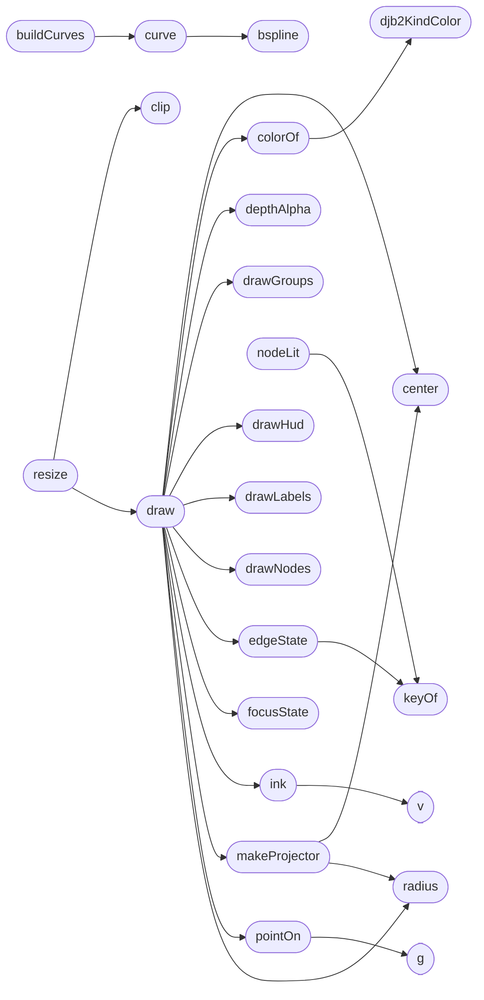

# `static/js/graph_bundle.js`

> Source: [static/js/graph_bundle.js:1](../../static/js/graph_bundle.js#L1) | language `js` | coverage 1.5% | [API index](../index.md)

Estorides Bundles — circle 2D + sphere 3D hierarchical edge bundling.

## Contents

- **Functions:** [`djb2KindColor`](#djb2kindcolor), [`mk`](#mk), [`clip`](#clip), [`tabActive`](#tabactive), [`ink`](#ink), [`v`](#v), [`colorOf`](#colorof), [`keyOf`](#keyof), [`bspline`](#bspline), [`curve`](#curve), [`buildCurves`](#buildcurves), [`resize`](#resize), [`radius`](#radius), [`center`](#center), [`makeProjector`](#makeprojector), [`depthAlpha`](#depthalpha), [`focusState`](#focusstate), [`edgeState`](#edgestate), [`nodeLit`](#nodelit), [`strokeCurve`](#strokecurve), [`pointOn`](#pointon), [`g`](#g), [`draw`](#draw), [`t0`](#t0), [`tt`](#tt), [`drawGroups`](#drawgroups), [`mid`](#mid), [`nodeRadius`](#noderadius), [`screenNodes`](#screennodes), [`drawNodes`](#drawnodes), [`labelSet`](#labelset), [`drawLabels`](#drawlabels), [`drawHud`](#drawhud), [`add`](#add), [`hitNode`](#hitnode), [`hitGroup`](#hitgroup), [`tipFor`](#tipfor), [`flowsOf`](#flowsof), [`rank`](#rank), [`inspectInGraph`](#inspectingraph), [`nodeButton`](#nodebutton), [`groupButton`](#groupbutton), [`listInto`](#listinto), [`renderPanel`](#renderpanel), [`renderLegend`](#renderlegend), [`focusNode`](#focusnode), [`focusGroup`](#focusgroup), [`facing`](#facing), [`aimAt`](#aimat), [`setView`](#setview), [`setColor`](#setcolor), [`setDir`](#setdir), [`setBeta`](#setbeta), [`sync`](#sync), [`writeHash`](#writehash), [`readHash`](#readhash), [`ingest`](#ingest), [`refresh`](#refresh), [`frame`](#frame), [`init`](#init), [`search`](#search), [`tag`](#tag)
- **Other Members:** [`add`](#add), [`listInto`](#listinto), [`listInto`](#listinto), [`listInto`](#listinto)

## Call Graph

Solid arrows stay in this module, dashed arrows leave it.



## Functions

<a id="djb2kindcolor"></a>

### `djb2KindColor`

`function` | [static/js/graph_bundle.js:33](../../static/js/graph_bundle.js#L33)

```javascript
function djb2KindColor(name)
```

**Parameters**

| Name | Type | Default | Description |
|---|---|---|---|
| `name` |  |  |  |

*Called by:* [`colorOf`](#colorof), [`renderLegend`](#renderlegend)

---

<a id="mk"></a>

### `mk`

`function` | [static/js/graph_bundle.js:61](../../static/js/graph_bundle.js#L61)

```javascript
function mk(tag, cls, text)
```

**Parameters**

| Name | Type | Default | Description |
|---|---|---|---|
| `tag` |  |  |  |
| `cls` |  |  |  |
| `text` |  |  |  |

*Called by:* [`add`](#add), [`drawHud`](#drawhud), [`groupButton`](#groupbutton), [`listInto`](#listinto), [`nodeButton`](#nodebutton), [`renderLegend`](#renderlegend), [`renderPanel`](#renderpanel), [`search`](#search), [`tipFor`](#tipfor)

---

<a id="clip"></a>

### `clip`

`function` | [static/js/graph_bundle.js:67](../../static/js/graph_bundle.js#L67)

```javascript
function clip(text, max)
```

**Parameters**

| Name | Type | Default | Description |
|---|---|---|---|
| `text` |  |  |  |
| `max` |  |  |  |

*Called by:* [`drawGroups`](#drawgroups), [`drawLabels`](#drawlabels), [`renderPanel`](#renderpanel), [`resize`](#resize), [`tipFor`](#tipfor)

---

<a id="tabactive"></a>

### `tabActive`

`function` | [static/js/graph_bundle.js:71](../../static/js/graph_bundle.js#L71)

```javascript
function tabActive()
```

*Called by:* [`writeHash`](#writehash)

---

<a id="ink"></a>

### `ink`

`function` | [static/js/graph_bundle.js:75](../../static/js/graph_bundle.js#L75)

```javascript
function ink()
```

*Calls:* [`v`](#v)

*Called by:* [`draw`](#draw), [`renderLegend`](#renderlegend)

---

<a id="v"></a>

### `v`

`function` | [static/js/graph_bundle.js:78](../../static/js/graph_bundle.js#L78)

```javascript
var v = function (k) { return cs.getPropertyValue(k).trim(); };
```

**Parameters**

| Name | Type | Default | Description |
|---|---|---|---|
| `k` |  |  |  |

*Called by:* [`ink`](#ink)

---

<a id="colorof"></a>

### `colorOf`

`function` | [static/js/graph_bundle.js:89](../../static/js/graph_bundle.js#L89)

```javascript
function colorOf(i)
```

**Parameters**

| Name | Type | Default | Description |
|---|---|---|---|
| `i` |  |  |  |

*Calls:* [`djb2KindColor`](#djb2kindcolor)

*Called by:* [`draw`](#draw), [`drawLabels`](#drawlabels), [`drawNodes`](#drawnodes), [`nodeButton`](#nodebutton), [`renderPanel`](#renderpanel), [`search`](#search)

---

<a id="keyof"></a>

### `keyOf`

`function` | [static/js/graph_bundle.js:95](../../static/js/graph_bundle.js#L95)

```javascript
function keyOf(i)
```

**Parameters**

| Name | Type | Default | Description |
|---|---|---|---|
| `i` |  |  |  |

*Called by:* [`edgeState`](#edgestate), [`nodeLit`](#nodelit), [`renderLegend`](#renderlegend)

---

<a id="bspline"></a>

### `bspline`

`function` | [static/js/graph_bundle.js:100](../../static/js/graph_bundle.js#L100)

```javascript
function bspline(ctrl, samples, dims)
```

**Parameters**

| Name | Type | Default | Description |
|---|---|---|---|
| `ctrl` |  |  |  |
| `samples` |  |  |  |
| `dims` |  |  |  |

*Called by:* [`curve`](#curve)

---

<a id="curve"></a>

### `curve`

`function` | [static/js/graph_bundle.js:121](../../static/js/graph_bundle.js#L121)

```javascript
function curve(la, lb, ga, gb, hub, root, dims)
```

**Parameters**

| Name | Type | Default | Description |
|---|---|---|---|
| `la` |  |  |  |
| `lb` |  |  |  |
| `ga` |  |  |  |
| `gb` |  |  |  |
| `hub` |  |  |  |
| `root` |  |  |  |
| `dims` |  |  |  |

*Calls:* [`bspline`](#bspline)

*Called by:* [`buildCurves`](#buildcurves)

---

<a id="buildcurves"></a>

### `buildCurves`

`function` | [static/js/graph_bundle.js:138](../../static/js/graph_bundle.js#L138)

```javascript
function buildCurves()
```

*Calls:* [`curve`](#curve)

*Called by:* [`ingest`](#ingest), [`setBeta`](#setbeta)

---

<a id="resize"></a>

### `resize`

`function` | [static/js/graph_bundle.js:149](../../static/js/graph_bundle.js#L149)

```javascript
function resize()
```

*Calls:* [`clip`](#clip), [`draw`](#draw)

*Called by:* [`ingest`](#ingest), [`init`](#init), [`setView`](#setview)

---

<a id="radius"></a>

### `radius`

`function` | [static/js/graph_bundle.js:161](../../static/js/graph_bundle.js#L161)

```javascript
function radius()
```

*Called by:* [`draw`](#draw), [`hitGroup`](#hitgroup), [`hitNode`](#hitnode), [`makeProjector`](#makeprojector)

---

<a id="center"></a>

### `center`

`function` | [static/js/graph_bundle.js:165](../../static/js/graph_bundle.js#L165)

```javascript
function center() { return [S.w / 2 + S.panX, S.h / 2 + S.panY]; }
```

*Called by:* [`draw`](#draw), [`hitGroup`](#hitgroup), [`hitNode`](#hitnode), [`makeProjector`](#makeprojector)

---

<a id="makeprojector"></a>

### `makeProjector`

`function` | [static/js/graph_bundle.js:166](../../static/js/graph_bundle.js#L166)

```javascript
function makeProjector()
```

*Calls:* [`center`](#center), [`radius`](#radius)

*Called by:* [`draw`](#draw)

---

<a id="depthalpha"></a>

### `depthAlpha`

`function` | [static/js/graph_bundle.js:176](../../static/js/graph_bundle.js#L176)

```javascript
function depthAlpha(z) { return S.view === '3d' ? 1 - CFG.depthFade * (z + 1) / 2 : 1; }
```

**Parameters**

| Name | Type | Default | Description |
|---|---|---|---|
| `z` |  |  |  |

*Called by:* [`draw`](#draw), [`drawGroups`](#drawgroups), [`drawLabels`](#drawlabels), [`drawNodes`](#drawnodes)

---

<a id="focusstate"></a>

### `focusState`

`function` | [static/js/graph_bundle.js:178](../../static/js/graph_bundle.js#L178)

```javascript
function focusState()
```

*Called by:* [`draw`](#draw), [`frame`](#frame)

---

<a id="edgestate"></a>

### `edgeState`

`function` | [static/js/graph_bundle.js:186](../../static/js/graph_bundle.js#L186)

```javascript
function edgeState(k, fs)
```

**Parameters**

| Name | Type | Default | Description |
|---|---|---|---|
| `k` |  |  |  |
| `fs` |  |  |  |

*Calls:* [`keyOf`](#keyof)

*Called by:* [`draw`](#draw)

---

<a id="nodelit"></a>

### `nodeLit`

`function` | [static/js/graph_bundle.js:206](../../static/js/graph_bundle.js#L206)

```javascript
function nodeLit(i, fs)
```

**Parameters**

| Name | Type | Default | Description |
|---|---|---|---|
| `i` |  |  |  |
| `fs` |  |  |  |

*Calls:* [`keyOf`](#keyof)

*Called by:* [`drawLabels`](#drawlabels), [`drawNodes`](#drawnodes)

---

<a id="strokecurve"></a>

### `strokeCurve`

`function` | [static/js/graph_bundle.js:217](../../static/js/graph_bundle.js#L217)

```javascript
function strokeCurve(pts, dims, prefix)
```

**Parameters**

| Name | Type | Default | Description |
|---|---|---|---|
| `pts` |  |  |  |
| `dims` |  |  |  |
| `prefix` |  |  |  |

*Called by:* [`draw`](#draw)

---

<a id="pointon"></a>

### `pointOn`

`function` | [static/js/graph_bundle.js:227](../../static/js/graph_bundle.js#L227)

```javascript
function pointOn(pts, dims, t)
```

**Parameters**

| Name | Type | Default | Description |
|---|---|---|---|
| `pts` |  |  |  |
| `dims` |  |  |  |
| `t` |  |  |  |

*Calls:* [`g`](#g)

*Called by:* [`draw`](#draw)

---

<a id="g"></a>

### `g`

`function` | [static/js/graph_bundle.js:229](../../static/js/graph_bundle.js#L229)

```javascript
function g(d) { return pts[j * dims + d] + (pts[(j + 1) * dims + d] - pts[j * dims + d]) * u; }
```

**Parameters**

| Name | Type | Default | Description |
|---|---|---|---|
| `d` |  |  |  |

*Called by:* [`pointOn`](#pointon)

---

<a id="draw"></a>

### `draw`

`function` | [static/js/graph_bundle.js:232](../../static/js/graph_bundle.js#L232)

```javascript
function draw(now)
```

**Parameters**

| Name | Type | Default | Description |
|---|---|---|---|
| `now` |  |  |  |

*Calls:* [`center`](#center), [`colorOf`](#colorof), [`depthAlpha`](#depthalpha), [`drawGroups`](#drawgroups), [`drawHud`](#drawhud), [`drawLabels`](#drawlabels), [`drawNodes`](#drawnodes), [`edgeState`](#edgestate), [`focusState`](#focusstate), [`ink`](#ink), [`makeProjector`](#makeprojector), [`pointOn`](#pointon) and 2 more

*Called by:* [`frame`](#frame), [`init`](#init), [`resize`](#resize), [`sync`](#sync)

---

<a id="t0"></a>

### `t0`

`function` | [static/js/graph_bundle.js:275](../../static/js/graph_bundle.js#L275)

```javascript
var t0 = (now || 0) / 1000;
```

**Parameters**

| Name | Type | Default | Description |
|---|---|---|---|
| `now` |  |  |  |

---

<a id="tt"></a>

### `tt`

`function` | [static/js/graph_bundle.js:279](../../static/js/graph_bundle.js#L279)

```javascript
var tt = ((t0 * 0.35) + pp / CFG.particles + ((pair[0] * 0.6180339) % 1)) % 1;
```

**Parameters**

| Name | Type | Default | Description |
|---|---|---|---|
| `pair` | `(t0 * 0.35) + pp / CFG.particles + (( [0] * 0.6180339) % 1)` |  |  |

---

<a id="drawgroups"></a>

### `drawGroups`

`function` | [static/js/graph_bundle.js:292](../../static/js/graph_bundle.js#L292)

```javascript
function drawGroups(K, fs, cx, cy, R)
```

**Parameters**

| Name | Type | Default | Description |
|---|---|---|---|
| `K` |  |  |  |
| `fs` |  |  |  |
| `cx` |  |  |  |
| `cy` |  |  |  |
| `R` |  |  |  |

*Calls:* [`clip`](#clip), [`depthAlpha`](#depthalpha)

*Called by:* [`draw`](#draw)

---

<a id="mid"></a>

### `mid`

`function` | [static/js/graph_bundle.js:306](../../static/js/graph_bundle.js#L306)

```javascript
var mid = (gg.a0 + gg.a1) / 2, x = cx + (R + 20) * Math.cos(mid), y = cy + (R + 20) * Math.sin(mid);
```

**Parameters**

| Name | Type | Default | Description |
|---|---|---|---|
| `a1` | `gg.a0 + gg.` |  |  |

---

<a id="noderadius"></a>

### `nodeRadius`

`function` | [static/js/graph_bundle.js:334](../../static/js/graph_bundle.js#L334)

```javascript
function nodeRadius(i)
```

**Parameters**

| Name | Type | Default | Description |
|---|---|---|---|
| `i` |  |  |  |

*Called by:* [`screenNodes`](#screennodes)

---

<a id="screennodes"></a>

### `screenNodes`

`function` | [static/js/graph_bundle.js:338](../../static/js/graph_bundle.js#L338)

```javascript
function screenNodes()
```

*Calls:* [`nodeRadius`](#noderadius)

*Called by:* [`drawNodes`](#drawnodes)

---

<a id="drawnodes"></a>

### `drawNodes`

`function` | [static/js/graph_bundle.js:344](../../static/js/graph_bundle.js#L344)

```javascript
function drawNodes(K, fs)
```

**Parameters**

| Name | Type | Default | Description |
|---|---|---|---|
| `K` |  |  |  |
| `fs` |  |  |  |

*Calls:* [`colorOf`](#colorof), [`depthAlpha`](#depthalpha), [`nodeLit`](#nodelit), [`screenNodes`](#screennodes)

*Called by:* [`draw`](#draw)

---

<a id="labelset"></a>

### `labelSet`

`function` | [static/js/graph_bundle.js:356](../../static/js/graph_bundle.js#L356)

```javascript
function labelSet(fs)
```

**Parameters**

| Name | Type | Default | Description |
|---|---|---|---|
| `fs` |  |  |  |

*Called by:* [`drawLabels`](#drawlabels)

---

<a id="drawlabels"></a>

### `drawLabels`

`function` | [static/js/graph_bundle.js:368](../../static/js/graph_bundle.js#L368)

```javascript
function drawLabels(K, fs, cx, cy, R)
```

**Parameters**

| Name | Type | Default | Description |
|---|---|---|---|
| `K` |  |  |  |
| `fs` |  |  |  |
| `cx` |  |  |  |
| `cy` |  |  |  |
| `R` |  |  |  |

*Calls:* [`clip`](#clip), [`colorOf`](#colorof), [`depthAlpha`](#depthalpha), [`labelSet`](#labelset), [`nodeLit`](#nodelit)

*Called by:* [`draw`](#draw)

---

<a id="drawhud"></a>

### `drawHud`

`function` | [static/js/graph_bundle.js:406](../../static/js/graph_bundle.js#L406)

```javascript
function drawHud(visible)
```

**Parameters**

| Name | Type | Default | Description |
|---|---|---|---|
| `visible` |  |  |  |

*Calls:* [`add`](#add), [`mk`](#mk)

*Called by:* [`draw`](#draw)

---

<a id="add"></a>

### `add`

`function` | [static/js/graph_bundle.js:411](../../static/js/graph_bundle.js#L411)

```javascript
function add(label, value)
```

**Parameters**

| Name | Type | Default | Description |
|---|---|---|---|
| `label` |  |  |  |
| `value` |  |  |  |

*Calls:* [`mk`](#mk)

*Called by:* [`add`](#add), [`drawHud`](#drawhud)

---

<a id="hitnode"></a>

### `hitNode`

`function` | [static/js/graph_bundle.js:421](../../static/js/graph_bundle.js#L421)

```javascript
function hitNode(x, y)
```

**Parameters**

| Name | Type | Default | Description |
|---|---|---|---|
| `x` |  |  |  |
| `y` |  |  |  |

*Calls:* [`center`](#center), [`radius`](#radius)

*Called by:* [`init`](#init)

---

<a id="hitgroup"></a>

### `hitGroup`

`function` | [static/js/graph_bundle.js:444](../../static/js/graph_bundle.js#L444)

```javascript
function hitGroup(x, y)
```

**Parameters**

| Name | Type | Default | Description |
|---|---|---|---|
| `x` |  |  |  |
| `y` |  |  |  |

*Calls:* [`center`](#center), [`radius`](#radius)

*Called by:* [`init`](#init)

---

<a id="tipfor"></a>

### `tipFor`

`function` | [static/js/graph_bundle.js:462](../../static/js/graph_bundle.js#L462)

```javascript
function tipFor(x, y, i, g)
```

**Parameters**

| Name | Type | Default | Description |
|---|---|---|---|
| `x` |  |  |  |
| `y` |  |  |  |
| `i` |  |  |  |
| `g` |  |  |  |

*Calls:* [`clip`](#clip), [`flowsOf`](#flowsof), [`mk`](#mk)

*Called by:* [`init`](#init)

---

<a id="flowsof"></a>

### `flowsOf`

`function` | [static/js/graph_bundle.js:484](../../static/js/graph_bundle.js#L484)

```javascript
function flowsOf(g)
```

**Parameters**

| Name | Type | Default | Description |
|---|---|---|---|
| `g` |  |  |  |

*Calls:* [`rank`](#rank)

*Called by:* [`renderPanel`](#renderpanel), [`tipFor`](#tipfor)

---

<a id="rank"></a>

### `rank`

`function` | [static/js/graph_bundle.js:492](../../static/js/graph_bundle.js#L492)

```javascript
function rank(o)
```

**Parameters**

| Name | Type | Default | Description |
|---|---|---|---|
| `o` |  |  |  |

*Called by:* [`flowsOf`](#flowsof)

---

<a id="inspectingraph"></a>

### `inspectInGraph`

`function` | [static/js/graph_bundle.js:498](../../static/js/graph_bundle.js#L498)

```javascript
function inspectInGraph(id)
```

**Parameters**

| Name | Type | Default | Description |
|---|---|---|---|
| `id` |  |  |  |

*Called by:* [`renderPanel`](#renderpanel)

---

<a id="nodebutton"></a>

### `nodeButton`

`function` | [static/js/graph_bundle.js:505](../../static/js/graph_bundle.js#L505)

```javascript
function nodeButton(i, extra)
```

**Parameters**

| Name | Type | Default | Description |
|---|---|---|---|
| `i` |  |  |  |
| `extra` |  |  |  |

*Calls:* [`colorOf`](#colorof), [`focusNode`](#focusnode), [`mk`](#mk)

*Called by:* [`listInto`](#listinto), [`listInto`](#listinto), [`listInto`](#listinto)

---

<a id="groupbutton"></a>

### `groupButton`

`function` | [static/js/graph_bundle.js:513](../../static/js/graph_bundle.js#L513)

```javascript
function groupButton(g, count)
```

**Parameters**

| Name | Type | Default | Description |
|---|---|---|---|
| `g` |  |  |  |
| `count` |  |  |  |

*Calls:* [`focusGroup`](#focusgroup), [`mk`](#mk)

*Called by:* [`renderPanel`](#renderpanel)

---

<a id="listinto"></a>

### `listInto`

`function` | [static/js/graph_bundle.js:520](../../static/js/graph_bundle.js#L520)

```javascript
function listInto(panel, title, cls, items, render)
```

**Parameters**

| Name | Type | Default | Description |
|---|---|---|---|
| `panel` |  |  |  |
| `title` |  |  |  |
| `cls` |  |  |  |
| `items` |  |  |  |
| `render` |  |  |  |

*Calls:* [`mk`](#mk)

*Called by:* [`listInto`](#listinto), [`listInto`](#listinto), [`listInto`](#listinto), [`renderPanel`](#renderpanel)

---

<a id="renderpanel"></a>

### `renderPanel`

`function` | [static/js/graph_bundle.js:530](../../static/js/graph_bundle.js#L530)

```javascript
function renderPanel()
```

*Calls:* [`clip`](#clip), [`colorOf`](#colorof), [`flowsOf`](#flowsof), [`focusGroup`](#focusgroup), [`groupButton`](#groupbutton), [`inspectInGraph`](#inspectingraph), [`listInto`](#listinto), [`mk`](#mk)

*Called by:* [`sync`](#sync)

---

<a id="renderlegend"></a>

### `renderLegend`

`function` | [static/js/graph_bundle.js:614](../../static/js/graph_bundle.js#L614)

```javascript
function renderLegend()
```

*Calls:* [`djb2KindColor`](#djb2kindcolor), [`focusGroup`](#focusgroup), [`ink`](#ink), [`keyOf`](#keyof), [`mk`](#mk), [`sync`](#sync)

*Called by:* [`sync`](#sync)

---

<a id="focusnode"></a>

### `focusNode`

`function` | [static/js/graph_bundle.js:646](../../static/js/graph_bundle.js#L646)

```javascript
function focusNode(i)
```

**Parameters**

| Name | Type | Default | Description |
|---|---|---|---|
| `i` |  |  |  |

*Calls:* [`aimAt`](#aimat), [`sync`](#sync)

*Called by:* [`init`](#init), [`nodeButton`](#nodebutton), [`search`](#search)

---

<a id="focusgroup"></a>

### `focusGroup`

`function` | [static/js/graph_bundle.js:651](../../static/js/graph_bundle.js#L651)

```javascript
function focusGroup(g)
```

**Parameters**

| Name | Type | Default | Description |
|---|---|---|---|
| `g` |  |  |  |

*Calls:* [`aimAt`](#aimat), [`sync`](#sync)

*Called by:* [`groupButton`](#groupbutton), [`init`](#init), [`renderLegend`](#renderlegend), [`renderPanel`](#renderpanel)

---

<a id="facing"></a>

### `facing`

`function` | [static/js/graph_bundle.js:656](../../static/js/graph_bundle.js#L656)

```javascript
function facing(p)
```

**Parameters**

| Name | Type | Default | Description |
|---|---|---|---|
| `p` |  |  |  |

*Called by:* [`aimAt`](#aimat), [`ingest`](#ingest)

---

<a id="aimat"></a>

### `aimAt`

`function` | [static/js/graph_bundle.js:662](../../static/js/graph_bundle.js#L662)

```javascript
function aimAt(p)
```

**Parameters**

| Name | Type | Default | Description |
|---|---|---|---|
| `p` |  |  |  |

*Calls:* [`facing`](#facing)

*Called by:* [`focusGroup`](#focusgroup), [`focusNode`](#focusnode)

---

<a id="setview"></a>

### `setView`

`function` | [static/js/graph_bundle.js:668](../../static/js/graph_bundle.js#L668)

```javascript
function setView(v)
```

**Parameters**

| Name | Type | Default | Description |
|---|---|---|---|
| `v` |  |  |  |

*Calls:* [`resize`](#resize), [`sync`](#sync)

*Called by:* [`init`](#init)

---

<a id="setcolor"></a>

### `setColor`

`function` | [static/js/graph_bundle.js:672](../../static/js/graph_bundle.js#L672)

```javascript
function setColor(c)
```

**Parameters**

| Name | Type | Default | Description |
|---|---|---|---|
| `c` |  |  |  |

*Calls:* [`sync`](#sync)

*Called by:* [`init`](#init)

---

<a id="setdir"></a>

### `setDir`

`function` | [static/js/graph_bundle.js:676](../../static/js/graph_bundle.js#L676)

```javascript
function setDir(d)
```

**Parameters**

| Name | Type | Default | Description |
|---|---|---|---|
| `d` |  |  |  |

*Calls:* [`sync`](#sync)

*Called by:* [`init`](#init)

---

<a id="setbeta"></a>

### `setBeta`

`function` | [static/js/graph_bundle.js:680](../../static/js/graph_bundle.js#L680)

```javascript
function setBeta(b)
```

**Parameters**

| Name | Type | Default | Description |
|---|---|---|---|
| `b` |  |  |  |

*Calls:* [`buildCurves`](#buildcurves), [`sync`](#sync)

*Called by:* [`init`](#init)

---

<a id="sync"></a>

### `sync`

`function` | [static/js/graph_bundle.js:688](../../static/js/graph_bundle.js#L688)

```javascript
function sync()
```

*Calls:* [`draw`](#draw), [`renderLegend`](#renderlegend), [`renderPanel`](#renderpanel), [`writeHash`](#writehash)

*Called by:* [`focusGroup`](#focusgroup), [`focusNode`](#focusnode), [`ingest`](#ingest), [`init`](#init), [`renderLegend`](#renderlegend), [`setBeta`](#setbeta), [`setColor`](#setcolor), [`setDir`](#setdir), [`setView`](#setview)

---

<a id="writehash"></a>

### `writeHash`

`function` | [static/js/graph_bundle.js:698](../../static/js/graph_bundle.js#L698)

```javascript
function writeHash()
```

*Calls:* [`tabActive`](#tabactive)

*Called by:* [`sync`](#sync)

---

<a id="readhash"></a>

### `readHash`

`function` | [static/js/graph_bundle.js:710](../../static/js/graph_bundle.js#L710)

```javascript
function readHash()
```

*Called by:* [`ingest`](#ingest)

---

<a id="ingest"></a>

### `ingest`

`function` | [static/js/graph_bundle.js:727](../../static/js/graph_bundle.js#L727)

```javascript
function ingest(bundle, settings)
```

**Parameters**

| Name | Type | Default | Description |
|---|---|---|---|
| `bundle` |  |  |  |
| `settings` |  |  |  |

*Calls:* [`buildCurves`](#buildcurves), [`facing`](#facing), [`readHash`](#readhash), [`resize`](#resize), [`sync`](#sync)

*Called by:* [`refresh`](#refresh)

---

<a id="refresh"></a>

### `refresh`

`function` | [static/js/graph_bundle.js:763](../../static/js/graph_bundle.js#L763)

```javascript
function refresh()
```

*Calls:* [`ingest`](#ingest)

*Called by:* [`init`](#init)

---

<a id="frame"></a>

### `frame`

`function` | [static/js/graph_bundle.js:787](../../static/js/graph_bundle.js#L787)

```javascript
function frame(now)
```

**Parameters**

| Name | Type | Default | Description |
|---|---|---|---|
| `now` |  |  |  |

*Calls:* [`draw`](#draw), [`focusState`](#focusstate), [`requestAnimationFrame`](static.js.graph_force.js.md#requestanimationframe)

---

<a id="init"></a>

### `init`

`function` | [static/js/graph_bundle.js:813](../../static/js/graph_bundle.js#L813)

```javascript
function init()
```

*Calls:* [`draw`](#draw), [`focusGroup`](#focusgroup), [`focusNode`](#focusnode), [`hitGroup`](#hitgroup), [`hitNode`](#hitnode), [`refresh`](#refresh), [`resize`](#resize), [`search`](#search), [`setBeta`](#setbeta), [`setColor`](#setcolor), [`setDir`](#setdir), [`setView`](#setview) and 3 more

---

<a id="search"></a>

### `search`

`function` | [static/js/graph_bundle.js:913](../../static/js/graph_bundle.js#L913)

```javascript
function search(text)
```

**Parameters**

| Name | Type | Default | Description |
|---|---|---|---|
| `text` |  |  |  |

*Calls:* [`colorOf`](#colorof), [`focusNode`](#focusnode), [`mk`](#mk)

*Called by:* [`init`](#init)

---

<a id="tag"></a>

### `tag`

`function` | [static/js/graph_bundle.js:958](../../static/js/graph_bundle.js#L958)

```javascript
var tag = (ev.target && ev.target.tagName) || '';
```

**Parameters**

| Name | Type | Default | Description |
|---|---|---|---|
| `tagName` | `ev.target && ev.target.` |  |  |

---

## Other Members

<a id="add"></a>

### `add`

`method` | [static/js/graph_bundle.js:415](../../static/js/graph_bundle.js#L415)

```javascript
add('clusters', GROUPS.filter(function (g) { return g.k !== CFG.unassignedKey; }).length);
```

**Parameters**

| Name | Type | Default | Description |
|---|---|---|---|
| `clusters` |  |  |  |
| `k` | `GROUPS.filter(function (g) { return g. !` | `= CFG.unassignedKey; }).length` |  |

*Calls:* [`add`](#add)

---

<a id="listinto"></a>

### `listInto`

`method` | [static/js/graph_bundle.js:559](../../static/js/graph_bundle.js#L559)

```javascript
listInto(panel, 'Relations out', 'gb-o', outs, function (j) { return nodeButton(j); });
```

**Parameters**

| Name | Type | Default | Description |
|---|---|---|---|
| `panel` |  |  |  |
| `out` | `'Relations '` |  |  |
| `o` | `'gb- '` |  |  |
| `outs` |  |  |  |
| `j` | `function (j) { return nodeButton( ); }` |  |  |

*Calls:* [`listInto`](#listinto), [`nodeButton`](#nodebutton)

---

<a id="listinto"></a>

### `listInto`

`method` | [static/js/graph_bundle.js:560](../../static/js/graph_bundle.js#L560)

```javascript
listInto(panel, 'Relations in', 'gb-i', ins, function (j) { return nodeButton(j); });
```

**Parameters**

| Name | Type | Default | Description |
|---|---|---|---|
| `panel` |  |  |  |
| `in` | `'Relations '` |  |  |
| `i` | `'gb- '` |  |  |
| `ins` |  |  |  |
| `j` | `function (j) { return nodeButton( ); }` |  |  |

*Calls:* [`listInto`](#listinto), [`nodeButton`](#nodebutton)

---

<a id="listinto"></a>

### `listInto`

`method` | [static/js/graph_bundle.js:580](../../static/js/graph_bundle.js#L580)

```javascript
listInto(panel, 'Entities by rank', null, members, function (j) { return nodeButton(j, '#' + NODES[j].rp); });
```

**Parameters**

| Name | Type | Default | Description |
|---|---|---|---|
| `panel` |  |  |  |
| `rank` | `'Entities by '` |  |  |
| `null` |  |  |  |
| `members` |  |  |  |
| `rp` | `function (j) { return nodeButton(j, '#' + NODES[j]. ); }` |  |  |

*Calls:* [`listInto`](#listinto), [`nodeButton`](#nodebutton)

---
