# `static/js/graph_force.js`

> Source: [static/js/graph_force.js:1](../../static/js/graph_force.js#L1) | language `js` | coverage 7.8% | [API index](../index.md)

Estorides force-graph module (spec/graph_force3d.md).

## Contents

- **Functions:** [`short`](#short), [`esc`](#esc), [`reducedMotion`](#reducedmotion), [`toast`](#toast), [`fail`](#fail), [`settings`](#settings), [`adaptLocal`](#adaptlocal), [`ordered`](#ordered), [`cid`](#cid), [`fam`](#fam), [`currentRaw`](#currentraw), [`rebuildRaw`](#rebuildraw), [`src`](#src), [`indexRaw`](#indexraw), [`s`](#s), [`t`](#t), [`entities`](#entities), [`lkey`](#lkey), [`colorOf`](#colorof), [`dimmed`](#dimmed), [`hiddenKind`](#hiddenkind), [`visiblePayload`](#visiblepayload), [`links`](#links), [`s`](#s), [`t`](#t), [`s`](#s), [`t`](#t), [`s`](#s), [`t`](#t), [`s`](#s), [`t`](#t), [`computeHighlight`](#computehighlight), [`tip`](#tip), [`refreshFamList`](#refreshfamlist), [`famAnchor`](#famanchor), [`a`](#a), [`famOf`](#famof), [`clusterForce`](#clusterforce), [`force`](#force), [`ringOf`](#ringof), [`radialForce`](#radialforce), [`force`](#force), [`collideForce`](#collideforce), [`force`](#force), [`m`](#m), [`radius`](#radius), [`linkStrengthFn`](#linkstrengthfn), [`setEngineButtons`](#setenginebuttons), [`show3DChrome`](#show3dchrome), [`mount3D`](#mount3d), [`startOverlayLoop`](#startoverlayloop), [`overlayTick`](#overlaytick), [`convexHullPts`](#convexhullpts), [`cross`](#cross), [`inflateHull`](#inflatehull), [`traceSmooth`](#tracesmooth), [`mid`](#mid), [`rr`](#rr), [`glyphPath`](#glyphpath), [`tierColorOf`](#tiercolorof), [`drawGlyph3D`](#drawglyph3d), [`drawLabel3D`](#drawlabel3d), [`paintOverlay3D`](#paintoverlay3d), [`col`](#col), [`topN`](#topn), [`stageLocal`](#stagelocal), [`hitNode3D`](#hitnode3d), [`segDist`](#segdist), [`hitEdge3D`](#hitedge3d), [`hoverAt3D`](#hoverat3d), [`bindStagePointer`](#bindstagepointer), [`refresh3D`](#refresh3d), [`reload3D`](#reload3d), [`resize3D`](#resize3d), [`applyLayout3D`](#applylayout3d), [`onSelect3D`](#onselect3d), [`expandSelected`](#expandselected), [`focusSelected`](#focusselected), [`copyDeepLink`](#copydeeplink), [`done`](#done), [`reheat`](#reheat), [`toggleBridges`](#togglebridges), [`snapshot3D`](#snapshot3d), [`toggleOrbit`](#toggleorbit), [`onEdge3D`](#onedge3d), [`clearSelection`](#clearselection), [`focusFamily`](#focusfamily), [`s`](#s), [`t`](#t), [`markFamilies`](#markfamilies), [`hud`](#hud), [`stat`](#stat), [`renderLegend`](#renderlegend), [`applyFilters`](#applyfilters), [`nodes`](#nodes), [`edges`](#edges), [`s`](#s), [`t`](#t), [`fn`](#fn), [`runSearch`](#runsearch), [`pickHit`](#pickhit), [`to3D`](#to3d), [`to2D`](#to2d), [`readHash`](#readhash), [`writeHash`](#writehash), [`syncIsolateBtn`](#syncisolatebtn), [`wireToolbar`](#wiretoolbar), [`toggle`](#toggle), [`tag`](#tag)
- **Other Members:** [`setTimeout`](#settimeout), [`requestAnimationFrame`](#requestanimationframe), [`toggle`](#toggle), [`setTimeout`](#settimeout), [`setTimeout`](#settimeout), [`setInterval`](#setinterval)

## Call Graph

Solid arrows stay in this module, dashed arrows leave it.

```mermaid
flowchart LR
    n_static_js_graph_force_js__currentRaw(["currentRaw"])
    n_static_js_graph_force_js__settings(["settings"])
    n_static_js_graph_force_js__rebuildRaw(["rebuildRaw"])
    n_static_js_graph_force_js__adaptLocal(["adaptLocal"])
    n_static_js_graph_force_js__indexRaw(["indexRaw"])
    n_static_js_graph_force_js__visiblePayload(["visiblePayload"])
    n_static_js_graph_force_js__hiddenKind(["hiddenKind"])
    n_static_js_graph_force_js__tip(["tip"])
    n_static_js_graph_force_js__esc(["esc"])
    n_static_js_graph_force_js__force(["force"])
    n_static_js_graph_force_js__famAnchor(["famAnchor"])
    n_static_js_graph_force_js__famOf(["famOf"])
    n_static_js_graph_force_js__force_362(["force"])
    n_static_js_graph_force_js__ringOf(["ringOf"])
    n_static_js_graph_force_js__force_379(["force"])
    n_static_js_graph_force_js__radius(["radius"])
    n_static_js_graph_force_js__linkStrengthFn(["linkStrengthFn"])
    n_static_js_graph_force_js__show3DChrome(["show3DChrome"])
    n_static_js_graph_force_js__resize3D(["resize3D"])
    n_static_js_graph_force_js__mount3D(["mount3D"])
    n_static_js_graph_force_js__applyLayout3D(["applyLayout3D"])
    n_static_js_graph_force_js__clusterForce(["clusterForce"])
    n_static_js_graph_force_js__collideForce(["collideForce"])
    n_static_js_graph_force_js__colorOf(["colorOf"])
    n_static_js_graph_force_js__dimmed(["dimmed"])
    n_static_js_graph_force_js__fail(["fail"])
    n_static_js_graph_force_js__hud(["hud"])
    n_static_js_graph_force_js__lkey(["lkey"])
    n_static_js_graph_force_js__radialForce(["radialForce"])
    n_static_js_graph_force_js__reducedMotion(["reducedMotion"])
    n_static_js_graph_force_js__currentRaw --> n_static_js_graph_force_js__settings
    n_static_js_graph_force_js__rebuildRaw --> n_static_js_graph_force_js__adaptLocal
    n_static_js_graph_force_js__rebuildRaw --> n_static_js_graph_force_js__indexRaw
    n_static_js_graph_force_js__indexRaw --> n_static_js_graph_force_js__settings
    n_static_js_graph_force_js__visiblePayload --> n_static_js_graph_force_js__hiddenKind
    n_static_js_graph_force_js__tip --> n_static_js_graph_force_js__esc
    n_static_js_graph_force_js__force --> n_static_js_graph_force_js__famAnchor
    n_static_js_graph_force_js__force --> n_static_js_graph_force_js__famOf
    n_static_js_graph_force_js__force_362 --> n_static_js_graph_force_js__ringOf
    n_static_js_graph_force_js__force_379 --> n_static_js_graph_force_js__radius
    n_static_js_graph_force_js__radius --> n_static_js_graph_force_js__settings
    n_static_js_graph_force_js__linkStrengthFn --> n_static_js_graph_force_js__famOf
    n_static_js_graph_force_js__show3DChrome --> n_static_js_graph_force_js__resize3D
    n_static_js_graph_force_js__mount3D --> n_static_js_graph_force_js__applyLayout3D
    n_static_js_graph_force_js__mount3D --> n_static_js_graph_force_js__clusterForce
    n_static_js_graph_force_js__mount3D --> n_static_js_graph_force_js__collideForce
    n_static_js_graph_force_js__mount3D --> n_static_js_graph_force_js__colorOf
    n_static_js_graph_force_js__mount3D --> n_static_js_graph_force_js__dimmed
    n_static_js_graph_force_js__mount3D --> n_static_js_graph_force_js__fail
    n_static_js_graph_force_js__mount3D --> n_static_js_graph_force_js__hud
    n_static_js_graph_force_js__mount3D --> n_static_js_graph_force_js__linkStrengthFn
    n_static_js_graph_force_js__mount3D --> n_static_js_graph_force_js__lkey
    n_static_js_graph_force_js__mount3D --> n_static_js_graph_force_js__radialForce
    n_static_js_graph_force_js__mount3D --> n_static_js_graph_force_js__reducedMotion
```



## Functions

<a id="short"></a>

### `short`

`function` | [static/js/graph_force.js:21](../../static/js/graph_force.js#L21)

```javascript
var short = function (t, n)
```

**Parameters**

| Name | Type | Default | Description |
|---|---|---|---|
| `t` |  |  |  |
| `n` |  |  |  |

*Called by:* [`drawLabel3D`](#drawlabel3d), [`hud`](#hud), [`paintOverlay3D`](#paintoverlay3d)

---

<a id="esc"></a>

### `esc`

`function` | [static/js/graph_force.js:25](../../static/js/graph_force.js#L25)

```javascript
var esc = function (t) { return B.escapeHTML(t); };
```

**Parameters**

| Name | Type | Default | Description |
|---|---|---|---|
| `t` |  |  |  |

*Called by:* [`tip`](#tip)

---

<a id="reducedmotion"></a>

### `reducedMotion`

`function` | [static/js/graph_force.js:52](../../static/js/graph_force.js#L52)

```javascript
function reducedMotion()
```

*Called by:* [`mount3D`](#mount3d), [`setTimeout`](#settimeout)

---

<a id="toast"></a>

### `toast`

`function` | [static/js/graph_force.js:57](../../static/js/graph_force.js#L57)

```javascript
function toast(msg)
```

**Parameters**

| Name | Type | Default | Description |
|---|---|---|---|
| `msg` |  |  |  |

*Called by:* [`copyDeepLink`](#copydeeplink), [`expandSelected`](#expandselected), [`focusSelected`](#focusselected), [`mount3D`](#mount3d), [`onEdge3D`](#onedge3d), [`reheat`](#reheat), [`snapshot3D`](#snapshot3d), [`toggleBridges`](#togglebridges), [`toggleOrbit`](#toggleorbit), [`wireToolbar`](#wiretoolbar)

---

<a id="fail"></a>

### `fail`

`function` | [static/js/graph_force.js:65](../../static/js/graph_force.js#L65)

```javascript
function fail(msg)
```

**Parameters**

| Name | Type | Default | Description |
|---|---|---|---|
| `msg` |  |  |  |

*Called by:* [`execute`](estorides_core.system_app_sources.py.md#execute), [`mount3D`](#mount3d)

---

<a id="settings"></a>

### `settings`

`function` | [static/js/graph_force.js:72](../../static/js/graph_force.js#L72)

```javascript
function settings()
```

*Called by:* [`applyLayout3D`](#applylayout3d), [`currentRaw`](#currentraw), [`focusSelected`](#focusselected), [`indexRaw`](#indexraw), [`mount3D`](#mount3d), [`paintOverlay3D`](#paintoverlay3d), [`radius`](#radius), [`runSearch`](#runsearch)

---

<a id="adaptlocal"></a>

### `adaptLocal`

`function` | [static/js/graph_force.js:79](../../static/js/graph_force.js#L79)

```javascript
function adaptLocal(nodes, edges, clusters)
```

---- adapt /api/graph nodes to RAW force-graph shape (fallback when
the server did not send data.force; mirrors graph_force.py) ----

**Parameters**

| Name | Type | Default | Description |
|---|---|---|---|
| `nodes` |  |  |  |
| `edges` |  |  |  |
| `clusters` |  |  |  |

*Called by:* [`rebuildRaw`](#rebuildraw)

---

<a id="ordered"></a>

### `ordered`

`function` | [static/js/graph_force.js:96](../../static/js/graph_force.js#L96)

```javascript
var ordered = (nodes || []).slice().sort(function (a, b)
```

**Parameters**

| Name | Type | Default | Description |
|---|---|---|---|
| `nodes` |  |  |  |

---

<a id="cid"></a>

### `cid`

`function` | [static/js/graph_force.js:104](../../static/js/graph_force.js#L104)

```javascript
var cid = (n.cluster == null) ? -1 : n.cluster;
```

**Parameters**

| Name | Type | Default | Description |
|---|---|---|---|
| `cluster` | `n.` | `= null` |  |

---

<a id="fam"></a>

### `fam`

`function` | [static/js/graph_force.js:105](../../static/js/graph_force.js#L105)

```javascript
var fam = (cid >= 0 && byCluster[cid]) ? (byCluster[cid].label || n.kind || n.type) : (n.kind || n.type || 'unknown');
```

**Parameters**

| Name | Type | Default | Description |
|---|---|---|---|
| `cid` |  | `0 && byCluster[cid]` |  |

---

<a id="currentraw"></a>

### `currentRaw`

`function` | [static/js/graph_force.js:137](../../static/js/graph_force.js#L137)

```javascript
function currentRaw()
```

*Calls:* [`settings`](#settings)

---

<a id="rebuildraw"></a>

### `rebuildRaw`

`function` | [static/js/graph_force.js:153](../../static/js/graph_force.js#L153)

```javascript
function rebuildRaw()
```

*Calls:* [`adaptLocal`](#adaptlocal), [`indexRaw`](#indexraw)

*Called by:* [`setInterval`](#setinterval)

---

<a id="src"></a>

### `src`

`function` | [static/js/graph_force.js:162](../../static/js/graph_force.js#L162)

```javascript
var src = (gd.nodes || []).filter(function (x) { return x.id === c.id; })[0];
```

**Parameters**

| Name | Type | Default | Description |
|---|---|---|---|
| `nodes` | `gd. \|\| []` |  |  |

---

<a id="indexraw"></a>

### `indexRaw`

`function` | [static/js/graph_force.js:179](../../static/js/graph_force.js#L179)

```javascript
function indexRaw()
```

*Calls:* [`settings`](#settings)

*Called by:* [`rebuildRaw`](#rebuildraw)

---

<a id="s"></a>

### `s`

`function` | [static/js/graph_force.js:189](../../static/js/graph_force.js#L189)

```javascript
var s = (e.source && e.source.id) || e.source;
```

**Parameters**

| Name | Type | Default | Description |
|---|---|---|---|
| `id` | `e.source && e.source.` |  |  |

---

<a id="t"></a>

### `t`

`function` | [static/js/graph_force.js:190](../../static/js/graph_force.js#L190)

```javascript
var t = (e.target && e.target.id) || e.target;
```

**Parameters**

| Name | Type | Default | Description |
|---|---|---|---|
| `id` | `e.target && e.target.` |  |  |

---

<a id="entities"></a>

### `entities`

`function` | [static/js/graph_force.js:205](../../static/js/graph_force.js#L205)

```javascript
var entities = (S.raw.nodes || []).filter(function (n) { return n.type === 'entity'; }); entities.forEach(function (n)
```

**Parameters**

| Name | Type | Default | Description |
|---|---|---|---|
| `nodes` | `S.raw. \|\| []` |  |  |

---

<a id="lkey"></a>

### `lkey`

`function` | [static/js/graph_force.js:218](../../static/js/graph_force.js#L218)

```javascript
function lkey(l) { return l.source + '|' + l.target + '|' + l.type; }
```

**Parameters**

| Name | Type | Default | Description |
|---|---|---|---|
| `l` |  |  |  |

*Called by:* [`mount3D`](#mount3d)

---

<a id="colorof"></a>

### `colorOf`

`function` | [static/js/graph_force.js:219](../../static/js/graph_force.js#L219)

```javascript
function colorOf(n) { return B.safeColor(n.color) || '#888'; }
```

**Parameters**

| Name | Type | Default | Description |
|---|---|---|---|
| `n` |  |  |  |

*Called by:* [`col`](#col), [`drawGlyph3D`](#drawglyph3d), [`drawLabel3D`](#drawlabel3d), [`mount3D`](#mount3d), [`runSearch`](#runsearch)

---

<a id="dimmed"></a>

### `dimmed`

`function` | [static/js/graph_force.js:220](../../static/js/graph_force.js#L220)

```javascript
function dimmed(id) { return S.hl.length > 0 && S.hl.indexOf(id) < 0; }
```

**Parameters**

| Name | Type | Default | Description |
|---|---|---|---|
| `id` |  |  |  |

*Called by:* [`drawGlyph3D`](#drawglyph3d), [`mount3D`](#mount3d)

---

<a id="hiddenkind"></a>

### `hiddenKind`

`function` | [static/js/graph_force.js:221](../../static/js/graph_force.js#L221)

```javascript
function hiddenKind(n)
```

**Parameters**

| Name | Type | Default | Description |
|---|---|---|---|
| `n` |  |  |  |

*Called by:* [`visiblePayload`](#visiblepayload)

---

<a id="visiblepayload"></a>

### `visiblePayload`

`function` | [static/js/graph_force.js:226](../../static/js/graph_force.js#L226)

```javascript
function visiblePayload()
```

*Calls:* [`hiddenKind`](#hiddenkind)

*Called by:* [`mount3D`](#mount3d), [`reload3D`](#reload3d)

---

<a id="links"></a>

### `links`

`function` | [static/js/graph_force.js:233](../../static/js/graph_force.js#L233)

```javascript
var links = (S.raw.links || []).filter(function (e)
```

**Parameters**

| Name | Type | Default | Description |
|---|---|---|---|
| `links` | `S.raw. \|\| []` |  |  |

*Called by:* [`runTransform`](static.js.estorides.js.md#runtransform)

---

<a id="s"></a>

### `s`

`function` | [static/js/graph_force.js:234](../../static/js/graph_force.js#L234)

```javascript
var s = (e.source && e.source.id) || e.source;
```

**Parameters**

| Name | Type | Default | Description |
|---|---|---|---|
| `id` | `e.source && e.source.` |  |  |

---

<a id="t"></a>

### `t`

`function` | [static/js/graph_force.js:235](../../static/js/graph_force.js#L235)

```javascript
var t = (e.target && e.target.id) || e.target;
```

**Parameters**

| Name | Type | Default | Description |
|---|---|---|---|
| `id` | `e.target && e.target.` |  |  |

---

<a id="s"></a>

### `s`

`function` | [static/js/graph_force.js:246](../../static/js/graph_force.js#L246)

```javascript
var s = (e.source && e.source.id) || e.source;
```

**Parameters**

| Name | Type | Default | Description |
|---|---|---|---|
| `id` | `e.source && e.source.` |  |  |

---

<a id="t"></a>

### `t`

`function` | [static/js/graph_force.js:247](../../static/js/graph_force.js#L247)

```javascript
var t = (e.target && e.target.id) || e.target;
```

**Parameters**

| Name | Type | Default | Description |
|---|---|---|---|
| `id` | `e.target && e.target.` |  |  |

---

<a id="s"></a>

### `s`

`function` | [static/js/graph_force.js:253](../../static/js/graph_force.js#L253)

```javascript
var s = (e.source && e.source.id) || e.source;
```

**Parameters**

| Name | Type | Default | Description |
|---|---|---|---|
| `id` | `e.source && e.source.` |  |  |

---

<a id="t"></a>

### `t`

`function` | [static/js/graph_force.js:254](../../static/js/graph_force.js#L254)

```javascript
var t = (e.target && e.target.id) || e.target;
```

**Parameters**

| Name | Type | Default | Description |
|---|---|---|---|
| `id` | `e.target && e.target.` |  |  |

---

<a id="s"></a>

### `s`

`function` | [static/js/graph_force.js:259](../../static/js/graph_force.js#L259)

```javascript
var s = (e.source && e.source.id) || e.source;
```

**Parameters**

| Name | Type | Default | Description |
|---|---|---|---|
| `id` | `e.source && e.source.` |  |  |

---

<a id="t"></a>

### `t`

`function` | [static/js/graph_force.js:260](../../static/js/graph_force.js#L260)

```javascript
var t = (e.target && e.target.id) || e.target;
```

**Parameters**

| Name | Type | Default | Description |
|---|---|---|---|
| `id` | `e.target && e.target.` |  |  |

---

<a id="computehighlight"></a>

### `computeHighlight`

`function` | [static/js/graph_force.js:275](../../static/js/graph_force.js#L275)

```javascript
function computeHighlight(id, depth)
```

**Parameters**

| Name | Type | Default | Description |
|---|---|---|---|
| `id` |  |  |  |
| `depth` |  |  |  |

*Called by:* [`hoverAt3D`](#hoverat3d), [`onSelect3D`](#onselect3d)

---

<a id="tip"></a>

### `tip`

`function` | [static/js/graph_force.js:298](../../static/js/graph_force.js#L298)

```javascript
function tip(n)
```

**Parameters**

| Name | Type | Default | Description |
|---|---|---|---|
| `n` |  |  |  |

*Calls:* [`esc`](#esc)

---

<a id="refreshfamlist"></a>

### `refreshFamList`

`function` | [static/js/graph_force.js:315](../../static/js/graph_force.js#L315)

```javascript
function refreshFamList()
```

*Called by:* [`mount3D`](#mount3d), [`renderLegend`](#renderlegend)

---

<a id="famanchor"></a>

### `famAnchor`

`function` | [static/js/graph_force.js:320](../../static/js/graph_force.js#L320)

```javascript
function famAnchor(f, linkDistance)
```

**Parameters**

| Name | Type | Default | Description |
|---|---|---|---|
| `f` |  |  |  |
| `linkDistance` |  |  |  |

*Called by:* [`force`](#force)

---

<a id="a"></a>

### `a`

`function` | [static/js/graph_force.js:327](../../static/js/graph_force.js#L327)

```javascript
var a = (2 * Math.PI * k) / Math.max(1, n) - Math.PI / 2;
```

**Parameters**

| Name | Type | Default | Description |
|---|---|---|---|
| `k` | `2 * Math.PI *` |  |  |

**Returns:** `v`

---

<a id="famof"></a>

### `famOf`

`function` | [static/js/graph_force.js:330](../../static/js/graph_force.js#L330)

```javascript
function famOf(n)
```

**Parameters**

| Name | Type | Default | Description |
|---|---|---|---|
| `n` |  |  |  |

*Called by:* [`force`](#force), [`linkStrengthFn`](#linkstrengthfn)

---

<a id="clusterforce"></a>

### `clusterForce`

`function` | [static/js/graph_force.js:335](../../static/js/graph_force.js#L335)

```javascript
function clusterForce(st)
```

**Parameters**

| Name | Type | Default | Description |
|---|---|---|---|
| `st` |  |  |  |

*Called by:* [`mount3D`](#mount3d)

---

<a id="force"></a>

### `force`

`function` | [static/js/graph_force.js:337](../../static/js/graph_force.js#L337)

```javascript
function force(alpha)
```

**Parameters**

| Name | Type | Default | Description |
|---|---|---|---|
| `alpha` |  |  |  |

*Calls:* [`famAnchor`](#famanchor), [`famOf`](#famof)

*Called by:* [`renderGraphCore`](static.js.estorides.js.md#rendergraphcore)

---

<a id="ringof"></a>

### `ringOf`

`function` | [static/js/graph_force.js:352](../../static/js/graph_force.js#L352)

```javascript
function ringOf(n)
```

**Parameters**

| Name | Type | Default | Description |
|---|---|---|---|
| `n` |  |  |  |

*Called by:* [`force`](#force)

---

<a id="radialforce"></a>

### `radialForce`

`function` | [static/js/graph_force.js:360](../../static/js/graph_force.js#L360)

```javascript
function radialForce(st)
```

**Parameters**

| Name | Type | Default | Description |
|---|---|---|---|
| `st` |  |  |  |

*Called by:* [`mount3D`](#mount3d)

---

<a id="force"></a>

### `force`

`function` | [static/js/graph_force.js:362](../../static/js/graph_force.js#L362)

```javascript
function force(alpha)
```

**Parameters**

| Name | Type | Default | Description |
|---|---|---|---|
| `alpha` |  |  |  |

*Calls:* [`ringOf`](#ringof)

---

<a id="collideforce"></a>

### `collideForce`

`function` | [static/js/graph_force.js:377](../../static/js/graph_force.js#L377)

```javascript
function collideForce(st)
```

**Parameters**

| Name | Type | Default | Description |
|---|---|---|---|
| `st` |  |  |  |

*Called by:* [`mount3D`](#mount3d)

---

<a id="force"></a>

### `force`

`function` | [static/js/graph_force.js:379](../../static/js/graph_force.js#L379)

```javascript
function force()
```

*Calls:* [`radius`](#radius)

---

<a id="m"></a>

### `m`

`function` | [static/js/graph_force.js:392](../../static/js/graph_force.js#L392)

```javascript
var m = ((min - d) / d) * 0.5;
```

**Parameters**

| Name | Type | Default | Description |
|---|---|---|---|
| `d` | `(min - d) /` |  |  |

---

<a id="radius"></a>

### `radius`

`function` | [static/js/graph_force.js:402](../../static/js/graph_force.js#L402)

```javascript
function radius(n)
```

**Parameters**

| Name | Type | Default | Description |
|---|---|---|---|
| `n` |  |  |  |

*Calls:* [`settings`](#settings)

*Called by:* [`force`](#force)

---

<a id="linkstrengthfn"></a>

### `linkStrengthFn`

`function` | [static/js/graph_force.js:406](../../static/js/graph_force.js#L406)

```javascript
function linkStrengthFn(st)
```

**Parameters**

| Name | Type | Default | Description |
|---|---|---|---|
| `st` |  |  |  |

*Calls:* [`famOf`](#famof)

*Called by:* [`applyLayout3D`](#applylayout3d), [`mount3D`](#mount3d)

---

<a id="setenginebuttons"></a>

### `setEngineButtons`

`function` | [static/js/graph_force.js:422](../../static/js/graph_force.js#L422)

```javascript
function setEngineButtons()
```

---- 3D mount ----

*Called by:* [`to2D`](#to2d), [`to3D`](#to3d)

---

<a id="show3dchrome"></a>

### `show3DChrome`

`function` | [static/js/graph_force.js:435](../../static/js/graph_force.js#L435)

```javascript
function show3DChrome(show)
```

Exclusive render: exactly one engine owns the pixels.

Entering 3D hides every D3 SVG layer; leaving 3D hides the stage and pauses the 3D loop so a hidden WebGL canvas can never stack over 2D or steal pointer events.

**Parameters**

| Name | Type | Default | Description |
|---|---|---|---|
| `show` |  |  |  |

*Calls:* [`resize3D`](#resize3d)

*Called by:* [`to2D`](#to2d), [`to3D`](#to3d)

---

<a id="mount3d"></a>

### `mount3D`

`function` | [static/js/graph_force.js:458](../../static/js/graph_force.js#L458)

```javascript
function mount3D()
```

*Calls:* [`applyLayout3D`](#applylayout3d), [`clusterForce`](#clusterforce), [`collideForce`](#collideforce), [`colorOf`](#colorof), [`dimmed`](#dimmed), [`fail`](#fail), [`hud`](#hud), [`linkStrengthFn`](#linkstrengthfn), [`lkey`](#lkey), [`radialForce`](#radialforce), [`reducedMotion`](#reducedmotion), [`refreshFamList`](#refreshfamlist) and 5 more

*Called by:* [`reload3D`](#reload3d), [`to3D`](#to3d)

---

<a id="startoverlayloop"></a>

### `startOverlayLoop`

`function` | [static/js/graph_force.js:546](../../static/js/graph_force.js#L546)

```javascript
function startOverlayLoop()
```

*Calls:* [`requestAnimationFrame`](#requestanimationframe)

*Called by:* [`mount3D`](#mount3d)

---

<a id="overlaytick"></a>

### `overlayTick`

`function` | [static/js/graph_force.js:551](../../static/js/graph_force.js#L551)

```javascript
function overlayTick()
```

*Calls:* [`paintOverlay3D`](#paintoverlay3d), [`requestAnimationFrame`](#requestanimationframe)

---

<a id="convexhullpts"></a>

### `convexHullPts`

`function` | [static/js/graph_force.js:561](../../static/js/graph_force.js#L561)

```javascript
function convexHullPts(pts)
```

**Parameters**

| Name | Type | Default | Description |
|---|---|---|---|
| `pts` |  |  |  |

*Calls:* [`cross`](#cross)

*Called by:* [`paintOverlay3D`](#paintoverlay3d)

---

<a id="cross"></a>

### `cross`

`function` | [static/js/graph_force.js:564](../../static/js/graph_force.js#L564)

```javascript
function cross(o, a, b) { return (a.x - o.x) * (b.y - o.y) - (a.y - o.y) * (b.x - o.x); }
```

**Parameters**

| Name | Type | Default | Description |
|---|---|---|---|
| `o` |  |  |  |
| `a` |  |  |  |
| `b` |  |  |  |

*Called by:* [`convexHullPts`](#convexhullpts)

---

<a id="inflatehull"></a>

### `inflateHull`

`function` | [static/js/graph_force.js:580](../../static/js/graph_force.js#L580)

```javascript
function inflateHull(hull, pad)
```

**Parameters**

| Name | Type | Default | Description |
|---|---|---|---|
| `hull` |  |  |  |
| `pad` |  |  |  |

*Called by:* [`paintOverlay3D`](#paintoverlay3d)

---

<a id="tracesmooth"></a>

### `traceSmooth`

`function` | [static/js/graph_force.js:592](../../static/js/graph_force.js#L592)

```javascript
function traceSmooth(ctx, hull)
```

**Parameters**

| Name | Type | Default | Description |
|---|---|---|---|
| `ctx` |  |  |  |
| `hull` |  |  |  |

*Calls:* [`mid`](#mid)

*Called by:* [`paintOverlay3D`](#paintoverlay3d)

---

<a id="mid"></a>

### `mid`

`function` | [static/js/graph_force.js:600](../../static/js/graph_force.js#L600)

```javascript
var mid = function (a, b) { return { x: (a.x + b.x) / 2, y: (a.y + b.y) / 2 }; };
```

**Parameters**

| Name | Type | Default | Description |
|---|---|---|---|
| `a` |  |  |  |
| `b` |  |  |  |

*Called by:* [`traceSmooth`](#tracesmooth)

---

<a id="rr"></a>

### `rr`

`function` | [static/js/graph_force.js:610](../../static/js/graph_force.js#L610)

```javascript
function rr(ctx, x, y, w, h, r)
```

**Parameters**

| Name | Type | Default | Description |
|---|---|---|---|
| `ctx` |  |  |  |
| `x` |  |  |  |
| `y` |  |  |  |
| `w` |  |  |  |
| `h` |  |  |  |
| `r` |  |  |  |

*Called by:* [`drawLabel3D`](#drawlabel3d), [`glyphPath`](#glyphpath)

---

<a id="glyphpath"></a>

### `glyphPath`

`function` | [static/js/graph_force.js:619](../../static/js/graph_force.js#L619)

```javascript
function glyphPath(ctx, n, x, y, r)
```

**Parameters**

| Name | Type | Default | Description |
|---|---|---|---|
| `ctx` |  |  |  |
| `n` |  |  |  |
| `x` |  |  |  |
| `y` |  |  |  |
| `r` |  |  |  |

*Calls:* [`rr`](#rr)

*Called by:* [`drawGlyph3D`](#drawglyph3d)

---

<a id="tiercolorof"></a>

### `tierColorOf`

`function` | [static/js/graph_force.js:647](../../static/js/graph_force.js#L647)

```javascript
function tierColorOf(n)
```

**Parameters**

| Name | Type | Default | Description |
|---|---|---|---|
| `n` |  |  |  |

*Called by:* [`drawGlyph3D`](#drawglyph3d)

---

<a id="drawglyph3d"></a>

### `drawGlyph3D`

`function` | [static/js/graph_force.js:651](../../static/js/graph_force.js#L651)

```javascript
function drawGlyph3D(ctx, n, x, y, r, alpha)
```

**Parameters**

| Name | Type | Default | Description |
|---|---|---|---|
| `ctx` |  |  |  |
| `n` |  |  |  |
| `x` |  |  |  |
| `y` |  |  |  |
| `r` |  |  |  |
| `alpha` |  |  |  |

*Calls:* [`colorOf`](#colorof), [`dimmed`](#dimmed), [`glyphPath`](#glyphpath), [`tierColorOf`](#tiercolorof)

*Called by:* [`paintOverlay3D`](#paintoverlay3d)

---

<a id="drawlabel3d"></a>

### `drawLabel3D`

`function` | [static/js/graph_force.js:703](../../static/js/graph_force.js#L703)

```javascript
function drawLabel3D(ctx, n, x, y, r, alpha)
```

**Parameters**

| Name | Type | Default | Description |
|---|---|---|---|
| `ctx` |  |  |  |
| `n` |  |  |  |
| `x` |  |  |  |
| `y` |  |  |  |
| `r` |  |  |  |
| `alpha` |  |  |  |

*Calls:* [`colorOf`](#colorof), [`rr`](#rr), [`short`](#short)

*Called by:* [`paintOverlay3D`](#paintoverlay3d)

---

<a id="paintoverlay3d"></a>

### `paintOverlay3D`

`function` | [static/js/graph_force.js:724](../../static/js/graph_force.js#L724)

```javascript
function paintOverlay3D()
```

*Calls:* [`convexHullPts`](#convexhullpts), [`drawGlyph3D`](#drawglyph3d), [`drawLabel3D`](#drawlabel3d), [`inflateHull`](#inflatehull), [`settings`](#settings), [`short`](#short), [`traceSmooth`](#tracesmooth)

*Called by:* [`overlayTick`](#overlaytick)

---

<a id="col"></a>

### `col`

`function` | [static/js/graph_force.js:788](../../static/js/graph_force.js#L788)

```javascript
var col = (members[0] && colorOf(members[0].n)) || '#888';
```

**Parameters**

| Name | Type | Default | Description |
|---|---|---|---|
| `n` | `members[0] && colorOf(members[0]. )` |  |  |

*Calls:* [`colorOf`](#colorof)

---

<a id="topn"></a>

### `topN`

`function` | [static/js/graph_force.js:816](../../static/js/graph_force.js#L816)

```javascript
var topN = (st.labelTopN || 30);
```

**Parameters**

| Name | Type | Default | Description |
|---|---|---|---|
| `labelTopN` | `st. \|\| 30` |  |  |

---

<a id="stagelocal"></a>

### `stageLocal`

`function` | [static/js/graph_force.js:839](../../static/js/graph_force.js#L839)

```javascript
function stageLocal(ev)
```

**Parameters**

| Name | Type | Default | Description |
|---|---|---|---|
| `ev` |  |  |  |

*Called by:* [`bindStagePointer`](#bindstagepointer)

---

<a id="hitnode3d"></a>

### `hitNode3D`

`function` | [static/js/graph_force.js:845](../../static/js/graph_force.js#L845)

```javascript
function hitNode3D(x, y)
```

**Parameters**

| Name | Type | Default | Description |
|---|---|---|---|
| `x` |  |  |  |
| `y` |  |  |  |

*Called by:* [`bindStagePointer`](#bindstagepointer), [`hoverAt3D`](#hoverat3d)

---

<a id="segdist"></a>

### `segDist`

`function` | [static/js/graph_force.js:854](../../static/js/graph_force.js#L854)

```javascript
function segDist(x, y, ax, ay, bx, by)
```

**Parameters**

| Name | Type | Default | Description |
|---|---|---|---|
| `x` |  |  |  |
| `y` |  |  |  |
| `ax` |  |  |  |
| `ay` |  |  |  |
| `bx` |  |  |  |
| `by` |  |  |  |

*Called by:* [`hitEdge3D`](#hitedge3d)

---

<a id="hitedge3d"></a>

### `hitEdge3D`

`function` | [static/js/graph_force.js:861](../../static/js/graph_force.js#L861)

```javascript
function hitEdge3D(x, y)
```

**Parameters**

| Name | Type | Default | Description |
|---|---|---|---|
| `x` |  |  |  |
| `y` |  |  |  |

*Calls:* [`segDist`](#segdist)

*Called by:* [`bindStagePointer`](#bindstagepointer), [`hoverAt3D`](#hoverat3d)

---

<a id="hoverat3d"></a>

### `hoverAt3D`

`function` | [static/js/graph_force.js:876](../../static/js/graph_force.js#L876)

```javascript
function hoverAt3D(x, y)
```

**Parameters**

| Name | Type | Default | Description |
|---|---|---|---|
| `x` |  |  |  |
| `y` |  |  |  |

*Calls:* [`computeHighlight`](#computehighlight), [`hitEdge3D`](#hitedge3d), [`hitNode3D`](#hitnode3d), [`refresh3D`](#refresh3d)

*Called by:* [`requestAnimationFrame`](#requestanimationframe)

---

<a id="bindstagepointer"></a>

### `bindStagePointer`

`function` | [static/js/graph_force.js:887](../../static/js/graph_force.js#L887)

```javascript
function bindStagePointer()
```

*Calls:* [`clearSelection`](#clearselection), [`expandSelected`](#expandselected), [`hitEdge3D`](#hitedge3d), [`hitNode3D`](#hitnode3d), [`onEdge3D`](#onedge3d), [`onSelect3D`](#onselect3d), [`stageLocal`](#stagelocal)

---

<a id="refresh3d"></a>

### `refresh3D`

`function` | [static/js/graph_force.js:939](../../static/js/graph_force.js#L939)

```javascript
function refresh3D()
```

*Called by:* [`clearSelection`](#clearselection), [`focusFamily`](#focusfamily), [`hoverAt3D`](#hoverat3d), [`onSelect3D`](#onselect3d), [`runSearch`](#runsearch), [`toggle`](#toggle)

---

<a id="reload3d"></a>

### `reload3D`

`function` | [static/js/graph_force.js:945](../../static/js/graph_force.js#L945)

```javascript
function reload3D()
```

*Calls:* [`hud`](#hud), [`mount3D`](#mount3d), [`visiblePayload`](#visiblepayload)

*Called by:* [`applyFilters`](#applyfilters), [`clearSelection`](#clearselection), [`onSelect3D`](#onselect3d), [`setInterval`](#setinterval), [`toggleBridges`](#togglebridges), [`wireToolbar`](#wiretoolbar)

---

<a id="resize3d"></a>

### `resize3D`

`function` | [static/js/graph_force.js:950](../../static/js/graph_force.js#L950)

```javascript
function resize3D()
```

*Called by:* [`mount3D`](#mount3d), [`show3DChrome`](#show3dchrome)

---

<a id="applylayout3d"></a>

### `applyLayout3D`

`function` | [static/js/graph_force.js:961](../../static/js/graph_force.js#L961)

```javascript
function applyLayout3D()
```

*Calls:* [`hud`](#hud), [`linkStrengthFn`](#linkstrengthfn), [`settings`](#settings)

*Called by:* [`mount3D`](#mount3d), [`readHash`](#readhash), [`wireToolbar`](#wiretoolbar)

---

<a id="onselect3d"></a>

### `onSelect3D`

`function` | [static/js/graph_force.js:982](../../static/js/graph_force.js#L982)

```javascript
function onSelect3D(n, ev)
```

Click selects and inspects only.

Double click, the Enter key or the Expand button pivots through the resolver. Single click never mutates the graph, so inspecting in 3D can no longer repaint a D3 layer on top of the scene.

**Parameters**

| Name | Type | Default | Description |
|---|---|---|---|
| `n` |  |  |  |
| `ev` |  |  |  |

*Calls:* [`computeHighlight`](#computehighlight), [`hud`](#hud), [`markFamilies`](#markfamilies), [`refresh3D`](#refresh3d), [`reload3D`](#reload3d), [`writeHash`](#writehash)

*Called by:* [`bindStagePointer`](#bindstagepointer), [`pickHit`](#pickhit), [`readHash`](#readhash), [`wireToolbar`](#wiretoolbar)

---

<a id="expandselected"></a>

### `expandSelected`

`function` | [static/js/graph_force.js:999](../../static/js/graph_force.js#L999)

```javascript
function expandSelected()
```

*Calls:* [`toast`](#toast)

*Called by:* [`bindStagePointer`](#bindstagepointer), [`wireToolbar`](#wiretoolbar)

---

<a id="focusselected"></a>

### `focusSelected`

`function` | [static/js/graph_force.js:1009](../../static/js/graph_force.js#L1009)

```javascript
function focusSelected()
```

*Calls:* [`settings`](#settings), [`toast`](#toast)

*Called by:* [`wireToolbar`](#wiretoolbar)

---

<a id="copydeeplink"></a>

### `copyDeepLink`

`function` | [static/js/graph_force.js:1020](../../static/js/graph_force.js#L1020)

```javascript
function copyDeepLink()
```

*Calls:* [`toast`](#toast)

*Called by:* [`wireToolbar`](#wiretoolbar)

---

<a id="done"></a>

### `done`

`function` | [static/js/graph_force.js:1022](../../static/js/graph_force.js#L1022)

```javascript
function done() { toast('Deep link copied.'); }
```

---

<a id="reheat"></a>

### `reheat`

`function` | [static/js/graph_force.js:1030](../../static/js/graph_force.js#L1030)

```javascript
function reheat()
```

*Calls:* [`toast`](#toast)

*Called by:* [`wireToolbar`](#wiretoolbar)

---

<a id="togglebridges"></a>

### `toggleBridges`

`function` | [static/js/graph_force.js:1038](../../static/js/graph_force.js#L1038)

```javascript
function toggleBridges(btn)
```

**Parameters**

| Name | Type | Default | Description |
|---|---|---|---|
| `btn` |  |  |  |

*Calls:* [`applyFilters`](#applyfilters), [`reload3D`](#reload3d), [`toast`](#toast)

*Called by:* [`wireToolbar`](#wiretoolbar)

---

<a id="snapshot3d"></a>

### `snapshot3D`

`function` | [static/js/graph_force.js:1048](../../static/js/graph_force.js#L1048)

```javascript
function snapshot3D()
```

PNG export composites the WebGL link field with the glyph overlay, so the snapshot matches the screen (native node spheres stay hidden).

*Calls:* [`toast`](#toast)

*Called by:* [`wireToolbar`](#wiretoolbar)

---

<a id="toggleorbit"></a>

### `toggleOrbit`

`function` | [static/js/graph_force.js:1074](../../static/js/graph_force.js#L1074)

```javascript
function toggleOrbit(btn)
```

**Parameters**

| Name | Type | Default | Description |
|---|---|---|---|
| `btn` |  |  |  |

*Calls:* [`toast`](#toast)

*Called by:* [`wireToolbar`](#wiretoolbar)

---

<a id="onedge3d"></a>

### `onEdge3D`

`function` | [static/js/graph_force.js:1088](../../static/js/graph_force.js#L1088)

```javascript
function onEdge3D(l, ev)
```

Edge inspection in 3D: bridge edges open the cross-reference tooltip, plain edges report their relation.

Hover only changes the cursor.

**Parameters**

| Name | Type | Default | Description |
|---|---|---|---|
| `l` |  |  |  |
| `ev` |  |  |  |

*Calls:* [`toast`](#toast)

*Called by:* [`bindStagePointer`](#bindstagepointer)

---

<a id="clearselection"></a>

### `clearSelection`

`function` | [static/js/graph_force.js:1112](../../static/js/graph_force.js#L1112)

```javascript
function clearSelection()
```

*Calls:* [`hud`](#hud), [`markFamilies`](#markfamilies), [`refresh3D`](#refresh3d), [`reload3D`](#reload3d), [`syncIsolateBtn`](#syncisolatebtn), [`writeHash`](#writehash)

*Called by:* [`bindStagePointer`](#bindstagepointer), [`focusFamily`](#focusfamily), [`wireToolbar`](#wiretoolbar)

---

<a id="focusfamily"></a>

### `focusFamily`

`function` | [static/js/graph_force.js:1125](../../static/js/graph_force.js#L1125)

```javascript
function focusFamily(fam)
```

**Parameters**

| Name | Type | Default | Description |
|---|---|---|---|
| `fam` |  |  |  |

*Calls:* [`clearSelection`](#clearselection), [`hud`](#hud), [`markFamilies`](#markfamilies), [`refresh3D`](#refresh3d), [`renderLegend`](#renderlegend)

*Called by:* [`renderLegend`](#renderlegend)

---

<a id="s"></a>

### `s`

`function` | [static/js/graph_force.js:1138](../../static/js/graph_force.js#L1138)

```javascript
var s = (e.source && e.source.id) || e.source;
```

**Parameters**

| Name | Type | Default | Description |
|---|---|---|---|
| `id` | `e.source && e.source.` |  |  |

---

<a id="t"></a>

### `t`

`function` | [static/js/graph_force.js:1139](../../static/js/graph_force.js#L1139)

```javascript
var t = (e.target && e.target.id) || e.target;
```

**Parameters**

| Name | Type | Default | Description |
|---|---|---|---|
| `id` | `e.target && e.target.` |  |  |

---

<a id="markfamilies"></a>

### `markFamilies`

`function` | [static/js/graph_force.js:1150](../../static/js/graph_force.js#L1150)

```javascript
function markFamilies()
```

*Called by:* [`clearSelection`](#clearselection), [`focusFamily`](#focusfamily), [`onSelect3D`](#onselect3d)

---

<a id="hud"></a>

### `hud`

`function` | [static/js/graph_force.js:1156](../../static/js/graph_force.js#L1156)

```javascript
function hud()
```

*Calls:* [`short`](#short), [`stat`](#stat)

*Called by:* [`applyFilters`](#applyfilters), [`applyLayout3D`](#applylayout3d), [`clearSelection`](#clearselection), [`focusFamily`](#focusfamily), [`mount3D`](#mount3d), [`onSelect3D`](#onselect3d), [`reload3D`](#reload3d)

---

<a id="stat"></a>

### `stat`

`function` | [static/js/graph_force.js:1160](../../static/js/graph_force.js#L1160)

```javascript
function stat(num, label)
```

**Parameters**

| Name | Type | Default | Description |
|---|---|---|---|
| `num` |  |  |  |
| `label` |  |  |  |

*Called by:* [`hud`](#hud)

---

<a id="renderlegend"></a>

### `renderLegend`

`function` | [static/js/graph_force.js:1187](../../static/js/graph_force.js#L1187)

```javascript
function renderLegend()
```

---- legend: kind pills + community families ----

*Calls:* [`applyFilters`](#applyfilters), [`focusFamily`](#focusfamily), [`refreshFamList`](#refreshfamlist)

*Called by:* [`focusFamily`](#focusfamily), [`setInterval`](#setinterval), [`to3D`](#to3d)

---

<a id="applyfilters"></a>

### `applyFilters`

`function` | [static/js/graph_force.js:1241](../../static/js/graph_force.js#L1241)

```javascript
function applyFilters()
```

*Calls:* [`fn`](#fn), [`hud`](#hud), [`reload3D`](#reload3d)

*Called by:* [`renderLegend`](#renderlegend), [`runSearch`](#runsearch), [`setInterval`](#setinterval), [`to2D`](#to2d), [`toggleBridges`](#togglebridges), [`wireToolbar`](#wiretoolbar)

---

<a id="nodes"></a>

### `nodes`

`function` | [static/js/graph_force.js:1249](../../static/js/graph_force.js#L1249)

```javascript
var nodes = (gd.nodes || []).filter(function (n)
```

**Parameters**

| Name | Type | Default | Description |
|---|---|---|---|
| `nodes` | `gd. \|\| []` |  |  |

---

<a id="edges"></a>

### `edges`

`function` | [static/js/graph_force.js:1256](../../static/js/graph_force.js#L1256)

```javascript
var edges = (gd.edges || []).filter(function (e)
```

**Parameters**

| Name | Type | Default | Description |
|---|---|---|---|
| `edges` | `gd. \|\| []` |  |  |

---

<a id="s"></a>

### `s`

`function` | [static/js/graph_force.js:1257](../../static/js/graph_force.js#L1257)

```javascript
var s = (e.source && e.source.id) || e.source;
```

**Parameters**

| Name | Type | Default | Description |
|---|---|---|---|
| `id` | `e.source && e.source.` |  |  |

---

<a id="t"></a>

### `t`

`function` | [static/js/graph_force.js:1258](../../static/js/graph_force.js#L1258)

```javascript
var t = (e.target && e.target.id) || e.target;
```

**Parameters**

| Name | Type | Default | Description |
|---|---|---|---|
| `id` | `e.target && e.target.` |  |  |

---

<a id="fn"></a>

### `fn`

`function` | [static/js/graph_force.js:1267](../../static/js/graph_force.js#L1267)

```javascript
var fn = (window.EstoridesGraph || {}).redraw2D;
```

**Parameters**

| Name | Type | Default | Description |
|---|---|---|---|
| `EstoridesGraph` | `window. \|\| {}` |  |  |

*Called by:* [`infer_relationship`](estorides_core.relationship_inference.py.md#infer_relationship), [`install_tool`](estorides_core.tool_install.py.md#install_tool), [`applyFilters`](#applyfilters)

---

<a id="runsearch"></a>

### `runSearch`

`function` | [static/js/graph_force.js:1276](../../static/js/graph_force.js#L1276)

```javascript
function runSearch()
```

*Calls:* [`applyFilters`](#applyfilters), [`colorOf`](#colorof), [`refresh3D`](#refresh3d), [`settings`](#settings)

*Called by:* [`wireToolbar`](#wiretoolbar)

---

<a id="pickhit"></a>

### `pickHit`

`function` | [static/js/graph_force.js:1342](../../static/js/graph_force.js#L1342)

```javascript
function pickHit(i)
```

**Parameters**

| Name | Type | Default | Description |
|---|---|---|---|
| `i` |  |  |  |

*Calls:* [`onSelect3D`](#onselect3d)

*Called by:* [`wireToolbar`](#wiretoolbar)

---

<a id="to3d"></a>

### `to3D`

`function` | [static/js/graph_force.js:1353](../../static/js/graph_force.js#L1353)

```javascript
function to3D()
```

---- engine toggle ----

*Calls:* [`mount3D`](#mount3d), [`renderLegend`](#renderlegend), [`setEngineButtons`](#setenginebuttons), [`show3DChrome`](#show3dchrome), [`writeHash`](#writehash)

*Called by:* [`wireToolbar`](#wiretoolbar)

---

<a id="to2d"></a>

### `to2D`

`function` | [static/js/graph_force.js:1362](../../static/js/graph_force.js#L1362)

```javascript
function to2D()
```

*Calls:* [`applyFilters`](#applyfilters), [`setEngineButtons`](#setenginebuttons), [`show3DChrome`](#show3dchrome), [`writeHash`](#writehash)

*Called by:* [`wireToolbar`](#wiretoolbar)

---

<a id="readhash"></a>

### `readHash`

`function` | [static/js/graph_force.js:1371](../../static/js/graph_force.js#L1371)

```javascript
function readHash()
```

*Calls:* [`applyLayout3D`](#applylayout3d), [`onSelect3D`](#onselect3d)

*Called by:* [`setInterval`](#setinterval)

---

<a id="writehash"></a>

### `writeHash`

`function` | [static/js/graph_force.js:1386](../../static/js/graph_force.js#L1386)

```javascript
function writeHash()
```

*Called by:* [`clearSelection`](#clearselection), [`onSelect3D`](#onselect3d), [`to2D`](#to2d), [`to3D`](#to3d), [`wireToolbar`](#wiretoolbar)

---

<a id="syncisolatebtn"></a>

### `syncIsolateBtn`

`function` | [static/js/graph_force.js:1393](../../static/js/graph_force.js#L1393)

```javascript
function syncIsolateBtn()
```

*Called by:* [`clearSelection`](#clearselection), [`wireToolbar`](#wiretoolbar)

---

<a id="wiretoolbar"></a>

### `wireToolbar`

`function` | [static/js/graph_force.js:1398](../../static/js/graph_force.js#L1398)

```javascript
function wireToolbar()
```

*Calls:* [`applyFilters`](#applyfilters), [`applyLayout3D`](#applylayout3d), [`clearSelection`](#clearselection), [`copyDeepLink`](#copydeeplink), [`expandSelected`](#expandselected), [`focusSelected`](#focusselected), [`onSelect3D`](#onselect3d), [`pickHit`](#pickhit), [`reheat`](#reheat), [`reload3D`](#reload3d), [`runSearch`](#runsearch), [`snapshot3D`](#snapshot3d) and 8 more

---

<a id="toggle"></a>

### `toggle`

`function` | [static/js/graph_force.js:1423](../../static/js/graph_force.js#L1423)

```javascript
function toggle(btnId, key, after)
```

**Parameters**

| Name | Type | Default | Description |
|---|---|---|---|
| `btnId` |  |  |  |
| `key` |  |  |  |
| `after` |  |  |  |

*Called by:* [`toggle`](#toggle), [`wireToolbar`](#wiretoolbar)

---

<a id="tag"></a>

### `tag`

`function` | [static/js/graph_force.js:1511](../../static/js/graph_force.js#L1511)

```javascript
var tag = (e.target && e.target.tagName) || '';
```

**Parameters**

| Name | Type | Default | Description |
|---|---|---|---|
| `tagName` | `e.target && e.target.` |  |  |

---

## Other Members

<a id="settimeout"></a>

### `setTimeout`

`method` | [static/js/graph_force.js:526](../../static/js/graph_force.js#L526)

```javascript
setTimeout(function ()
```

**Parameters**

| Name | Type | Default | Description |
|---|---|---|---|
| `function` |  |  |  |

*Calls:* [`reducedMotion`](#reducedmotion)

---

<a id="requestanimationframe"></a>

### `requestAnimationFrame`

`method` | [static/js/graph_force.js:931](../../static/js/graph_force.js#L931)

```javascript
requestAnimationFrame(function ()
```

**Parameters**

| Name | Type | Default | Description |
|---|---|---|---|
| `function` |  |  |  |

*Calls:* [`hoverAt3D`](#hoverat3d)

*Called by:* [`scheduleRender`](static.js.estorides.js.md#schedulerender), [`frame`](static.js.graph_bundle.js.md#frame), [`init`](static.js.graph_bundle.js.md#init), [`overlayTick`](#overlaytick), [`startOverlayLoop`](#startoverlayloop)

---

<a id="toggle"></a>

### `toggle`

`method` | [static/js/graph_force.js:1434](../../static/js/graph_force.js#L1434)

```javascript
toggle('gf-flow', 'flow', function () { refresh3D(); });
```

**Parameters**

| Name | Type | Default | Description |
|---|---|---|---|
| `flow` | `'gf- '` |  |  |
| `flow` |  |  |  |
| `refresh3D` | `function () { (); }` |  |  |

*Calls:* [`refresh3D`](#refresh3d), [`toggle`](#toggle)

---

<a id="settimeout"></a>

### `setTimeout`

`method` | [static/js/graph_force.js:1478](../../static/js/graph_force.js#L1478)

```javascript
setTimeout(function () { URL.revokeObjectURL(a.href); }, 4000);
```

**Parameters**

| Name | Type | Default | Description |
|---|---|---|---|
| `href` | `function () { URL.revokeObjectURL(a. ); }` |  |  |
| `4000` |  |  |  |

---

<a id="settimeout"></a>

### `setTimeout`

`method` | [static/js/graph_force.js:1502](../../static/js/graph_force.js#L1502)

```javascript
setTimeout(function () { var b = $('gf-results'); if (b) b.classList.remove('open'); }, 150);
```

**Parameters**

| Name | Type | Default | Description |
|---|---|---|---|
| `b` | `function () { var` | `$('gf-results'); if (b) b.classList.remove('open'); }` |  |
| `150` |  |  |  |

---

<a id="setinterval"></a>

### `setInterval`

`method` | [static/js/graph_force.js:1553](../../static/js/graph_force.js#L1553)

```javascript
setInterval(function ()
```

**Parameters**

| Name | Type | Default | Description |
|---|---|---|---|
| `function` |  |  |  |

*Calls:* [`applyFilters`](#applyfilters), [`readHash`](#readhash), [`rebuildRaw`](#rebuildraw), [`reload3D`](#reload3d), [`renderLegend`](#renderlegend)

---
