# `static/js/source_manager.js`

> Source: [static/js/source_manager.js:1](../../static/js/source_manager.js#L1) | language `js` | coverage 75.0% | [API index](../index.md)

Estorides Source Manager — form-based YAML editor

## Contents

- **Classes:** [`from`](#from)
- **Functions:** [`authHeaders`](#authheaders), [`apiFetch`](#apifetch), [`getCheckedTags`](#getcheckedtags), [`setCheckedTags`](#setcheckedtags), [`readForm`](#readform), [`writeForm`](#writeform), [`updateYamlPreview`](#updateyamlpreview), [`renderList`](#renderlist), [`escHtml`](#eschtml), [`escAttr`](#escattr), [`toast`](#toast), [`loadSources`](#loadsources), [`clearEditor`](#cleareditor), [`selectSource`](#selectsource), [`saveSource`](#savesource), [`deleteSource`](#deletesource), [`newSource`](#newsource)
- **Other Members:** [`setTimeout`](#settimeout)

## Call Graph

Solid arrows stay in this module, dashed arrows leave it.

```mermaid
flowchart LR
    n_static_js_source_manager_js__apiFetch(["apiFetch"])
    n_static_js_source_manager_js__authHeaders(["authHeaders"])
    n_static_js_source_manager_js__readForm(["readForm"])
    n_static_js_source_manager_js__getCheckedTags(["getCheckedTags"])
    n_static_js_source_manager_js__writeForm(["writeForm"])
    n_static_js_source_manager_js__setCheckedTags(["setCheckedTags"])
    n_static_js_source_manager_js__updateYamlPreview(["updateYamlPreview"])
    n_static_js_source_manager_js__renderList(["renderList"])
    n_static_js_source_manager_js__escAttr(["escAttr"])
    n_static_js_source_manager_js__escHtml(["escHtml"])
    n_static_js_source_manager_js__loadSources(["loadSources"])
    n_static_js_source_manager_js__saveSource(["saveSource"])
    n_static_js_source_manager_js__selectSource(["selectSource"])
    n_static_js_source_manager_js__clearEditor(["clearEditor"])
    n_static_js_source_manager_js__toast(["toast"])
    n_static_js_source_manager_js__apiFetch --> n_static_js_source_manager_js__authHeaders
    n_static_js_source_manager_js__readForm --> n_static_js_source_manager_js__getCheckedTags
    n_static_js_source_manager_js__writeForm --> n_static_js_source_manager_js__setCheckedTags
    n_static_js_source_manager_js__writeForm --> n_static_js_source_manager_js__updateYamlPreview
    n_static_js_source_manager_js__updateYamlPreview --> n_static_js_source_manager_js__readForm
    n_static_js_source_manager_js__renderList --> n_static_js_source_manager_js__escAttr
    n_static_js_source_manager_js__renderList --> n_static_js_source_manager_js__escHtml
    n_static_js_source_manager_js__escAttr --> n_static_js_source_manager_js__loadSources
    n_static_js_source_manager_js__escAttr --> n_static_js_source_manager_js__renderList
    n_static_js_source_manager_js__escAttr --> n_static_js_source_manager_js__saveSource
    n_static_js_source_manager_js__escAttr --> n_static_js_source_manager_js__selectSource
    n_static_js_source_manager_js__escAttr --> n_static_js_source_manager_js__updateYamlPreview
    n_static_js_source_manager_js__loadSources --> n_static_js_source_manager_js__apiFetch
    n_static_js_source_manager_js__loadSources --> n_static_js_source_manager_js__clearEditor
    n_static_js_source_manager_js__loadSources --> n_static_js_source_manager_js__renderList
    n_static_js_source_manager_js__loadSources --> n_static_js_source_manager_js__toast
    n_static_js_source_manager_js__clearEditor --> n_static_js_source_manager_js__writeForm
    n_static_js_source_manager_js__selectSource --> n_static_js_source_manager_js__escAttr
    n_static_js_source_manager_js__selectSource --> n_static_js_source_manager_js__writeForm
    n_static_js_source_manager_js__saveSource --> n_static_js_source_manager_js__apiFetch
    n_static_js_source_manager_js__saveSource --> n_static_js_source_manager_js__loadSources
    n_static_js_source_manager_js__saveSource --> n_static_js_source_manager_js__readForm
    n_static_js_source_manager_js__saveSource --> n_static_js_source_manager_js__selectSource
    n_static_js_source_manager_js__saveSource --> n_static_js_source_manager_js__toast
```



## Classes

<a id="from"></a>

### `from`

`class` | [static/js/source_manager.js:255](../../static/js/source_manager.js#L255)

```javascript
// Remove active class from all list items
```

---

## Functions

<a id="authheaders"></a>

### `authHeaders`

`function` | [static/js/source_manager.js:7](../../static/js/source_manager.js#L7)

```javascript
function authHeaders()
```

─── auth ───

*Called by:* [`apiFetch`](#apifetch)

---

<a id="apifetch"></a>

### `apiFetch`

`function` | [static/js/source_manager.js:15](../../static/js/source_manager.js#L15)

```javascript
function apiFetch(url, opts)
```

**Parameters**

| Name | Type | Default | Description |
|---|---|---|---|
| `url` |  |  |  |
| `opts` |  |  |  |

*Calls:* [`authHeaders`](#authheaders)

*Called by:* [`deleteSource`](#deletesource), [`loadSources`](#loadsources), [`saveSource`](#savesource)

---

<a id="getcheckedtags"></a>

### `getCheckedTags`

`function` | [static/js/source_manager.js:67](../../static/js/source_manager.js#L67)

```javascript
function getCheckedTags(containerId)
```

─── get checked tags ───

**Parameters**

| Name | Type | Default | Description |
|---|---|---|---|
| `containerId` |  |  |  |

*Called by:* [`readForm`](#readform)

---

<a id="setcheckedtags"></a>

### `setCheckedTags`

`function` | [static/js/source_manager.js:74](../../static/js/source_manager.js#L74)

```javascript
function setCheckedTags(containerId, values)
```

**Parameters**

| Name | Type | Default | Description |
|---|---|---|---|
| `containerId` |  |  |  |
| `values` |  |  |  |

*Called by:* [`newSource`](#newsource), [`writeForm`](#writeform)

---

<a id="readform"></a>

### `readForm`

`function` | [static/js/source_manager.js:84](../../static/js/source_manager.js#L84)

```javascript
function readForm()
```

─── read form → source object ───

*Calls:* [`getCheckedTags`](#getcheckedtags)

*Called by:* [`saveSource`](#savesource), [`updateYamlPreview`](#updateyamlpreview)

---

<a id="writeform"></a>

### `writeForm`

`function` | [static/js/source_manager.js:120](../../static/js/source_manager.js#L120)

```javascript
function writeForm(s)
```

─── write source object → form ───

**Parameters**

| Name | Type | Default | Description |
|---|---|---|---|
| `s` |  |  |  |

*Calls:* [`setCheckedTags`](#setcheckedtags), [`updateYamlPreview`](#updateyamlpreview)

*Called by:* [`clearEditor`](#cleareditor), [`newSource`](#newsource), [`selectSource`](#selectsource)

---

<a id="updateyamlpreview"></a>

### `updateYamlPreview`

`function` | [static/js/source_manager.js:183](../../static/js/source_manager.js#L183)

```javascript
function updateYamlPreview()
```

─── update YAML preview ───

*Calls:* [`readForm`](#readform)

*Called by:* [`escAttr`](#escattr), [`writeForm`](#writeform)

---

<a id="renderlist"></a>

### `renderList`

`function` | [static/js/source_manager.js:193](../../static/js/source_manager.js#L193)

```javascript
function renderList(filterText)
```

─── render source list ───

**Parameters**

| Name | Type | Default | Description |
|---|---|---|---|
| `filterText` |  |  |  |

*Calls:* [`escAttr`](#escattr), [`escHtml`](#eschtml)

*Called by:* [`escAttr`](#escattr), [`loadSources`](#loadsources)

---

<a id="eschtml"></a>

### `escHtml`

`function` | [static/js/source_manager.js:223](../../static/js/source_manager.js#L223)

```javascript
function escHtml(s) { return String(s).replace(/[&<>"]/g, function (m) { return ({ '&': '&amp;', '<': '&lt;', '>': '&gt;', '"': '&quot;' })[m]; }); }
```

─── helpers ───

**Parameters**

| Name | Type | Default | Description |
|---|---|---|---|
| `s` |  |  |  |

*Called by:* [`deleteSource`](#deletesource), [`renderList`](#renderlist)

---

<a id="escattr"></a>

### `escAttr`

`function` | [static/js/source_manager.js:224](../../static/js/source_manager.js#L224)

```javascript
function escAttr(s) { return String(s).replace(/"/g, '&quot;'); }
```

**Parameters**

| Name | Type | Default | Description |
|---|---|---|---|
| `s` |  |  |  |

*Calls:* [`loadSources`](#loadsources), [`renderList`](#renderlist), [`saveSource`](#savesource), [`selectSource`](#selectsource), [`updateYamlPreview`](#updateyamlpreview)

*Called by:* [`renderList`](#renderlist), [`selectSource`](#selectsource)

---

<a id="toast"></a>

### `toast`

`function` | [static/js/source_manager.js:227](../../static/js/source_manager.js#L227)

```javascript
function toast(msg, kind)
```

─── toast ───

**Parameters**

| Name | Type | Default | Description |
|---|---|---|---|
| `msg` |  |  |  |
| `kind` |  |  |  |

*Called by:* [`deleteSource`](#deletesource), [`loadSources`](#loadsources), [`saveSource`](#savesource)

---

<a id="loadsources"></a>

### `loadSources`

`function` | [static/js/source_manager.js:236](../../static/js/source_manager.js#L236)

```javascript
function loadSources()
```

─── load sources ───

*Calls:* [`apiFetch`](#apifetch), [`clearEditor`](#cleareditor), [`renderList`](#renderlist), [`toast`](#toast)

*Called by:* [`deleteSource`](#deletesource), [`escAttr`](#escattr), [`saveSource`](#savesource)

---

<a id="cleareditor"></a>

### `clearEditor`

`function` | [static/js/source_manager.js:251](../../static/js/source_manager.js#L251)

```javascript
function clearEditor()
```

─── clear editor ───

*Calls:* [`writeForm`](#writeform)

*Called by:* [`deleteSource`](#deletesource), [`loadSources`](#loadsources)

---

<a id="selectsource"></a>

### `selectSource`

`function` | [static/js/source_manager.js:261](../../static/js/source_manager.js#L261)

```javascript
function selectSource(name)
```

─── select source ───

**Parameters**

| Name | Type | Default | Description |
|---|---|---|---|
| `name` |  |  |  |

*Calls:* [`escAttr`](#escattr), [`writeForm`](#writeform)

*Called by:* [`escAttr`](#escattr), [`saveSource`](#savesource)

---

<a id="savesource"></a>

### `saveSource`

`function` | [static/js/source_manager.js:273](../../static/js/source_manager.js#L273)

```javascript
function saveSource()
```

─── save source ───

*Calls:* [`apiFetch`](#apifetch), [`loadSources`](#loadsources), [`readForm`](#readform), [`selectSource`](#selectsource), [`toast`](#toast)

*Called by:* [`escAttr`](#escattr)

---

<a id="deletesource"></a>

### `deleteSource`

`function` | [static/js/source_manager.js:304](../../static/js/source_manager.js#L304)

```javascript
function deleteSource()
```

─── delete source ───

*Calls:* [`apiFetch`](#apifetch), [`clearEditor`](#cleareditor), [`escHtml`](#eschtml), [`loadSources`](#loadsources), [`toast`](#toast)

---

<a id="newsource"></a>

### `newSource`

`function` | [static/js/source_manager.js:334](../../static/js/source_manager.js#L334)

```javascript
function newSource()
```

─── new source ───

*Calls:* [`setCheckedTags`](#setcheckedtags), [`writeForm`](#writeform)

---

## Other Members

<a id="settimeout"></a>

### `setTimeout`

`method` | [static/js/source_manager.js:232](../../static/js/source_manager.js#L232)

```javascript
setTimeout(function () { if (el.parentNode) el.parentNode.removeChild(el); }, 4000);
```

**Parameters**

| Name | Type | Default | Description |
|---|---|---|---|
| `el` | `function () { if (el.parentNode) el.parentNode.removeChild( ); }` |  |  |
| `4000` |  |  |  |

---
