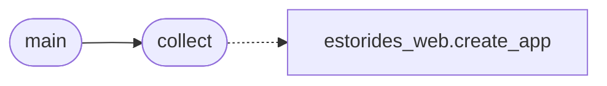

# `tools.sync_docs`

> Source: [tools/sync_docs.py:1](../../tools/sync_docs.py#L1) | language `py` | coverage 100.0% | [API index](../index.md)

tools.sync_docs =============== Generate docs manifest from source truth and fail on drift.

I scan spec/*.md headings plus estorides_core modules plus the live
Flask route table, then write docs/MANIFEST.json. CI runs me with
--check so stale docs fail the build instead of rotting silently.

## Contents

- **Functions:** [`collect`](#collect), [`main`](#main)
- **Constants:** [`ROOT`](#root)

## Call Graph

Solid arrows stay in this module, dashed arrows leave it.



## Functions

<a id="collect"></a>

### `collect`

`function` | [tools/sync_docs.py:20](../../tools/sync_docs.py#L20)

```python
def collect() -> dict[str, object]
```

Collect specs, core modules and web routes from the tree.

**Returns:** `dict[str, object]`

*Calls:* [`create_app`](estorides_web.py.md#create_app)

*Called by:* [`main`](#main)

---

<a id="main"></a>

### `main`

`function` | [tools/sync_docs.py:36](../../tools/sync_docs.py#L36)

```python
def main(argv: list[str] | None = None) -> int
```

Write the manifest or check it for drift.

**Parameters**

| Name | Type | Default | Description |
|---|---|---|---|
| `argv` | `list[str] \| None` | `None` |  |

**Returns:** `int`

*Calls:* [`collect`](#collect)

---

## Constants

<a id="root"></a>

### `ROOT`

`constant` | [tools/sync_docs.py:17](../../tools/sync_docs.py#L17)

```python
ROOT = Path(__file__).resolve().parent.parent
```

---
