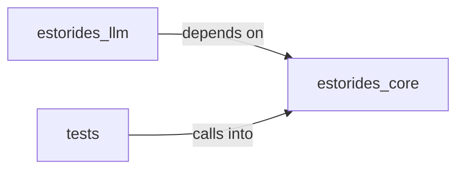

# estorides_core: config

estorides_core: config groups 19 files (py) around ensure_data_dirs, ensure_reports_dir, _env_tool_allowlist, contact_level, effective_proxies. estorides_core.async_client

## estorides_core (3.1)

estorides_core groups 10 files (py) around ensure_data_dirs, ensure_reports_dir, _env_tool_allowlist, contact_level, effective_proxies. estorides_core.async_client

## estorides_llm (3.2)

estorides_llm groups 3 files (py) around LLMBackend, __call__, stream_generate, register, deco. estorides_llm

## tests (3.3)

tests groups 6 files (py) around meta_strategy, obs_strategy, entity_strategy, test_observation_round_trip_stability, test_observation_bounded_fields. Property-based invariants for estorides_core.observation_models.

**Files**:

- estorides_core/async_client.py
- estorides_core/config.py
- estorides_core/feeds.py
- estorides_core/intel_resolver.py
- estorides_core/observation_models.py
- estorides_core/ontology.py
- estorides_core/osiris_sources.py
- estorides_core/pivot_engine.py
- estorides_core/ssrf_guard.py
- estorides_core/transforms.py
- estorides_llm/__init__.py
- estorides_llm/intelligence_prompts.py
- estorides_llm/manager.py
- tests/properties/test_observation_models_properties.py
- tests/test_async_client.py
- tests/test_config_env.py
- tests/test_observation_models.py
- tests/test_structured_extraction.py
- tests/test_transforms.py
