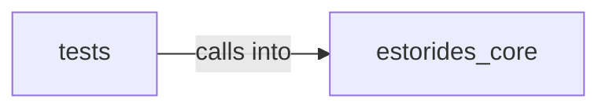

# estorides_core: entity_resolution

estorides_core: entity_resolution groups 10 files (py) around Entity, to_dict, _looks_like_phone, normalize_query, detect_query_type. estorides_core.entity_extraction

## estorides_core (10.1)

estorides_core groups 5 files (py) around Entity, to_dict, _looks_like_phone, normalize_query, detect_query_type. estorides_core.entity_extraction

## tests (10.2)

tests groups 5 files (py) around TestEE1TypesFilter, test_none_means_all, test_empty_list_means_nothing, test_subset_restricts, TestEE2FuzzyCanonical. BDD / regression tests for entity extraction and fuzzy merge.  - EE1: `types=[]`...

**Files**:

- estorides_core/entity_extraction.py
- estorides_core/entity_resolution.py
- estorides_core/entity_store.py
- estorides_core/transliteration.py
- estorides_core/validation.py
- tests/test_entity_extraction.py
- tests/test_entity_resolution.py
- tests/test_query_intent.py
- tests/test_source_routing.py
- tests/test_tool_runner.py
