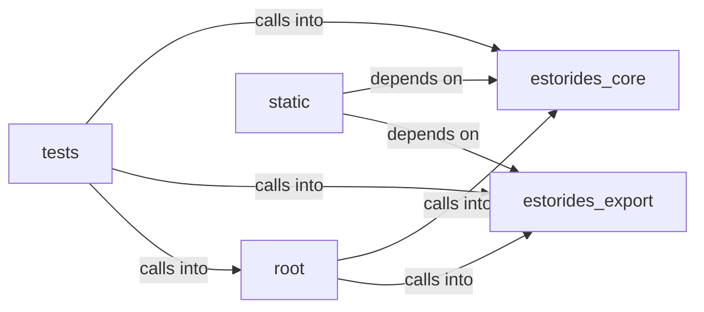

# estorides_core: estorides

estorides_core: estorides groups 17 files (js, py) around SqliteStore, __init__, _init_schema, _tx, close. estorides CLI.

## estorides_core (5.1)

estorides_core groups 6 files (py) around SqliteStore, __init__, _init_schema, _tx, close. estorides_core.alerter

## estorides_export (5.2)

estorides_export groups 1 files (py) around _tldr, _iocs, _diff_section, _analysis, _meta_footer. estorides_export.report

## root (5.3)

root groups 1 files (py) around _setup_logging, _collect_selectors, _resolve_proxy, _add_opsec_flags, cmd_discover. estorides CLI.

## static (5.4)

static groups 1 files (js) around setVisible, isLanQueryLocal, t, lanRunFields, ensureLanConsent. Estorides front-end controller

## tests (5.5)

tests groups 8 files (py) around _fresh_store, test_disabled_stores_plaintext, test_enabled_roundtrip, test_bad_key_falls_back, test_mixed_rows_and_tamper. M4 case_crypto BDD red.

**Files**:

- estorides_cli.py
- estorides_core/alerter.py
- estorides_core/case_crypto.py
- estorides_core/cases.py
- estorides_core/monitoring.py
- estorides_core/scope.py
- estorides_core/sqlite_store.py
- estorides_export/report.py
- static/js/estorides.js
- tests/test_case_crypto.py
- tests/test_cli_watch.py
- tests/test_hardening.py
- tests/test_monitoring.py
- tests/test_obs_fts.py
- tests/test_scope.py
- tests/test_security_remediation.py
- tests/test_sqlite_store.py
