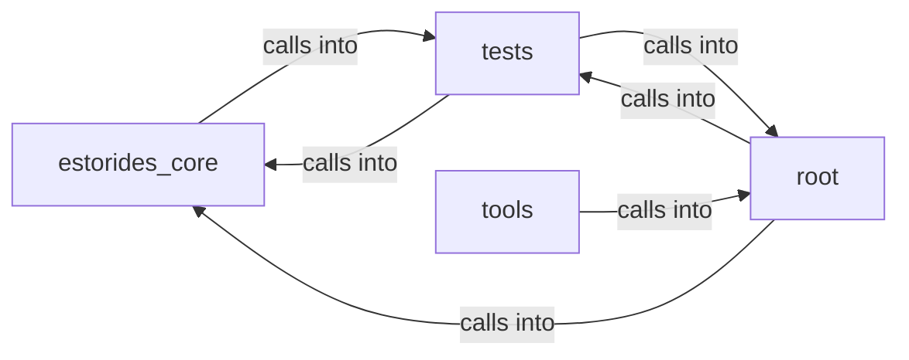

# estorides_core: estorides_web

estorides_core: estorides_web groups 25 files (py) around _sse_response, _provides, deco, wrapper, _client_ip. Deprecated entry point.

## estorides_core (1.1)

estorides_core groups 7 files (py) around build_https_url, WebSecurityConfig, is_cors_enabled, is_origin_allowed, _env_str. estorides_core.audit

## root (1.2)

root groups 5 files (py) around _sse_response, _provides, deco, wrapper, _client_ip. Deprecated entry point.

## tests (1.3)

tests groups 12 files (py) around test_js_never_gains_a_style_attribute_in_template_literal, test_template_never_gains_a_style_attribute, test_csp_style_src_never_gains_unsafe_inline, test_progress_invariants_hold, test_progress_rejects_unknown_phase. Property-based fuzz for `csp_safe_styles`.

## tools (1.4)

tools groups 1 files (py) around collect, main. tools.sync_docs

**Files**:

- app.py
- estorides_core/audit.py
- estorides_core/graph_rag_search.py
- estorides_core/lan_web.py
- estorides_core/openapi.py
- estorides_core/ops_observability.py
- estorides_core/search_telemetry.py
- estorides_core/web_security.py
- estorides_web.py
- estorides_web_tools.py
- tests/properties/test_csp_safe_styles_properties.py
- tests/properties/test_search_telemetry_properties.py
- tests/test_audit_log.py
- tests/test_auth_gate.py
- tests/test_csp_safe_styles.py
- tests/test_graph_rag_search.py
- tests/test_map_basemap.py
- tests/test_openapi.py
- tests/test_ops_observability.py
- tests/test_search_telemetry.py
- tests/test_web_helpers.py
- tests/test_web_tools_blueprint.py
- tools/sync_docs.py
- web.py
- wsgi.py
