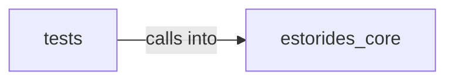

# estorides_core: hypothesis_engine

estorides_core: hypothesis_engine groups 19 files (py) around SourceReliability, Credibility, SourceType, ConfidenceInput, __post_init__. estorides_core.change_detection

## estorides_core (4.1)

estorides_core groups 7 files (py) around SourceReliability, Credibility, SourceType, ConfidenceInput, __post_init__. estorides_core.change_detection

## tests (4.2)

tests groups 12 files (py) around test_scores_always_bounded, test_max_changes_respected, test_id_is_16_char_hex, test_idempotent, test_first_run_reports_all_as_new. Property-based invariants for estorides_core.change_detection.

**Files**:

- estorides_core/change_detection.py
- estorides_core/fusion_analytics.py
- estorides_core/fusion_store.py
- estorides_core/hypothesis_engine.py
- estorides_core/ids.py
- estorides_core/recon_fusion.py
- estorides_core/reliability_scoring.py
- tests/properties/test_change_detection_properties.py
- tests/properties/test_hypothesis_engine_properties.py
- tests/properties/test_recon_fusion_properties.py
- tests/properties/test_reliability_scoring_properties.py
- tests/test_change_detection.py
- tests/test_fusion_analytics.py
- tests/test_hypothesis_engine.py
- tests/test_ids.py
- tests/test_probabilistic_fusion.py
- tests/test_recon_fusion.py
- tests/test_reliability_scoring.py
- tests/test_ui_professional.py
