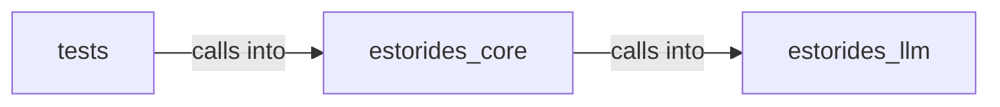

# estorides_core: manager

estorides_core: manager groups 14 files (py) around pending_system_app_tasks, _safe_format, repl, _resolve_auth, _expand_query_type. Background subdomain/domain discoverer.

## estorides_core (7.1)

estorides_core groups 8 files (py) around pending_system_app_tasks, _safe_format, repl, _resolve_auth, _expand_query_type. Background subdomain/domain discoverer.

## estorides_llm (7.2)

estorides_llm groups 3 files (py) around LLMBackend, __call__, stream_generate, register, deco. estorides_llm

## tests (7.3)

tests groups 3 files (py) around test_subscribe_publish_order_and_count, test_raising_handler_does_not_block_others, bad, test_payload_isolation_between_handlers, test_invalid_inputs_raise. M2a event_bus BDD red.

**Files**:

- estorides_core/discoverer.py
- estorides_core/event_bus.py
- estorides_core/graph_kuzu.py
- estorides_core/job_registry.py
- estorides_core/mitre_attack.py
- estorides_core/orchestrator.py
- estorides_core/pagination.py
- estorides_core/relationship_inference.py
- estorides_llm/__init__.py
- estorides_llm/intelligence_prompts.py
- estorides_llm/manager.py
- tests/test_event_bus.py
- tests/test_job_registry.py
- tests/test_pagination.py
