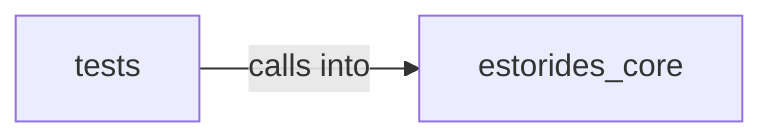

# estorides_core: parsers

estorides_core: parsers groups 21 files (py) around _d, _first_dict, _list, _text, parse_dns_json. Background subdomain/domain discoverer.

## estorides_core (2.1)

estorides_core groups 11 files (py) around _d, _first_dict, _list, _text, parse_dns_json. Background subdomain/domain discoverer.

## tests (2.2)

tests groups 10 files (py) around test_all_parsers_are_total, test_tool_parsers_never_raise, test_render_args_safe_inputs_no_metachars, test_render_args_substitution_is_verbatim, test_read_capped_respects_limit. Property-based fuzzing for the parser totality contract (doctrine §6).

**Files**:

- estorides_core/discoverer.py
- estorides_core/event_bus.py
- estorides_core/graph_kuzu.py
- estorides_core/mitre_attack.py
- estorides_core/orchestrator.py
- estorides_core/pagination.py
- estorides_core/parsers.py
- estorides_core/relationship_inference.py
- estorides_core/socmint.py
- estorides_core/source_loader.py
- estorides_core/system_app_sources.py
- tests/properties/test_parsers_properties.py
- tests/properties/test_system_app_sources_properties.py
- tests/test_event_bus.py
- tests/test_keyless_sources.py
- tests/test_opsec_contact.py
- tests/test_pagination.py
- tests/test_socmint.py
- tests/test_source_loader.py
- tests/test_source_routing.py
- tests/test_system_app_sources.py
