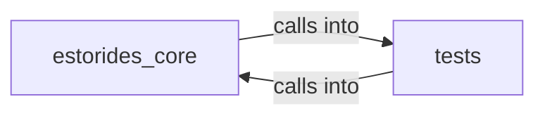

# estorides_core: parsers

estorides_core: parsers groups 13 files (py) around _finite, _clean, _codes, normalize_type_code, classify_aircraft. estorides_core.aerospace

## estorides_core (9.1)

estorides_core groups 7 files (py) around _finite, _clean, _codes, normalize_type_code, classify_aircraft. estorides_core.aerospace

## tests (9.2)

tests groups 6 files (py) around test_all_parsers_are_total, _iss_epoch, TestA1TleParsing, test_malformed_set_is_skipped, test_raw_text_envelope_and_duplicates. Property-based fuzzing for the parser totality contract (doctrine §6).

**Files**:

- estorides_core/aerospace.py
- estorides_core/airports.py
- estorides_core/aviation.py
- estorides_core/feeds.py
- estorides_core/parsers.py
- estorides_core/socmint.py
- estorides_core/source_loader.py
- tests/properties/test_parsers_properties.py
- tests/test_aerospace.py
- tests/test_keyless_sources.py
- tests/test_opsec_contact.py
- tests/test_socmint.py
- tests/test_source_loader.py
