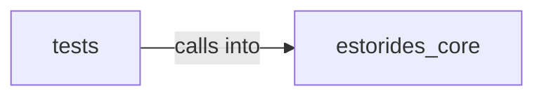

# estorides_core: people_intel

estorides_core: people_intel groups 15 files (py) around CloudAsset, to_dict, CloudAssetDiscoveryResult, to_dict, generate_bucket_names.

## estorides_core (6.1)

estorides_core groups 8 files (py) around CloudAsset, to_dict, CloudAssetDiscoveryResult, to_dict, generate_bucket_names.

## tests (6.2)

tests groups 7 files (py) around _make_asset, TestPublicS3Bucket, test_accessible_bucket_returned, TestBucketWithListing, test_listing_bucket_has_files. ATDD + BDD tests for estorides_core.cloud_asset_discovery.

**Files**:

- estorides_core/cloud_asset_discovery.py
- estorides_core/code_exposure.py
- estorides_core/pdns_monitor.py
- estorides_core/people_intel.py
- estorides_core/recon_pipeline.py
- estorides_core/supply_chain.py
- estorides_core/tech_fingerprint.py
- estorides_core/vuln_correlation.py
- tests/test_cloud_asset_discovery.py
- tests/test_code_exposure.py
- tests/test_pdns_monitor.py
- tests/test_people_intel.py
- tests/test_supply_chain.py
- tests/test_tech_fingerprint.py
- tests/test_vuln_correlation.py
