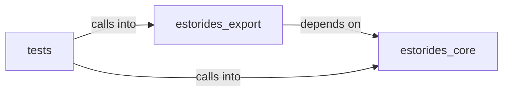

# estorides_export

estorides_export groups 15 files (py) around Entity, to_dict, _looks_like_phone, normalize_query, detect_query_type. estorides_core.entity_extraction

## estorides_core (8.1)

estorides_core groups 5 files (py) around Entity, to_dict, _looks_like_phone, normalize_query, detect_query_type. estorides_core.entity_extraction

## estorides_export (8.2)

estorides_export groups 5 files (py) around ReportMetadata, __post_init__, to_dict, ReportSection, to_dict. estorides_export

## tests (8.3)

tests groups 5 files (py) around _FakeCompleted, __init__, _kg_with_one_node, _patch_age_ok, _run. Encrypted export: plaintext must be removed after encryption.

**Files**:

- estorides_core/entity_extraction.py
- estorides_core/entity_resolution.py
- estorides_core/entity_store.py
- estorides_core/knowledge_graph.py
- estorides_core/transliteration.py
- estorides_export/__init__.py
- estorides_export/encryption.py
- estorides_export/misp.py
- estorides_export/recon_report.py
- estorides_export/stix.py
- tests/test_encrypted_export.py
- tests/test_entity_extraction.py
- tests/test_entity_resolution.py
- tests/test_query_intent.py
- tests/test_recon_report.py
