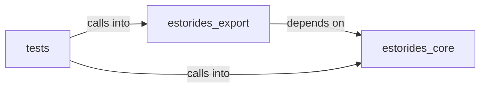

# estorides_export

estorides_export groups 8 files (py) around _node_sources, KnowledgeGraph, __init__, add_entity, add_observation. estorides_core.knowledge_graph

## estorides_core (11.1)

estorides_core groups 1 files (py) around _node_sources, KnowledgeGraph, __init__, add_entity, add_observation. estorides_core.knowledge_graph

## estorides_export (11.2)

estorides_export groups 5 files (py) around ReportMetadata, __post_init__, to_dict, ReportSection, to_dict. estorides_export

## tests (11.3)

tests groups 2 files (py) around _FakeCompleted, __init__, _kg_with_one_node, _patch_age_ok, _run. Encrypted export: plaintext must be removed after encryption.

**Files**:

- estorides_core/knowledge_graph.py
- estorides_export/__init__.py
- estorides_export/encryption.py
- estorides_export/misp.py
- estorides_export/recon_report.py
- estorides_export/stix.py
- tests/test_encrypted_export.py
- tests/test_recon_report.py
