```mermaid
graph LR
    estorides_core_estorides_web["estorides_core: estorides_web"]
    estorides_core_graph_bundle["estorides_core: graph_bundle"]
    estorides_core_hypothesis_engine["estorides_core: hypothesis_engine"]
    estorides_core_estorides["estorides_core: estorides"]
    estorides_core_config["estorides_core: config"]
    estorides_core_people_intel["estorides_core: people_intel"]
    estorides_core_manager["estorides_core: manager"]
    estorides_core_system_app_sources["estorides_core: system_app_sources"]
    estorides_core_parsers["estorides_core: parsers"]
    estorides_core_entity_resolution["estorides_core: entity_resolution"]
    estorides_export["estorides_export"]
    estorides_core_source_health_monitoring["estorides_core: source_health_monitoring"]
    estorides_core_estorides_web -- "calls into" --> estorides_core_entity_resolution
    estorides_core_estorides_web -- "calls into" --> estorides_export
    estorides_core_estorides_web -- "depends on" --> estorides_core_graph_bundle
    estorides_core_estorides_web -- "calls into" --> estorides_core_hypothesis_engine
    estorides_core_estorides_web -- "calls into" --> estorides_core_estorides
    estorides_core_estorides_web -- "calls into" --> estorides_core_config
    estorides_core_estorides_web -- "calls into" --> estorides_core_manager
    estorides_core_estorides_web -- "calls into" --> estorides_core_system_app_sources
    estorides_core_estorides_web -- "calls into" --> estorides_core_parsers
    estorides_core_entity_resolution -- "calls into" --> estorides_core_hypothesis_engine
    estorides_core_entity_resolution -- "calls into" --> estorides_core_estorides
    estorides_core_entity_resolution -- "calls into" --> estorides_core_config
    estorides_core_entity_resolution -- "calls into" --> estorides_core_manager
    estorides_core_entity_resolution -- "calls into" --> estorides_core_system_app_sources
    estorides_core_entity_resolution -- "calls into" --> estorides_core_parsers
    estorides_export -- "calls into" --> estorides_core_estorides_web
    estorides_export -- "depends on" --> estorides_core_entity_resolution
    estorides_export -- "depends on" --> estorides_core_estorides
    estorides_export -- "depends on" --> estorides_core_config
    estorides_export -- "calls into" --> estorides_core_manager
    estorides_core_source_health_monitoring -- "calls into" --> estorides_core_estorides
    estorides_core_source_health_monitoring -- "calls into" --> estorides_core_parsers
    estorides_core_graph_bundle -- "calls into" --> estorides_core_estorides_web
    estorides_core_graph_bundle -- "calls into" --> estorides_core_estorides
    estorides_core_graph_bundle -- "calls into" --> estorides_core_config
    estorides_core_graph_bundle -- "calls into" --> estorides_core_manager
    estorides_core_graph_bundle -- "calls into" --> estorides_core_parsers
    estorides_core_hypothesis_engine -- "calls into" --> estorides_core_estorides_web
    estorides_core_hypothesis_engine -- "depends on" --> estorides_core_entity_resolution
    estorides_core_hypothesis_engine -- "calls into" --> estorides_core_estorides
    estorides_core_hypothesis_engine -- "depends on" --> estorides_core_config
    estorides_core_hypothesis_engine -- "calls into" --> estorides_core_manager
    estorides_core_hypothesis_engine -- "calls into" --> estorides_core_system_app_sources
    estorides_core_estorides -- "calls into" --> estorides_core_estorides_web
    estorides_core_estorides -- "calls into" --> estorides_core_entity_resolution
    estorides_core_estorides -- "calls into" --> estorides_export
    estorides_core_estorides -- "depends on" --> estorides_core_graph_bundle
    estorides_core_estorides -- "calls into" --> estorides_core_hypothesis_engine
    estorides_core_estorides -- "depends on" --> estorides_core_config
    estorides_core_estorides -- "calls into" --> estorides_core_manager
    estorides_core_estorides -- "calls into" --> estorides_core_system_app_sources
    estorides_core_estorides -- "calls into" --> estorides_core_parsers
    estorides_core_config -- "calls into" --> estorides_core_entity_resolution
    estorides_core_config -- "calls into" --> estorides_core_estorides
    estorides_core_config -- "calls into" --> estorides_core_manager
    estorides_core_config -- "calls into" --> estorides_core_system_app_sources
    estorides_core_config -- "calls into" --> estorides_core_parsers
    estorides_core_people_intel -- "calls into" --> estorides_core_manager
    estorides_core_manager -- "calls into" --> estorides_core_entity_resolution
    estorides_core_manager -- "calls into" --> estorides_export
    estorides_core_manager -- "calls into" --> estorides_core_hypothesis_engine
    estorides_core_manager -- "calls into" --> estorides_core_estorides
    estorides_core_manager -- "calls into" --> estorides_core_config
    estorides_core_manager -- "calls into" --> estorides_core_system_app_sources
    estorides_core_manager -- "calls into" --> estorides_core_parsers
    estorides_core_system_app_sources -- "calls into" --> estorides_core_entity_resolution
    estorides_core_system_app_sources -- "calls into" --> estorides_core_graph_bundle
    estorides_core_system_app_sources -- "calls into" --> estorides_core_estorides
    estorides_core_system_app_sources -- "depends on" --> estorides_core_config
    estorides_core_system_app_sources -- "depends on" --> estorides_core_manager
    estorides_core_system_app_sources -- "calls into" --> estorides_core_parsers
    estorides_core_parsers -- "calls into" --> estorides_core_estorides_web
    estorides_core_parsers -- "calls into" --> estorides_core_entity_resolution
    estorides_core_parsers -- "depends on" --> estorides_core_graph_bundle
    estorides_core_parsers -- "calls into" --> estorides_core_estorides
    estorides_core_parsers -- "calls into" --> estorides_core_config
    estorides_core_parsers -- "calls into" --> estorides_core_manager
    click estorides_core_estorides_web href "./estorides_core_estorides_web.md" "Details"
    click estorides_core_graph_bundle href "./estorides_core_graph_bundle.md" "Details"
    click estorides_core_hypothesis_engine href "./estorides_core_hypothesis_engine.md" "Details"
    click estorides_core_estorides href "./estorides_core_estorides.md" "Details"
    click estorides_core_config href "./estorides_core_config.md" "Details"
    click estorides_core_people_intel href "./estorides_core_people_intel.md" "Details"
    click estorides_core_manager href "./estorides_core_manager.md" "Details"
    click estorides_core_system_app_sources href "./estorides_core_system_app_sources.md" "Details"
    click estorides_core_parsers href "./estorides_core_parsers.md" "Details"
    click estorides_core_entity_resolution href "./estorides_core_entity_resolution.md" "Details"
    click estorides_export href "./estorides_export.md" "Details"
```

## Details

Static architecture map of 199 files (js, py, sh) in 12 components: estorides_core: estorides_web, estorides_core: graph_bundle, estorides_core: hypothesis_engine, estorides_core: estorides, estorides_core: config, estorides_core: people_intel, estorides_core: manager, estorides_core: system_app_sources. Structure is extracted statically without LLM calls; component prose may be enriched locally.

### estorides_core: estorides_web (1)

estorides_core: estorides_web groups 25 files (py) around _sse_response, _provides, deco, wrapper, _client_ip. Deprecated entry point.

**Related Classes/Methods**:

- <a href="../estorides_web.py#L78-L82">estorides_web.py::_sse_response</a>
- <a href="../estorides_web.py#L83-L89">estorides_web.py::_provides</a>
- <a href="../estorides_web.py#L90-L91">estorides_web.py::deco</a>
- <a href="../estorides_web.py#L92-L101">estorides_web.py::wrapper</a>
- <a href="../estorides_web.py#L102-L118">estorides_web.py::_client_ip</a>
- <a href="../estorides_web.py#L119-L134">estorides_web.py::_arg_int</a>
- <a href="../estorides_web.py#L135-L148">estorides_web.py::_send_and_cleanup</a>
- <a href="../estorides_web.py#L149-L156">estorides_web.py::_RunStreamJob</a>

### estorides_core: graph_bundle (2)

estorides_core: graph_bundle groups 19 files (py) around family_color_from_name, node_value, force_settings, _req_str, _opt_str. estorides_core.__init__

**Related Classes/Methods**:

- <a href="../estorides_core/graph_force.py#L48-L64">estorides_core/graph_force.py::family_color_from_name</a>
- <a href="../estorides_core/graph_force.py#L65-L69">estorides_core/graph_force.py::node_value</a>
- <a href="../estorides_core/graph_force.py#L70-L96">estorides_core/graph_force.py::force_settings</a>
- <a href="../estorides_core/graph_force.py#L97-L106">estorides_core/graph_force.py::_req_str</a>
- <a href="../estorides_core/graph_force.py#L107-L112">estorides_core/graph_force.py::_opt_str</a>
- <a href="../estorides_core/graph_force.py#L113-L123">estorides_core/graph_force.py::_opt_int</a>
- <a href="../estorides_core/graph_force.py#L124-L149">estorides_core/graph_force.py::_degrees</a>
- <a href="../estorides_core/graph_force.py#L150-L160">estorides_core/graph_force.py::_is_bridge</a>

### estorides_core: hypothesis_engine (3)

estorides_core: hypothesis_engine groups 19 files (py) around SourceReliability, Credibility, SourceType, ConfidenceInput, __post_init__. estorides_core.change_detection

**Related Classes/Methods**:

- <a href="../estorides_core/reliability_scoring.py#L37-L47">estorides_core/reliability_scoring.py::SourceReliability</a>
- <a href="../estorides_core/reliability_scoring.py#L48-L58">estorides_core/reliability_scoring.py::Credibility</a>
- <a href="../estorides_core/reliability_scoring.py#L59-L242">estorides_core/reliability_scoring.py::SourceType</a>
- <a href="../estorides_core/reliability_scoring.py#L243-L252">estorides_core/reliability_scoring.py::ConfidenceInput</a>
- <a href="../estorides_core/reliability_scoring.py#L253-L262">estorides_core/reliability_scoring.py::__post_init__</a>
- <a href="../estorides_core/reliability_scoring.py#L263-L279">estorides_core/reliability_scoring.py::ConfidenceResult</a>
- <a href="../estorides_core/reliability_scoring.py#L280-L286">estorides_core/reliability_scoring.py::_corroboration_weight</a>
- <a href="../estorides_core/reliability_scoring.py#L287-L296">estorides_core/reliability_scoring.py::_freshness_weight</a>

### estorides_core: estorides (4)

estorides_core: estorides groups 17 files (js, py) around SqliteStore, __init__, _init_schema, _tx, close. estorides CLI.

**Related Classes/Methods**:

- <a href="../estorides_core/sqlite_store.py#L34-L49">estorides_core/sqlite_store.py::SqliteStore</a>
- <a href="../estorides_core/sqlite_store.py#L50-L65">estorides_core/sqlite_store.py::__init__</a>
- <a href="../estorides_core/sqlite_store.py#L66-L71">estorides_core/sqlite_store.py::_init_schema</a>
- <a href="../estorides_core/sqlite_store.py#L72-L81">estorides_core/sqlite_store.py::_tx</a>
- <a href="../estorides_core/sqlite_store.py#L82-L88">estorides_core/sqlite_store.py::close</a>
- <a href="../estorides_core/sqlite_store.py#L89-L108">estorides_core/sqlite_store.py::__del__</a>
- <a href="../estorides_core/sqlite_store.py#L109-L111">estorides_core/sqlite_store.py::DictMixin</a>
- <a href="../estorides_core/sqlite_store.py#L112-L119">estorides_core/sqlite_store.py::to_dict</a>

### estorides_core: config (5)

estorides_core: config groups 16 files (py) around _installed_share, _resolve_dir, _resolve_writable_dir, ensure_data_dirs, ensure_reports_dir. estorides_core.async_client

**Related Classes/Methods**:

- <a href="../estorides_core/config.py#L42-L46">estorides_core/config.py::_installed_share</a>
- <a href="../estorides_core/config.py#L47-L62">estorides_core/config.py::_resolve_dir</a>
- <a href="../estorides_core/config.py#L63-L100">estorides_core/config.py::_resolve_writable_dir</a>
- <a href="../estorides_core/config.py#L101-L111">estorides_core/config.py::ensure_data_dirs</a>
- <a href="../estorides_core/config.py#L112-L168">estorides_core/config.py::ensure_reports_dir</a>
- <a href="../estorides_core/config.py#L169-L246">estorides_core/config.py::_env_tool_allowlist</a>
- <a href="../estorides_core/config.py#L247-L272">estorides_core/config.py::contact_level</a>
- <a href="../estorides_core/config.py#L273-L406">estorides_core/config.py::effective_proxies</a>

### estorides_core: people_intel (6)

estorides_core: people_intel groups 15 files (py) around CloudAsset, to_dict, CloudAssetDiscoveryResult, to_dict, generate_bucket_names.

**Related Classes/Methods**:

- <a href="../estorides_core/cloud_asset_discovery.py#L34-L44">estorides_core/cloud_asset_discovery.py::CloudAsset</a>
- <a href="../estorides_core/cloud_asset_discovery.py#L45-L49">estorides_core/cloud_asset_discovery.py::to_dict</a>
- <a href="../estorides_core/cloud_asset_discovery.py#L50-L55">estorides_core/cloud_asset_discovery.py::CloudAssetDiscoveryResult</a>
- <a href="../estorides_core/cloud_asset_discovery.py#L56-L64">estorides_core/cloud_asset_discovery.py::to_dict</a>
- <a href="../estorides_core/cloud_asset_discovery.py#L65-L83">estorides_core/cloud_asset_discovery.py::generate_bucket_names</a>
- <a href="../estorides_core/cloud_asset_discovery.py#L84-L92">estorides_core/cloud_asset_discovery.py::assess_bucket</a>
- <a href="../estorides_core/cloud_asset_discovery.py#L93-L94">estorides_core/cloud_asset_discovery.py::CloudAssetDiscoveryError</a>
- <a href="../estorides_core/code_exposure.py#L47-L56">estorides_core/code_exposure.py::CodeFinding</a>

### estorides_core: manager (7)

estorides_core: manager groups 14 files (py) around pending_system_app_tasks, _safe_format, repl, _resolve_auth, _expand_query_type. Background subdomain/domain discoverer.

**Related Classes/Methods**:

- <a href="../estorides_core/orchestrator.py#L56-L114">estorides_core/orchestrator.py::pending_system_app_tasks</a>
- <a href="../estorides_core/orchestrator.py#L115-L121">estorides_core/orchestrator.py::_safe_format</a>
- <a href="../estorides_core/orchestrator.py#L122-L126">estorides_core/orchestrator.py::repl</a>
- <a href="../estorides_core/orchestrator.py#L127-L151">estorides_core/orchestrator.py::_resolve_auth</a>
- <a href="../estorides_core/orchestrator.py#L152-L157">estorides_core/orchestrator.py::_expand_query_type</a>
- <a href="../estorides_core/orchestrator.py#L158-L167">estorides_core/orchestrator.py::_domain_from_query</a>
- <a href="../estorides_core/orchestrator.py">estorides_core/orchestrator.py::Orchestrator</a>
- <a href="../estorides_core/orchestrator.py#L169-L189">estorides_core/orchestrator.py::__init__</a>

### estorides_core: system_app_sources (8)

estorides_core: system_app_sources groups 13 files (py) around ToolError, ToolNotAllowedError, ToolInjectionError, ToolNotFoundError, ToolTimeoutError. estorides_core.lan_runner

**Related Classes/Methods**:

- <a href="../estorides_core/tool_runner.py#L17-L20">estorides_core/tool_runner.py::ToolError</a>
- <a href="../estorides_core/tool_runner.py#L21-L24">estorides_core/tool_runner.py::ToolNotAllowedError</a>
- <a href="../estorides_core/tool_runner.py#L25-L28">estorides_core/tool_runner.py::ToolInjectionError</a>
- <a href="../estorides_core/tool_runner.py#L29-L32">estorides_core/tool_runner.py::ToolNotFoundError</a>
- <a href="../estorides_core/tool_runner.py#L33-L37">estorides_core/tool_runner.py::ToolTimeoutError</a>
- <a href="../estorides_core/tool_runner.py#L38-L50">estorides_core/tool_runner.py::ToolResult</a>
- <a href="../estorides_core/tool_runner.py#L51-L58">estorides_core/tool_runner.py::to_dict</a>
- <a href="../estorides_core/tool_runner.py#L59-L85">estorides_core/tool_runner.py::from_failure</a>

### estorides_core: parsers (9)

estorides_core: parsers groups 13 files (py) around _finite, _clean, _codes, normalize_type_code, classify_aircraft. estorides_core.aerospace

**Related Classes/Methods**:

- <a href="../estorides_core/aviation.py#L79-L89">estorides_core/aviation.py::_finite</a>
- <a href="../estorides_core/aviation.py#L90-L97">estorides_core/aviation.py::_clean</a>
- <a href="../estorides_core/aviation.py#L98-L223">estorides_core/aviation.py::_codes</a>
- <a href="../estorides_core/aviation.py#L224-L229">estorides_core/aviation.py::normalize_type_code</a>
- <a href="../estorides_core/aviation.py#L230-L244">estorides_core/aviation.py::classify_aircraft</a>
- <a href="../estorides_core/aviation.py#L245-L256">estorides_core/aviation.py::_category_class</a>
- <a href="../estorides_core/aviation.py#L257-L283">estorides_core/aviation.py::aircraft_class_label</a>
- <a href="../estorides_core/aviation.py#L284-L305">estorides_core/aviation.py::normalize_squawk</a>

### estorides_core: entity_resolution (10)

estorides_core: entity_resolution groups 10 files (py) around Entity, to_dict, _looks_like_phone, normalize_query, detect_query_type. estorides_core.entity_extraction

**Related Classes/Methods**:

- <a href="../estorides_core/entity_extraction.py#L22-L33">estorides_core/entity_extraction.py::Entity</a>
- <a href="../estorides_core/entity_extraction.py#L34-L48">estorides_core/entity_extraction.py::to_dict</a>
- <a href="../estorides_core/entity_extraction.py#L49-L56">estorides_core/entity_extraction.py::_looks_like_phone</a>
- <a href="../estorides_core/entity_extraction.py#L57-L99">estorides_core/entity_extraction.py::normalize_query</a>
- <a href="../estorides_core/entity_extraction.py#L100-L126">estorides_core/entity_extraction.py::detect_query_type</a>
- <a href="../estorides_core/entity_extraction.py#L127-L139">estorides_core/entity_extraction.py::_is_valid_domain</a>
- <a href="../estorides_core/entity_extraction.py#L140-L145">estorides_core/entity_extraction.py::_context</a>
- <a href="../estorides_core/entity_extraction.py#L146-L199">estorides_core/entity_extraction.py::extract_from_text</a>

### estorides_export (11)

estorides_export groups 8 files (py) around _node_sources, KnowledgeGraph, __init__, add_entity, add_observation. estorides_core.knowledge_graph

**Related Classes/Methods**:

- <a href="../estorides_core/knowledge_graph.py#L73-L89">estorides_core/knowledge_graph.py::_node_sources</a>
- <a href="../estorides_core/knowledge_graph.py">estorides_core/knowledge_graph.py::KnowledgeGraph</a>
- <a href="../estorides_core/knowledge_graph.py#L91-L96">estorides_core/knowledge_graph.py::__init__</a>
- <a href="../estorides_core/knowledge_graph.py#L97-L126">estorides_core/knowledge_graph.py::add_entity</a>
- <a href="../estorides_core/knowledge_graph.py#L127-L141">estorides_core/knowledge_graph.py::add_observation</a>
- <a href="../estorides_core/knowledge_graph.py#L142-L163">estorides_core/knowledge_graph.py::add_relationship</a>
- <a href="../estorides_core/knowledge_graph.py#L164-L182">estorides_core/knowledge_graph.py::export_graphml</a>
- <a href="../estorides_core/knowledge_graph.py#L183-L206">estorides_core/knowledge_graph.py::export_json</a>

### estorides_core: source_health_monitoring (12)

estorides_core: source_health_monitoring groups 3 files (py) around SourceHealthStatus, SourceHealthConfig, __post_init__, SourceHealthInput, __post_init__. estorides_core.source_health_monitoring

**Related Classes/Methods**:

- <a href="../estorides_core/source_health_monitoring.py#L31-L41">estorides_core/source_health_monitoring.py::SourceHealthStatus</a>
- <a href="../estorides_core/source_health_monitoring.py#L42-L57">estorides_core/source_health_monitoring.py::SourceHealthConfig</a>
- <a href="../estorides_core/source_health_monitoring.py#L58-L97">estorides_core/source_health_monitoring.py::__post_init__</a>
- <a href="../estorides_core/source_health_monitoring.py#L98-L111">estorides_core/source_health_monitoring.py::SourceHealthInput</a>
- <a href="../estorides_core/source_health_monitoring.py#L112-L133">estorides_core/source_health_monitoring.py::__post_init__</a>
- <a href="../estorides_core/source_health_monitoring.py#L134-L145">estorides_core/source_health_monitoring.py::SourceHealthResult</a>
- <a href="../estorides_core/source_health_monitoring.py#L146-L159">estorides_core/source_health_monitoring.py::to_dict</a>
- <a href="../estorides_core/source_health_monitoring.py#L160-L172">estorides_core/source_health_monitoring.py::DashboardSummary</a>
